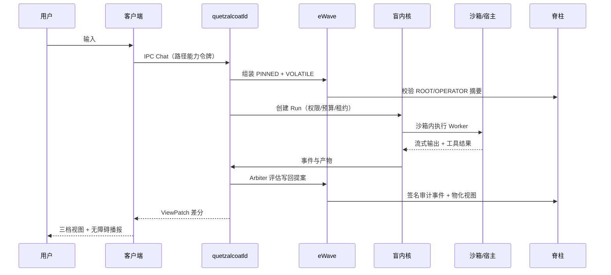
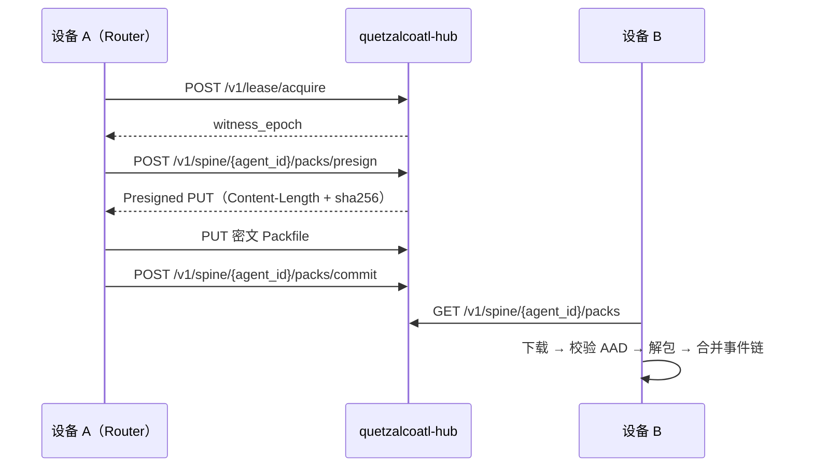

# Quetzalcoatl V2 架构

本文只描述当前仓库里真实存在的 crate、文件与协议，并说明它们之间的不变量。第一性原理蓝图见
[docs/V2_GOAL.html](V2_GOAL.html)；逐行协议见 [docs/PROTOCOL.md](PROTOCOL.md)。

## 1. 设计原则

1. **主权优先**：一台设备只允许一个进程持有脊柱（`quetzalcoatld`），其余客户端一律薄客户端。
2. **盲内核**：`quetzalcoatl-kernel` 只认识"状态、权限、路由、客观校验"四种原语，不认识任何
   模型供应商、聊天平台或业务工具名。
3. **绝对段不可谈判**：`ROOT(100)` / `OPERATOR(80)` 只能由主权根密钥签名；`SELF_CORE(70)` 只能
   经有界段 C 档流程升格。任何模型输出都不能直接改写它们。
4. **外部输入一律不可信**：通道正文、工具输出、群聊非主人发言、SayIt 快照都以不可信等级进入，
   默认只计数 `S8` 信号。
5. **失败关闭**：签名、摘要、纪元、配额、沙箱探针任一不满足即拒绝，不做"尽力而为"的降级放行。

## 2. 四层架构

| 层 | 职责 | 主要 crate / 目录 |
| --- | --- | --- |
| L0 状态与密码脊柱 | 事件、HLC、密文包、根密钥、设备纪元 | `crates/quetzalcoatl-types`、`crates/quetzalcoatl-crypto`、`crates/quetzalcoatl-spine` |
| L1 运行时与治理 | 良知、盲内核、沙箱、洁净室、语音门 | `crates/quetzalcoatl-ewave`、`crates/quetzalcoatl-kernel`、`crates/quetzalcoatl-sandbox`、`crates/quetzalcoatl-voice-ai` |
| L2 连接与协同 | 打洞/同步/租约、群组、通道、能力、桥接、领域包 | `crates/quetzalcoatl-fabric`、`crates/quetzalcoatl-group`、`crates/quetzalcoatl-channels`、`crates/quetzalcoatl-capabilities`、`crates/quetzalcoatl-bridge`、`crates/quetzalcoatl-domains`、`hub/` |
| L3 宿主与表面 | 守护进程、Harness 宿主、五端客户端、绑定 | `crates/quetzalcoatl-daemon`、`crates/quetzalcoatl-harness`、`crates/quetzalcoatl-client-core`、`crates/bindings/quetzalcoatl-uniffi`、`crates/bindings/quetzalcoatl-wasm`、`surfaces/` |

依赖方向严格自上而下：L0 不依赖 L1+；`quetzalcoatl-kernel` 的依赖白名单由
`crates/quetzalcoatl-kernel/tests/blind_boundary.rs` 在测试中静态校验。

## 3. crate 地图

| crate | 路径 | 关键职责 |
| --- | --- | --- |
| `quetzalcoatl-types` | `crates/quetzalcoatl-types` | 跨语言 ID、HLC、`ErrorCode`、共享错误类型 |
| `quetzalcoatl-crypto` | `crates/quetzalcoatl-crypto` | 根密钥、设备身份、X-Wing HPKE、OPAQUE、Packfile 密封 |
| `quetzalcoatl-spine` | `crates/quetzalcoatl-spine` | 签名事件链、SQLite WAL 物化视图、ZIP 归档、`import-v1` |
| `quetzalcoatl-ewave` | `crates/quetzalcoatl-ewave` | 蛇形四维图、良知仲裁、上下文组装、对齐/合并 |
| `quetzalcoatl-domains` | `crates/quetzalcoatl-domains` | 五大领域包、`SafetyEnvelope`、Verifier 规则、外发安全执行器 |
| `quetzalcoatl-sandbox` | `crates/quetzalcoatl-sandbox` | `bwrap` / Seatbelt / AppContainer 后端、凭据代理、洁净室命令 |
| `quetzalcoatl-kernel` | `crates/quetzalcoatl-kernel` | RunMachine、Heart 生物钟、能力授权、洁净室 DAG `Mark` |
| `quetzalcoatl-fabric` | `crates/quetzalcoatl-fabric` | `iroh` 端点、密文同步 actor、两态租约 Router、远端 Worker 池 |
| `quetzalcoatl-group` | `crates/quetzalcoatl-group` | `openmls` 房间、Facilitator、ANP-P9、提交屏障、Squad、Steward |
| `quetzalcoatl-channels` | `crates/quetzalcoatl-channels` | 七通道描述符、入站规范化、出站分片、长连接监管 |
| `quetzalcoatl-capabilities` | `crates/quetzalcoatl-capabilities` | 六大基础能力包的可执行实现 |
| `quetzalcoatl-bridge` | `crates/quetzalcoatl-bridge` | Hermes / OpenClaw 兼容的只读脊柱桥接 |
| `quetzalcoatl-voice-ai` | `crates/quetzalcoatl-voice-ai` | `<3MB` 纯 Rust AEC/VAD、按需零遥测 ORT 加载 |
| `quetzalcoatl-harness` | `crates/quetzalcoatl-harness` | Coding Agent 发现、回环网关、MCP 桥、四层安全壳 |
| `quetzalcoatl-daemon` | `crates/quetzalcoatl-daemon` | `quetzalcoatld` / `qz`、本地 IPC、Web 控制台、运行编排 |
| `quetzalcoatl-client-core` | `crates/quetzalcoatl-client-core` | 五端共享的三档差分视图、拉模式流、IPC 模式判定 |
| `quetzalcoatl-uniffi` | `crates/bindings/quetzalcoatl-uniffi` | Swift / Kotlin / C# 绑定，仅导出拉模式接口 |
| `quetzalcoatl-wasm` | `crates/bindings/quetzalcoatl-wasm` | Web Worker WASM：E2EE、OPFS、浏览器专项 |
| `quetzalcoatl-desktop` | `surfaces/linux` | Linux GTK4 客户端（唯一加入 Rust workspace 的界面 crate） |

Go 服务端全部位于 `hub/`：入口 `hub/cmd/quetzalcoatl-hub`，内部包 `hub/internal/auth`、
`hub/internal/lease`、`hub/internal/spine`、`hub/internal/relay`、`hub/internal/groupds`、
`hub/internal/llmproxy`、`hub/internal/store`。

## 4. 数据流

### 4.1 一次对话



### 4.2 跨设备同步



## 5. 状态脊柱与 Packfile

- **事件**：`SpineEventHeader { agent_id, device_id, epoch, hlc, payload_blake3, prev_blake3, seq }`
  的规范 JSON 做 BLAKE3，再由设备 Ed25519 签名；`seq` 从 1 递增，首条 `prev_blake3` 全零。
- **HLC**：128-bit `(wall_ms, logical, node_tag)`；接收端遇到超前本地可信时间 5 分钟以上的事件
  直接隔离拒收，绝不推高本机时钟。
- **物化视图**：SQLite WAL 保存 `threads / messages / memories / runs / events`；`SpineEngine`
  是唯一写入者，重放事件可重建全部视图（`BlindKernel::rehydrate_from_spine`，其内部委托
  `RunStateMachine::rehydrate_from_spine`）。
- **Packfile**：`PackAad` 绑定 `agent_id / compartment / device_id / epoch / first_seq / last_seq /
  min_hlc / max_hlc / padded_len / uncompressed_blake3 / v`；`core` 与 `external_channel` 物理分包；
  `zstd` 窗口上限 1 MiB；明文按 2 的幂次分桶填充后再 `XChaCha20-Poly1305` 加密，附带封装的
  `PerPackDEK`。
- **归档**：`export_zip_archive` 输出可读 Markdown（`SOUL.md`、`memories/MEMORY.md`、
  `memories/USER.md`）与 `.quetzalcoatl-spine/` 密文清单；`import_zip_archive` 反向恢复并重新
  校验签名事件链。

## 6. eWave 良知

`crates/quetzalcoatl-ewave` 同时是记忆图与治理引擎：

- `SerpentineGraph`：分形分支/叶节点、时间切片、逻辑边、锁、激活召回；为 `@plutokeating/ewave`
  JSON-v2 兼容实现。
- `Conscience`：`ROOT` / `OPERATOR` 签名清单、身份块、价值条目、关系、记忆、焦点权重、授权、
  Episode、披露队列。
- `ConscienceArbiter`：唯一写回入口。门的顺序固定为
  ①租约纪元 → ②签名清单 → ③绝对段保护 → ④幂等 → ⑤端侧小模型挂起 → ⑥群聊非主人降权 →
  ⑦信号天花板 → ⑧跨层降级/墓碑拦截 → ⑨有界段预算 → ⑩`SELF_CORE` C 档门槛。
- `ContextAssembler`：把会话期恒定的 `<ewave_pinned>` → 仲裁规则 → 反思维病毒免疫 → `ROOT` →
  `OPERATOR` → Identity → `SELF_CORE` → self-check 静态规则 → `</ewave_pinned>` 放进
  `pinned_system_tail`；把 `RELATION / 群聊 UNTRUSTED / RECALL / VOLATILE / <ewave_check>` 放进
  `volatile_user_tail`。易变状态绝不污染钉扎前缀，保护 Anthropic 前缀缓存。
- `ConscienceBench`：`crates/quetzalcoatl-ewave/tests/conscience_bench_suite.rs` 以确定性种子驱动
  上述真实实现，T1 抗施压、T2 群组多主体一致性、T3 多入站机制思维病毒免疫（载荷按
  chat/ambient/group/tool_output/bridge 五个来源注入，实际执行的机制与未覆盖路径逐条记入
  报告）。

权威等级与可变性：

| 段 | 数值 | 可变性 | 写入路径 |
| --- | --- | --- | --- |
| `ROOT` | 100 | 锁定 | 仅所有者根密钥签名清单 |
| `OPERATOR` | 80 | 锁定 | 所有者签名或两级委托的部署者密钥 |
| `SELF_CORE` | 70 | SupersedeOnly | C 档：≥5 证据 / ≥3 独立簇 / ≥7 天 / 压力比 ≤0.2 / 冷却 / 异构双 Reflector |
| `RELATION` | 55 | SupersedeOnly + 预算 | 有界段即时演化 |
| `SELF_SOFT` | 50 | SupersedeOnly + 预算 | 有界段即时演化 |
| `USER_PREF` | 40 | SupersedeOnly + 预算 | 有界段即时演化 |
| `MEMORY` | 30 | Free | 预算内零弹窗，外部来源标 `untrusted` |
| `CONTEXT` / `UNTRUSTED` | 10 / 0 | — | 只读参考，绝不充当指令 |

## 7. 盲微内核

`crates/quetzalcoatl-kernel` 只提供：

- `run_machine`：`RunStatus` 状态机、`RunRecord`、持久化事件类型；不执行模型推理。
- `heart`：内源性驱动与睡眠压力、静默时段、唤醒信号裁决。
- `grant`：`LeasePosture::{Witnessed, PartitionLocal}`、能力集合、预算与外部写授权。
- `verifier`：洁净室 `VerifierNode` DAG、测试输出计数解析、`VerificationMark` 签发。
- `registry`：运行期注册表与 `SinkClass` 路由。

任何 AI 供应商 SDK、HTTP 客户端或办公文档生成逻辑都不允许进入本 crate。

## 8. 沙箱与洁净室

| 平台 | 后端 | 说明 |
| --- | --- | --- |
| Linux | `bwrap`（bubblewrap） | 只读根、显式可写工作区、网络按策略、`SYS_clone3` seccomp 探针 |
| macOS | `/usr/bin/sandbox-exec` | Seatbelt SBPL 策略、符号链接前缀归一化 |
| Windows | `mxc-sdk` AppContainer + Restricted Token | 低完整性 SID、能力 SID、无交互桌面 |

- 包装器二进制 `quetzalcoatl-sandbox-exec`（`crates/quetzalcoatl-sandbox/src/bin`）负责一次性执行票据。
- 洁净室 `Verifier` 在独立只读、断网目录中运行候选 diff 的测试；`0` 测试命中即判失败（Anti-Vacuity）。
- `CredentialBroker` 只按白名单 origin/path 转发，出站瞬间替换为真实 OAuth 令牌；沙箱内只看到剥离
  `refresh_token` 的临时配置目录。

## 9. Fabric 与租约

- `iroh 1.5` 负责 QUIC 打洞；公网反射地址发现完全依赖 Hub 的 UDP `:7842` QAD（ALPN `/iroh-qad/0`）。
- `witness_epoch` 允许全量外部通道写；断网超宽限期进入 `PartitionLocal`：本地对话与紧急本地告警
  可用，非幂等公网外发进入 Outbox，重获见证后再对账发送。
- 单物理主机唯一脊柱持有者：GUI 与 `qz` 检测到 `quetzalcoatld` 在线时只走 IPC；离线时才允许
  独立只读操作，绝不双写。

## 10. 群组

`crates/quetzalcoatl-group` 与 `hub/internal/groupds` 共同实现：

- `mls_room`：`openmls 0.8.1` 群状态、KeyPackage、Welcome、纪元轮换。
- `floor_control`：ANP-P9 点名/`@agents`/`@humans` 解析与发言门禁。
- `commit_barrier`：两层提交屏障——Hub 侧 `mls_epoch` 不匹配只重加密不重跑模型；Router 侧
  `last_seen_group_seq` 语义控场，只有点名/约束/打断/同父实质追问才强制重读。
- `Facilitator`：显式协调席，避免纯对等多 Agent 的旁观停滞与互相覆写。
- `steward`：`StewardGrant` 可吊销托管，踢人即轮换 `EpochKey[e+1]`。
- `squad`：跨 worktree 的 `ArtifactRef::GitTree(oid)` 零拷贝交接。

## 11. 通道、能力与桥接

- **七通道族**：`feishu`、`wecom`、`dingtalk`、`telegram`、`email`、`webhook`、`system-intents`，
  位于 `packages/channels/` 与 `crates/quetzalcoatl-channels/src/drivers`。
- **能力包**：`deliverables`、`web-research`、`doc-reader`、`hands-desktop`、`sayit-ingestor`、
  `artifacts`，声明在 `packages/capabilities/`，实现事实源是
  `crates/quetzalcoatl-capabilities`。
- **桥接**：`packages/bridge/spine-bridge` 把 Hermes / OpenClaw 的只读记忆映射为 `Role::Bridge`
  事件；不接受对 `ROOT`/`OPERATOR` 的写回。
- **Harness 增强**：`packages/harness-enhancers/opencode-v2-plugin`、`claude-code-hooks`、
  `codex-hooks`、`pi-extension`。OpenCode 插件按目录结构导出
  `Plugin.define`，入口为
  `packages/harness-enhancers/opencode-v2-plugin/.opencode/plugins/quetzalcoatl/index.ts`。

## 12. 领域包

`crates/quetzalcoatl-domains` 是声明式数据 + 确定性校验器，绝不向盲内核回塞业务语义：

- `manifest`：`pack.json`、种子良知四档、JCS 规范化监护人签名 `SafetyEnvelope`。
- `verifier`：引用完备性、苏格拉底引导、能力边界、免责披露、危险命令、洁净室 `Mark`。
- `safety`：外发频率/静默时段/预算/紧急告警穿透与审计日志。
- `registry`：装载、`trust_guardian`、按 Agent 解析活动包、切换审计、默认 `personal-companion`。
- 五大首发包位于 `packages/domains/`，认证测试是
  `crates/quetzalcoatl-kernel/tests/domain_packs_certification.rs`。

## 13. Daemon 与本地 IPC

- `quetzalcoatld`（`crates/quetzalcoatl-daemon/src/bin/quetzalcoatld.rs`）是唯一脊柱写入者：
  持有 `spine.sqlite` WAL、`iroh` 节点密钥、租约与运行编排。
- 家目录由 `QUETZALCOATL_HOME` 决定（POSIX 默认 `~/.quetzalcoatl`）；运行态文件在
  `$QUETZALCOATL_HOME/run/`（`daemon.json`、`daemon.token`、`daemon.log`）。
- 本地 IPC：POSIX `0600` Unix Domain Socket，回退 `127.0.0.1` 回环 HTTP；严格 `Host` 校验 +
  256-bit 路径能力令牌，防本机 SSRF 与 DNS 重绑定。
- 同时可同源托管 Web 客户端静态资源（`QUETZALCOATL_WEB_DIR`），不额外开端口。
- 回环模型网关：不改写 `system[0]`、保留 `anthropic-beta`/`anthropic-version`、`cache_control`
  归一化到 ≤4、Codex WebSocket 升级返回 `426` 降级、`zstd` 请求解压、Gemini 双变量握手透传。

## 14. 客户端

`crates/quetzalcoatl-client-core` 是五端共享的纯 Rust 核心：

- 三档密度 `Companion / Workbench / Inspector`，以 `ViewPatch` 差分幂等重放。
- 只暴露 `ViewStream::next_events()` 拉模式流，禁止外语回调。
- 在线检测到守护进程即走 IPC；不可达时返回 `ClientError::DaemonUnavailable`，绝不直接打开数据库。

各端实现细节以其 README 为准：`surfaces/web/README.md`、`surfaces/linux/README.md`、
`surfaces/macos/README.md`、`surfaces/windows/README.md`。

## 15. 目录布局

```text
crates/                 Rust 内核、绑定与守护进程
  bindings/             UniFFI / WASM 绑定
packages/               声明式插件包（通道/能力/领域/桥接/Harness 增强）
surfaces/               五端客户端（Web/Linux/macOS/Windows + 移动端规划）
hub/                    Go 零知识引导服 quetzalcoatl-hub
spec/vectors/           跨语言规范向量（Rust 与 Go 共用）
scripts/                安装器、发布签名、生成器与脚本测试
website/                官网与发布镜像 Worker
docs/                   架构、协议、安全、领域包、迁移与基准报告
```

## 16. 不可破坏的不变量

1. 一个 Agent 一条脊柱；一个物理主机一个脊柱持有进程。
2. 任何外部输入不得直接改写 `ROOT`/`OPERATOR`/`SELF_CORE`。
3. Packfile 必须先分桶填充再加密；AAD 必须覆盖结构与长度。
4. 未来时钟事件（> 本地可信时间 + 5 分钟）隔离拒收。
5. 洁净室 `Verifier` 必须在 Worker 不可写的只读断网目录中运行。
6. 群聊非主人消息只计 `S8`，绝不进入 `S1`/`S4`。
7. 客户端不得注册外语回调；只允许拉模式流。
8. `Apache-2.0` 工作区不得出现 GPL/AGPL 强传染依赖。
