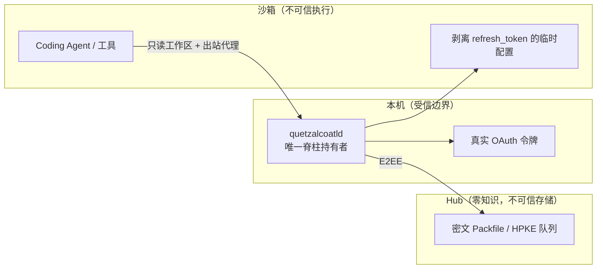

# Quetzalcoatl V2 安全模型

本文是威胁模型与安全边界说明，不是"已通过第三方审计"的声明。当前没有任何外部安全审计，
所有结论均来自仓库内可复现的代码与测试。

## 1. 资产

| 资产 | 位置 | 泄露后果 |
| --- | --- | --- |
| 长期记忆与关系 | `$QUETZALCOATL_HOME/spine.sqlite` + E2EE Packfile | 不可逆隐私损失 |
| 良知 `ROOT`/`OPERATOR` 指令 | 签名清单 + 受保护指令 | 行为被远程劫持 |
| OAuth `refresh_token` | 仅 `quetzalcoatld` 进程内存 / 家目录受控文件 | 账号被长期接管 |
| 设备与纪元密钥 | 本机钥匙串或加密文件；Hub 仅存包裹密文 | 历史密文可解 |
| 通道凭据 | 进程内存；`ChannelIngressKey` 槽 | 冒充身份发信 |
| 发布产物 | GitHub Release + 镜像 | 供应链投毒 |

## 2. 对手模型

**纳入考虑**：

- 本机其他非特权进程、恶意脚本、被投毒的仓库与工具输出；
- 被邀请进群房间的恶意成员（含伪造 `@admin`、注入自复制指令）；
- 能篡改网络流量的运营商/代理，以及被攻破的 Hub 存储；
- 通过提示注入诱导 Agent 改写核心身份或外发私密记忆的攻击者；
- 供应链上游依赖投毒与发布资产替换。

**不承诺**：

- 已取得 root/Administrator 或物理接触并解锁设备的攻击者；
- 恶意操作系统内核、固件或硬件后门；
- 侧信道（功耗、缓存、屏幕反射）与勒索软件；
- 用户主动把明文记忆粘贴到外部服务。

## 3. 信任边界

关键规则：

1. 沙箱内任何进程都不得直接打开 `spine.sqlite`、钥匙串或真实令牌文件。
2. Hub 永远不解密 Packfile，也不持有任何根密钥。
3. 客户端进程不得绕过 `quetzalcoatld` 直接写脊柱。

## 4. 沙箱边界

| 平台 | 机制 | 关键限制 |
| --- | --- | --- |
| Linux | `bwrap` | 只读根；显式可写工作区；`--unshare-*`；`SYS_clone3` seccomp 探针 |
| macOS | Seatbelt `sandbox-exec` | SBPL 白名单；符号链接前缀归一化；禁止任意网络 |
| Windows | AppContainer + Restricted Token | 低完整性 SID `S-1-16-4096`；仅按需授予网络能力 SID |

- 仓库自带的 `.opencode/`、`.claude/`、`.git/hooks/` 等配置在沙箱内只读挂载；宿主以启动参数
  锁定配置，恶意仓库无法用 `opencode.json` / `settings.json` 卸载良知插件。
- 洁净室 `Verifier` 在**独立、断网、只读**目录运行候选 diff 的测试，Worker 无法篡改测试脚本；
  解析到 `0` 个测试即判失败（Anti-Vacuity），防止奖励作弊。
- 所有外部写操作必须经内核 `RunMachine` 的能力与预算门禁；`PartitionLocal` 下非幂等公网外发
  直接 `PARTITION_RESTRICTED`。

## 5. 零知识 Hub

- **认证**：WebAuthn passkey、OPAQUE（RFC 9807，Ristretto255-SHA512 + Argon2id 槽）与 OIDC
  三选一；配对码只存 HMAC。
- **存储**：只存 Packfile 密文、`PackAad`、上传元数据、群提交密文、webhook 密封队列、配额计数。
- **入站 webhook**：仅在内存验证平台 HMAC，立即用 Agent `ChannelIngressKey` 做 HPKE 密封入队；
  不写明文日志。
- **对象存储**：Presigned `PUT` 绑定 `Content-Length` 与 `sha256`，防止上传替换。
- **LLM 代理**：仅转发与配额，不落请求正文；不修改 `system[0]` 与认证头。
- **可用性**：Hub 被完全攻破时，最坏后果是拒绝服务与密文/配额泄露，不是明文记忆泄露。

## 6. 凭据代理（零凭据沙箱）

`crates/quetzalcoatl-sandbox/src/broker.rs` 的 `CredentialBroker`：

1. 真实 `~/.claude` / `~/.codex` 长期令牌由 `quetzalcoatld` 托管；
2. 沙箱只挂载剥离 `refresh_token` 的 `CLAUDE_CONFIG_DIR` / `CODEX_HOME` 存根；
3. 出站请求经回环网关，按 origin + path 白名单在**发送瞬间**替换为真令牌；
4. 白名单外请求拒绝并记录 `CREDENTIAL_REJECTED`；正文与令牌绝不进 `Debug`/日志；
5. Coding Agent 发现阶段在无 `DBUS_SESSION_BUS_ADDRESS` 的 SSH/容器环境禁止触碰
   `libsecret`/`secret-tool`，避免无限阻塞（`crates/quetzalcoatl-harness`）。

## 7. 良知权威与治理

| 段 | 写入门槛 | 安全意义 |
| --- | --- | --- |
| `ROOT(100)` | 所有者 `AccountRootKey` 签名；LLM 提案一律报错 | 最高红线不可被对话改写 |
| `OPERATOR(80)` | 所有者直接签名，或所有者授权 + 部署者密钥两级委托；Operator 不能覆盖同名 ROOT | 部署方可收紧但不能提权 |
| `SELF_CORE(70)` | ≥5 证据、≥3 独立簇、≥7 天、S5 压力比 ≤0.2、14 天冷却、≥2 个异构 Reflector | 抗单会话 PUA 与自我谄媚 |
| `USER_PREF(40)` / `RELATION(55)` / `SELF_SOFT(50)` | 有界预算内自演化；单线程含 S5 时挂起等独立证据 | 可演化但不可被一次对话劫持 |
| `MEMORY(30)` | 自由写入；外部来源标 `untrusted` | 可污染但不可提权 |

补充硬规则：

- 每次上下文组装与每次提案提交前都重新计算 `ROOT`/`OPERATOR` BLAKE3 并验 Ed25519 签名，篡改即
  `CONSCIENCE_VIOLATION`。
- `<=8B` 端侧小模型不得审议 `>= USER_PREF` 的写回；离线产生的 episode 标记 `pending`，待云端/
  桌面大模型巩固。
- 群聊非主人消息只计 `S8`；`S1`/`S4` 必须验主人设备签名。
- 出站 `Router` 拦截任何未经 `eWave::Grant` 或本人群内授权的私有 `MEMORY`/`USER_PREF` 引用。
- 反思维病毒免疫铁律钉扎在 `pinned_system_tail`，任何信道正文都不得进入该段。

`ConscienceBench` 的 T1/T2/T3 结果见
[docs/bench/conscience-bench-2026-11-25.md](bench/conscience-bench-2026-11-25.md)。

## 8. 网络面

- 本地 IPC 仅绑 `127.0.0.1`/UDS，`0600`，严格 `Host`，256-bit 路径能力令牌常量时间比较。
- Hub 生产必须启用 TLS；默认配置只绑回环，避免误暴露。
- `iroh` 节点身份与租约 `witness_epoch` 绑定；旧纪元 Router 在任何网络包发出前先自检租约过期。
- 未来时钟事件隔离拒收，防止 HLC 投毒推高本机时钟。

## 9. 供应链

- `deny.toml`：许可证白名单、`wildcards = "deny"`、源白名单；`GPL-2.0*`/`GPL-3.0*`/`AGPL-3.0*`
  无法进入 `Apache-2.0` 工作区。
- Linux 桌面动态链接 `libadwaita-1` 属 `LGPL-2.1`，通过 ELF 动态链接合规单测约束，不做静态链接。
- 发布：`scripts/gen-sums.sh` 生成 `SHA256SUMS` 与 Ed25519 `SHA256SUMS.sig`；`scripts/install.sh`
  与 `scripts/install.ps1` 在落盘前验签、验哈希，失败即中止并回滚。
- 验签与回滚行为由 `scripts/tests/install_verify_sig.test.sh` 与
  `scripts/tests/gen_sums.test.sh` 覆盖（本地假发布源，不联网）。
- 仓库零密钥：签名私钥只通过 `RELEASE_SIGNING_KEY_FILE` / `RELEASE_SIGNING_KEY` 注入 CI Secret。

## 10. 数据与密钥纪律

1. API Key、OAuth 令牌、私钥、真实个人记忆/人格样本、设备标识符、私有 IP/MAC 一律禁止入库。
2. 测试夹具 100% 合成；领域包内置签名使用由包 ID 派生的**合成演示钥匙**，并在
   `crates/quetzalcoatl-domains/src/demo_keys.rs` 钉扎到唯一内置正文摘要。
3. 运行态数据只写 `QUETZALCOATL_HOME`；临时目录优先 `/var/tmp`，避免 `bwrap --tmpfs /tmp` 抹除
   OAuth 存根。
4. 导出归档同时包含可读 Markdown 与密文脊柱；分享前须自行确认不含敏感正文。

## 11. 已知限制与延后项

- **无第三方安全审计**；不要把当前状态当作生产级安全认证。
- iOS / Android 运行时（含后台推送扩展）未在 VM 上复验：`Deferred (VMs paused by owner)`。
- macOS VoiceOver / Windows Narrator / Linux AT-SPI / 移动端 TalkBack 的实机无障碍走查未执行：
  `Deferred (VMs paused by owner)`，清单见 [docs/ACCESSIBILITY_CHECKLIST.md](ACCESSIBILITY_CHECKLIST.md)。
- 可复现构建、SBOM 与透明度日志尚未落地，属计划 Task 5.4 范围。
- Hub 的监护人恢复流程当前只覆盖"配置 + 批准 + 查询"，社交恢复的多方阈值策略仍以代码为准。

## 12. 报告安全问题

请通过仓库维护者的私密渠道报告，不要在公开 issue 中粘贴真实令牌、记忆正文或设备标识。
报告时请附：受影响版本（`2.0.0-alpha.1` 起的 git commit）、复现步骤、期望与实际行为、
以及是否涉及 `ROOT`/`OPERATOR` 绕过。我们会在确认后同步修复与测试。
