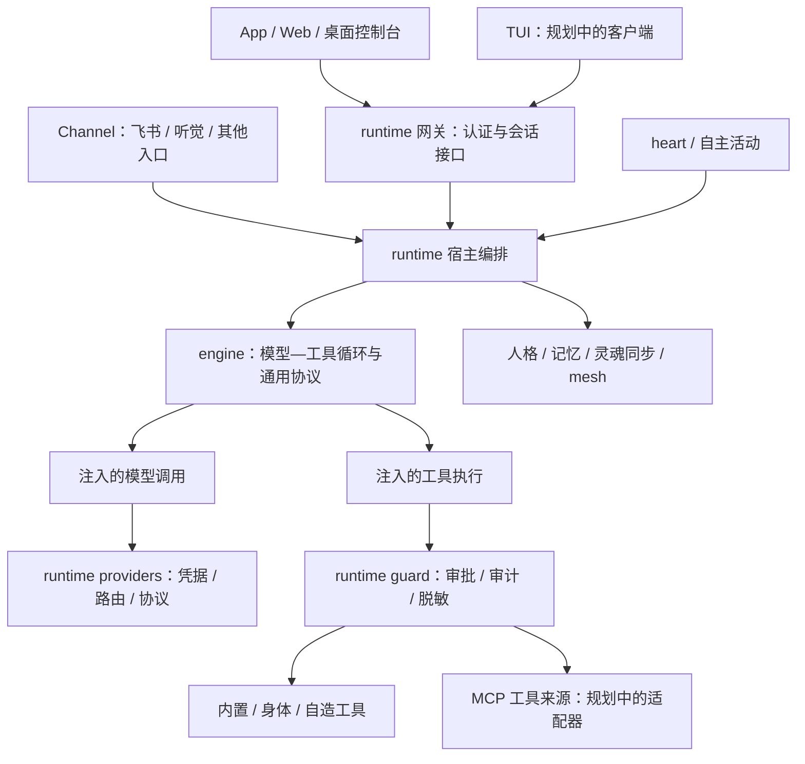

# 独立 Agent 引擎：目标与渐进式拆分

日期：2026-10-14。用户明确要求将 Quetzal Agent 核心放进独立模块，让 App、TUI、Channel 共用引擎，MCP 作为模型可用的工具来源；同时要求尽量避免大范围重构。本页记录选定的迁移方向；阶段状态与验收见 [路线图](ROADMAP.md)，MCP / TUI 专项见 [适配器计划](ADAPTERS_PLAN.md)。

## 1. 目标与当前切片

目标目录是仓库根级 `engine/`，以 TypeScript / Node.js 实现可独立调用、测试和构建的模型—工具执行模块。它不需要启动 Quetzal 的身体、心脏、数据库、网关、飞书或 Git 同步；这些实际能力由宿主装配并注入。

第一切片抽出通用消息类型和真实执行循环，现有 `runtime/src/mind/brain.ts` 保留对话、醒来、做梦与子 agent 编排，将模型—工具循环委托给引擎。原调用路径保留，不批量重命名文件、不移动整个 `mind/`、`memory/` 或 `providers/`，也不同时改变默认执行行为。

这是独立引擎的第一个可运行切片，不是所有状态、上下文、记忆和子 agent 管理都已完成实例化。长期会话队列、Session 生命周期、提示组装、FTS5 与持久化目前仍由 runtime 管理，后续按真实需求逐项提取。

## 2. 依赖方向

Flutter 等进程外客户端通过网关间接使用同一个引擎；并不要求浏览器或 Dart 直接加载 Node.js 模块。独立 Node.js 宿主或离线研究 runner 则可以直接调用引擎并提供自己的模型、工具和轮次控制。

MCP 属于工具侧。Channel 属于输入 / 输出侧。它们可以共享执行事件与取消契约，但不能混用连接身份、凭据或授权：外部 MCP 内容不能获得控制台管理权限，也不能自动提升为系统指令。

## 3. 第一阶段接口

公共导出以 [engine/src/index.ts](../../engine/src/index.ts) 为准：

- `Msg`、`ImagePart`、`ToolDef`、`ToolCall`、`ChatRequest`、`ChatResult`：通用模型通信类型；runtime 原类型路径重导出，供应商配置与 ProviderError 留在宿主。
- `runTurn(options, ports)`：执行一轮模型—工具循环。输入为已组装上下文、工具定义、可选结束工具、输出上限和轮次控制；返回最终文本、结束参数、工具步骤、累计用量与最后使用的模型。
- `TurnControl`：轮次进展、模型取消、流式输出与工具等待协议。当前 runtime 的 Session 满足此结构接口；不提取其身体、会话、事件总线或持久化实现。
- `EnginePorts`：宿主提供模型调用、工具执行、补充输入、停止 / 中断分类、输出清理、参数脱敏、记录与警告。是否迁移身体的宿主信号由宿主提供，引擎只负责结束本地循环。

第一切片采用函数接口，不引入带全局状态的 Engine 单例。并行运行必须使用各自的 `messages` 数组与轮次控制；引擎函数内的重试次数、失败计数和结果均为本轮局部状态。未来会话服务实例化另行验收，不能仅因执行函数独立就宣称宿主已支持多实例隔离。

## 4. 兼容性与治理

迁移保留工具快照、串行调用、最终回复来源、两次空回复提醒、失败与拒绝区分、重复失败提示、12000 字符工具上下文和1500 字符步骤摘录、插话 / 打断 / 停止、finish 与身体交接行为。停止一轮不等于回滚已经发生的副作用。

MCP、TUI、新预算策略和论文实验分别实施。默认工具授权、沙箱、保密输入、灵魂规范及自动同步在这次提取中不改变。引擎不自行加载远端服务器，不读取模型 Key，不执行 Git，不调用身体或通道。

本轮保留循环里已有的提示文案与事件，后续再研究国际化、可配置策略及更小的 ports 接口，避免一次提取同时引入策略变化。独立构建用于维护和验证；不表示已发布新 npm 包或改变 App 安装方式。

## 5. 论文研究的归属

| 方向 | 引擎可提供的能力 | 后续研究模块负责的工作 |
|---|---|---|
| PRIME | 稳定循环、可注入上下文、经验选择所需输入 | 从轨迹提出结构化经验，条件检索、候选演化和留出集验证 |
| Training-Free GRPO | 同一执行接口可使用模拟模型 / 工具与独立任务状态 | 同题多轨迹采样、可信结果评价、成败对照和经验提炼 |
| OpenRLHF | 可关联的执行记录与明确的宿主接口 | 未来独立训练数据导出和开放权重模型训练服务 |

论文建议不自动改变线上人格、用户事实或每次对话的采样次数。先比较现有基线和候选策略的完成率、误用率、成本和延迟，再决定是否进入宿主默认配置。具体工作包与依赖顺序见 [路线图](ROADMAP.md)。
