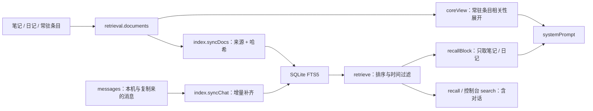

# Agent 记忆分层、检索与同步

这里的“分层”是现有数据职责的归纳，源码没有统一的 Memory 层级接口或可替换后端。纯分词、评分和摘录现位于 [engine 检索策略](../../engine/src/retrieval.ts)，宿主兼容包装仍位于 `runtime/src/memory/retrieval.ts`；文件、SQLite 和同步留在 runtime。基线见 [BASELINE.md](BASELINE.md)；格式契约见 [灵魂仓库规范 v14](../SOUL_REPO_SPEC.md)。

## 1. 记忆与状态分层

| 层 / 职责 | 真相来源 | 如何进入模型 | 持久性与共享 |
|---|---|---|---|
| 身份与人格 | `soul/agent.json`、`SOUL.md` | 身份插入处境，人格放在系统提示首段 | 私有 Git 灵魂仓库 |
| 常驻核心认识 | `soul/memories/MEMORY.md`、`USER.md` | 按相关性 / 位置与字符预算展开；遗漏条目可 recall | § 分隔 Markdown 条目，文件增长不受上下文字符预算限制 |
| 语义 / 知识记忆 | `soul/notes/**.md` | 目录摘要、自动检索、note_read / recall | 最多 4 层共享目录树，Git 同步 |
| 情节 / 反思记忆 | `soul/journal/<body>/<日期>.md` | 最近文件尾部、按小节检索、做梦回顾 | 身体各写自己的日记，Git 同步 |
| 技能 / 程序性意图 | `soul/skills/<名>/SKILL.md` | 技能摘要列表、tool_read 按需读取 | 文档随灵魂，执行实现留在本机 `tools/` |
| 原始对话与过程 | SQLite `messages`、`sessions`、`timeline` | 当前历史、其他会话近况、recall 对话、过程附注 | mesh 复制到在线身体，原始对话不进 Git |
| 详细行动证据 | SQLite `audit`、`tool_calls` | recent_actions 查审计，tool.detail 给控制台 | 完整工具记录只在执行身体本机；非长期语义记忆 |
| 工作状态 | `kv` 中 openLoops、thought、心脏、子 agent 等 | 对应提示块、状态界面与调度 | openLoops 属于本机 kv；thought 等部分状态有专门 mesh 共享策略 |
| 本轮工作上下文 | 内存 `Msg[]`、`Session.inbox/images/seen` | 直接传入模型循环 | 不作执行检查点持久化；重启消失 |
| 检索派生索引 | SQLite `recall_chat`、`recall_chat_ids`、`recall_doc` | retrieve / recallBlock / recall 查询 | 从消息与文件派生，不是灵魂真相来源，不进 Git |

保密库 `vault/` 和基座密钥目录 `secrets/` 是凭据存储，不是可检索的 agent memory；系统提示只列保密库元信息。本文不包含真实灵魂内容。

## 2. 写入与访问

[memory.ts](../../runtime/src/memory/memory.ts) 提供条目、笔记和日记操作。`memory` 工具采用 add / replace / remove；replace / remove 由唯一子串定位，匹配不唯一返回说明。条目用 `\n§\n` 分隔。

笔记标题可带分类路径，路径段由 `portable-path.ts` 的规则规范化；`saveNote()` 写标题、可选引用行摘要与正文，支持追加。`noteMeta()` 从标题、引用行或正文首句得到摘要；目录只提供索引，全文由 `note_read` 读取。冲突副本 `.incoming*.md` 不作为普通笔记列举 / 检索。

思考和做梦收尾通过 `writeJournal()` 按身体、日期追加一个 `## HH:MM` 小节。普通对话增加待整理经历计数，但没有无条件把每一轮对话自动转成长期 MEMORY 条目。长期提炼由模型使用记忆工具，或在做梦任务中完成。

未完成念头 `openLoops` 与想分享的话 `thought` 虽放在 memory 模块，实际在 SQLite kv。不能因模块名称就断言它们由灵魂 Git 同步。

## 3. 两条检索路径

自动注入与显式 recall 不等价：常驻条目单独展开，自动 `recallBlock()` 只请求 `note` / `journal`；显式 `retrieve()` 默认覆盖 `chat`、`note`、`journal`、`memory`、`user`。完整历史对话能被查到，不代表每轮已自动召回它。

分词由 [engine/retrieval.ts](../../engine/src/retrieval.ts) 实现纯分词，宿主保留兼容导出：英文 / 数字转小写按词；中文二字组，单字串保留单字；可用时增加 `Intl.Segmenter` 分出的三字以上中文词。不调用 embedding 模型，没有向量库、语义相似度或独立 reranker。

## 4. FTS5 与降级的实际算法

[index.ts](../../runtime/src/memory/index.ts) 的 `ensureIndex()` 创建 FTS5 表。对话索引保存分词，正文仍从 messages 取；文件索引保存正文、来源、类型、时间与内容哈希。写入 FTS 的 tokens 会先去重。

检索查询词用 OR 组合，先取各类候选（有词查询的对话 / 文件各最多 200 条），基于 SQLite `bm25` 得分，再乘查询覆盖率的平方和新近加分，最后按 limit 返回。文件的时间过滤在候选取出后进行；不能把 limit 解释为在所有时间过滤后文档上的完整排序。标题虽在 `syncDocs()` 拼接两次，但 `toks()` 去重，所以并不因此产生重复标题的词频加权。

对话在检索前每次最多补索引 2000 条；启动 `backfillChat()` 每批 1000，延迟启动并分批让出事件循环。因此大量尚未索引的历史不保证第一次查询就全覆盖。文件在检索时收集，再按来源与哈希只替换变化条目、删除消失来源；这不是向量增量索引或常驻文件监控服务。文件读取 / 分词仍可能随记忆总量增长。

FTS5 不可用时降级为 `rank()` 逐篇评分：词频饱和 × IDF、标题命中奖励、查询覆盖率与新近加分。对话只取指定时间段最近 3000 条，再参与评分。因此降级路径与 FTS5 的召回范围 / 排序不完全一致。

时间区间为 `[from,to)`；工具将明确的当地日期时间解析为毫秒。对话用消息时间，日记小节从文件日期和 `HH:MM` 换算，笔记用 mtime；常驻条目没有真实时间，带时间筛选时不纳入。`around()` 给对话命中补同会话前后各一条非 ambient 消息；工具显示的是摘录和相邻消息，可再读取原文。

## 5. 整理与记忆演化

做梦是一次模型任务，提示要求回顾日记与对话、提炼核心认识、合并重复和修正过时条目、整理笔记、审查稳定工具流程。它不是强制执行的数据清洗算法，也没有自动事实验证、遗忘评分、知识图谱或无模型的记忆归并器。

做梦前尝试取得 `locks/consolidation.json` 租约（30 分钟），每 10 分钟续租，收尾释放；其他身体持有有效租约则浅睡。`wake()` 对 acquireLease 异常采用继续执行的降级路径，不能把租约描述为所有失败与离线条件下的绝对排他锁。

## 6. 两种同步与一致性

| 数据 | 机制与源码 | 边界 |
|---|---|---|
| 灵魂文件 | `soul-sync.ts` → `SoulRepo`；工具结束检查改动、立即提交、3 秒去抖推送；对话 / 醒来前拉取，mesh 的 soul.pushed 通知立即拉取 | 自动 Git 同步，不能要求模型手动 pull / push；网络失败时本地提交仍待推送 |
| 对话 / 会话 / 时间线 | `mesh/replica.ts`，版本向量补齐与实时广播，store 校验 / 幂等写入 | 不进 Git；每次连上补齐每身体最多 20 万行 / 512 MB |
| 心脏、设置、thought、提醒、认领等 | `mesh/coordinator.ts` / `shared.ts` 的具体协议 | 各有合并方式，不是复制整个数据库 |

常驻记忆按条目三方合并（双方新增保留，删除生效）；身份按字段合并并检查 agent id；普通文本冲突按提交时刻选择，落选版可留 `.incoming.md`，同步知觉提醒模型裁决。副本本机保留，不再同步；历史仍可由控制台查看与反向提交撤销。

同进程的正规记忆写入与 Git 工作区合并共用 `memory.exclusive()` 写锁，Git 操作另由 `soul-sync` 串行队列执行。直接通过 shell 改文件不经过这把写锁，多身体也不共享进程锁；自动同步不等于全网即时强一致。

Git 执行只使用配置远端，默认独立 SSH 部署私钥，拒绝不合身份 / 仓库历史、禁止执行钩子与合并符号链接。现规范也允许部署者显式选指定私钥 / 系统 SSH。私有灵魂仓库 v11 起不检查记忆内容是否含密钥；公开基座仓库仍禁止纳入任何真实凭据或记忆。更多细节见 [SOUL_SYNC.md](../SOUL_SYNC.md)。
