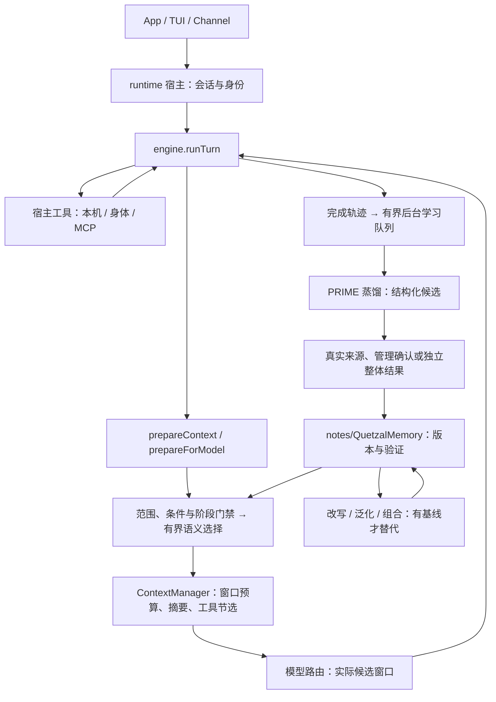

# 上下文／记忆替代交付记录

本轮唯一工程是将动态上下文、结构化记忆和 PRIME 经验学习／演化接入默认执行路径。执行循环、身体适配器、网关、MCP、TUI 与原灵魂目录保留；不是再次拆迁全部 runtime，也不是只增加一个离线检索实验。

## 当前架构与真实路径

引擎新增 [context-manager.ts](../../engine/src/context-manager.ts)、[memory.ts](../../engine/src/memory.ts)、[prime.ts](../../engine/src/prime.ts)，并导出类型和接口。引擎不反向依赖 runtime，不加载部署配置、凭据、数据库或灵魂 Git。宿主新增 [mind/context.ts](../../runtime/src/mind/context.ts)、[memory/structured.ts](../../runtime/src/memory/structured.ts)、[memory/semantic.ts](../../runtime/src/memory/semantic.ts)、[memory/prime.ts](../../runtime/src/memory/prime.ts)。模型／工具／事件端口继续复用既有机制。

每步读取最新记忆、目标、约束、阶段与标签。路由用实际模型窗口重新计算输入；原始消息与来源不被裁掉，摘要和工具短视图只是模型输入投影。`task_state` 记录模型工作计划，原用户输入继续受保护。`context_read` 通过会话限定引用恢复正文，`context.status` 查看最后计划。

结构化长期记忆含 fact、preference、episode、experience 四类，candidate、active、superseded、archived 四种状态。所有版本保留来源、有效时间、作用域、条件、阶段、验证和父关系。正文保存在既有私有灵魂 notes 内，遵守现行灵魂规范，不增加顶层目录。旧 MEMORY／USER／notes／journal 原样保留，并映射为明确标注的未核实资料；显式 recall 与旧工具仍可使用。

默认自动学习保留用户完整发言作为有语境的观察，不将转述、否定或故事中的子串直接当个人事实。提炼个人语义默认 candidate；管理确认后可激活，稳定 slot 支持可信更新与历史保留。真实工具失败只能形成限定工具的失败观察，不能自动推断整体任务失败。整体成功经验须有独立真实结果，再由第二次 quick 调用检查提炼是否忠实、适用范围是否扩大；它不证明策略因果收益。

PRIME rewrite／generalize／combine 已具有真实提案、验证、父版本与安装状态路径。默认宿主没有固定任务的可信基线评价器，因此演化只生成候选，活动原版本不被替代；通过评估端口注入真实对照后才可激活。归档与回滚保留历史。

## 配置与开销

| brain 配置 | 默认 | 作用 |
|---|---|---|
| maxOutputTokens | 4096 | 主模型输出上限，仍受模型和窗口限制 |
| contextWindow | 65536 | 仅用于缺少有效窗口元数据的模型 |
| contextSummaryTokens | 1024 | 自动摘要输出预算 |
| contextSummaryModelTokens | 1024 | 模型生成预算（128–4096）；与保留摘要预算分开以支持推理模型 |
| contextSummaryTimeoutMs | 10000 | 自动摘要有界等待，可配置100–60000毫秒 |
| memorySemantic | true | 有界 quick 语义选择；关闭后走资格门禁＋词面选择 |
| memorySelectionTokens | 256 | 选择输出预算，可配置128–2400，计入日预算预留 |
| memorySelectionTimeoutMs | 5000 | 语义选择有界等待，可配置100–60000毫秒 |
| memoryLearning | true | 对话／醒来／子 Agent 完成后自动学习 |
| memoryLearningTokens | 1200 | 后台蒸馏／评价每次输出预算 |
| memoryLearningTimeoutMs | 15000 | 一次学习会话共享硬超时 |

语义选择最多 20 候选、每项 300 字符，返回最多 6 项且可零命中；个人与经验分组保留名额。宿主选择缓存最多 64 项／60 秒，记录内容、范围、条件、验证及有效时间边界变化会使缓存失效。选择共享本机每日 64000 保守 token 预算，默认5秒超时（可配置），失败退回同资格门禁的词面选择。取消或急停不进入退路。

后台队列串行、最多 16 个待学习任务；回复不等待 quick 蒸馏。学习模型会话默认每日 64000、单次 32000 保守 token 预算，蒸馏与第二次评审共享限额。达到预算、取消、超时、急停或没有可信反馈时不会伪造成功。长期资料收集仍需读取文件，候选有界不代表全库读取成本固定。

预算文本使用 UTF-8 字节估计，图片使用启发式估计，不是精确 tokenizer。主执行请求走 ContextManager；内省、显式摘要等直接 quick 调用仍有各自限制，不能宣称整个宿主每一个 chat 都统一经过它。新能力可能增加 quick 调用成本，关闭语义选择／自动学习只停相应模型工作，不自动恢复旧的全量常驻注入。

## 管理接口与追溯

管理 RPC 复用现有认证网关和 ops；Agent 工具没有可信确认入口。

| 方法 | 参数 | 行为 |
|---|---|---|
| memory.records | state?、kind? | 当前 Agent 的结构化记录与来源 |
| memory.confirm | key | 管理者确认个人候选的真实语义；核对原始 user 消息 |
| memory.feedback | episodeId、status: success／failure、session? | 对完成轨迹的整个任务结果明确反馈，保存真实 user 消息，再有界学习评价 |
| memory.archive | key | 归档指定版本，保留原文 |
| memory.rollback | key | 从可信且有效历史生成新版本 |
| memory.evolve | operation: rewrite／generalize／combine、keys | 生成提案；缺可信对照时保持 candidate |
| context.status | conv | 最近上下文计划、估计和状态 |

`memory.feedback` 校验管理者、Agent 和本地轨迹会话映射。缺映射的旧轨迹明确拒绝，不猜会话、不重演任务。轨迹缓存在本机 kv 最近 50 个，来源映射最近 200 个；它不是无限训练仓库。可从上下文计划 turn 定位刚结束轮次，等待后台学习建立轨迹后反馈。当前没有新增 App／TUI 的专门候选确认界面，管理 API 已可调用。

上下文引用缓存保留最多 5000 项，每项最多 256 KiB；全文工具指针限定 call＋turn，原始历史指针限定消息 id＋会话。超过保留窗口、没有本机工具明细或超大正文未保存引用时，不能承诺恢复。私有持久层保留原文，不对灵魂做敏感内容拒绝／删改；发送到模型或日志之前复用既有脱敏边界。

## 验证与交付边界

最终本地验收已执行引擎与宿主类型检查及 runtime 构建。全量 runtime 与 engine 测试共 421 项：414 通过、7 项平台条件跳过、0 失败。真实 API 合成数据验收通过摘要约束保留、蒸馏候选隔离与确认、语义召回、主模型独立结果与经验门禁四个检查点，耗时约 154 秒；本次产生一条通过门禁的经验。这是有界验收，不代表长期收益或多设备效果。跨平台及正式发行状态以发布流水线结果为准。

新测试覆盖实际 converse 的每步检索／工具写后刷新、真实路由窗口回退、固定 Schema 过大时不发送、摘要与工具配对、原文分页与跨会话隔离、工作状态取消、后台学习与 main／quick 分流、管理确认／整体反馈、同 slot 更新、来源不可改写、候选污染隔离、语义无词面重合召回、空选择、跨作用域拒绝、缓存变更及生效／失效时间边界、不合作模型取消和急停。

证据来自合成供应商与本机测试，不代表真实模型记忆忠实度、长期收益、真实 MCP 服务、多身体冲突效果或设备验收。PRIME 属于本项目适配，未声称官方复现或论文收益。新增实现不引入依赖；既有测试 glob 和构建入口覆盖新增文件，配置在 brain 中扩展。构建产物、数据库与运行数据均保持忽略；只做本地提交，不作远程发布。
