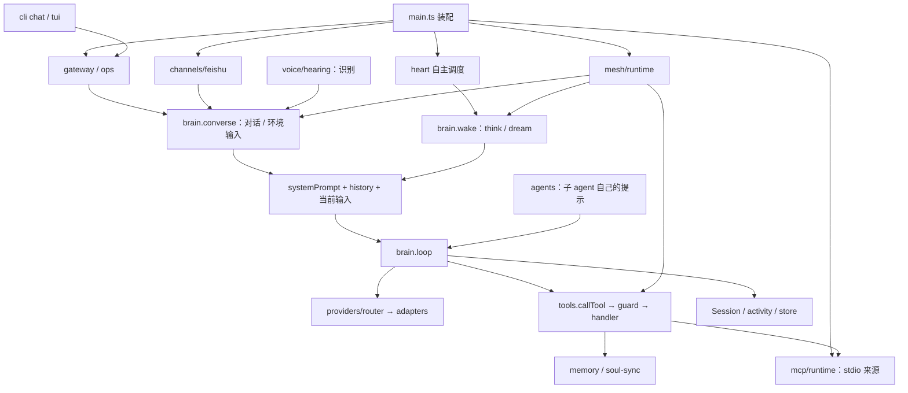

# 内核模块地图与装配边界

本页在初始基线基础上同步引擎提取及后续小切片；初始版本见 [BASELINE.md](BASELINE.md)，本次变更与验证见 [EXTRACTION.md](EXTRACTION.md)。

## 1. 内核所在目录

| 职责 | 源码入口 | 关键实现 |
|---|---|---|
| 进程装配 | [main.ts](../../runtime/src/main.ts) | `main()`：配置、数据库、适配器、网关、通道、灵魂、mesh、心脏与感知 |
| 独立模型与工具循环 | [engine/src/loop.ts](../../engine/src/loop.ts)、[通用协议](../../engine/src/types.ts) | `runTurn()`；模型、工具、输入补充、轮次控制与记录通过宿主注入 |
| 宿主心智编排 | [mind/brain.ts](../../runtime/src/mind/brain.ts) | `converse()`、`wake()`、`history()`、`spawnAgent()`；`loop()` 适配现有能力到引擎 |
| 动态上下文 | [engine/context-manager.ts](../../engine/src/context-manager.ts)、[mind/context.ts](../../runtime/src/mind/context.ts) | 实际模型窗口预算、摘要、工作状态与全文引用 |
| 结构化记忆 / PRIME | [engine/memory.ts](../../engine/src/memory.ts)、[engine/prime.ts](../../engine/src/prime.ts)、[runtime/memory/structured.ts](../../runtime/src/memory/structured.ts)、[prime.ts](../../runtime/src/memory/prime.ts)、[semantic.ts](../../runtime/src/memory/semantic.ts) | 资格门禁、语义选择、可信确认、蒸馏与版本演化 |
| 纯上下文 / 检索策略 | [engine/context.ts](../../engine/src/context.ts)、[engine/retrieval.ts](../../engine/src/retrieval.ts) | 常驻条目 / 召回预算、分词、评分和摘录，无文件或数据库依赖 |
| 受限研究运行器 | [engine/research.ts](../../engine/src/research.ts) | 独立样本环境、边界、轨迹与外部评分，仅研究使用 |
| 上下文 | [mind/prompt.ts](../../runtime/src/mind/prompt.ts) | `systemPrompt()`、其他会话 / 身体 / 技能等提示块 |
| 轮次状态与取消 | [mind/activity.ts](../../runtime/src/mind/activity.ts) | `Session`、收件箱、图片去重、流式事件、进行中快照 |
| 子 agent 与协作 | [mind/agents.ts](../../runtime/src/mind/agents.ts)、[mind/claims.ts](../../runtime/src/mind/claims.ts) | 独立提示词后台循环、报告回送、认领 |
| 工具注册与执行 | [mind/tools.ts](../../runtime/src/mind/tools.ts) | `allTools()`、`callTool()`、失败标记、闸门、审计、触碰同步 |
| MCP 工具来源 | [mcp/client.ts](../../runtime/src/mcp/client.ts)、[mcp/runtime.ts](../../runtime/src/mcp/runtime.ts) | stdio SDK、发现与稳定别名、本机配置、启动授权、调用取消和生命周期 |
| 终端聊天 | [cli/tui.ts](../../cli/src/tui.ts) | 本机网关客户端，沿用同一 Agent / 会话，无引擎依赖 |
| 自造工具与技能 | [mind/custom-tools.ts](../../runtime/src/mind/custom-tools.ts) | 本机 manifest / 实现、灵魂技能文档、子进程执行 |
| 附件与外部资料 | [mind/attachments.ts](../../runtime/src/mind/attachments.ts)、[mind/images.ts](../../runtime/src/mind/images.ts)、[mind/documents.ts](../../runtime/src/mind/documents.ts)、[mind/search.ts](../../runtime/src/mind/search.ts) | 多模态消息、图片缩放、文档抽取、搜索；`fetch-guard.ts` 检查网页请求 |
| 身份与文件记忆 | [memory/identity.ts](../../runtime/src/memory/identity.ts)、[memory/memory.ts](../../runtime/src/memory/memory.ts) | 身份数据、人格、常驻条目、日记、笔记、写锁 |
| 检索 | [memory/retrieval.ts](../../runtime/src/memory/retrieval.ts)、[memory/index.ts](../../runtime/src/memory/index.ts) | 分词、相关性展开、自动注入、FTS5 与降级 |
| 灵魂同步 | [memory/soul-sync.ts](../../runtime/src/memory/soul-sync.ts)、[memory/soul-repo.ts](../../runtime/src/memory/soul-repo.ts)、[memory/entries.ts](../../runtime/src/memory/entries.ts) | 运行时绑定、Git 协议、条目合并；`portable-path.ts` 管跨平台路径 |
| 模型层 | [providers/types.ts](../../runtime/src/providers/types.ts)、[providers/router.ts](../../runtime/src/providers/router.ts)、[providers/adapters.ts](../../runtime/src/providers/adapters.ts) | 统一消息、全局路由、Key 轮换、四种协议与流解析 |
| 模型配置 | [providers/registry.ts](../../runtime/src/providers/registry.ts)、[providers/catalog.ts](../../runtime/src/providers/catalog.ts)、[providers/quick.ts](../../runtime/src/providers/quick.ts) | 加密配置、目录、快速接入；`compat/` 封装供应商特例 |
| 自主调度 | [heart/model.ts](../../runtime/src/heart/model.ts)、[heart/heart.ts](../../runtime/src/heart/heart.ts) | 内驱力、生物钟、抽样、预算抑制、跟随协调者 |
| 身体边界 | [body/adapter.ts](../../runtime/src/body/adapter.ts)、[body/twin.ts](../../runtime/src/body/twin.ts)、[body/uuid.ts](../../runtime/src/body/uuid.ts) | 能力接口、采样与感受、身体身份 |
| 定时承诺 | [time/reminders.ts](../../runtime/src/time/reminders.ts)、[time/zone.ts](../../runtime/src/time/zone.ts) | 提醒独立于模型与自主抽样 |
| 记录与事件 | [store.ts](../../runtime/src/store.ts)、[bus.ts](../../runtime/src/bus.ts) | SQLite 状态与记录、进程内事件总线 |
| 执行权限 | [guard/guard.ts](../../runtime/src/guard/guard.ts)、[guard/sentinel.ts](../../runtime/src/guard/sentinel.ts)、[sandbox.ts](../../runtime/src/sandbox.ts)、[host-mode.ts](../../runtime/src/host-mode.ts)、[sh.ts](../../runtime/src/sh.ts) | 能力类别、安全审核、审批、急停、沙箱、会话真实环境、子进程 |
| 保密输入与脱敏 | [mind/secrets.ts](../../runtime/src/mind/secrets.ts)、[secret-values.ts](../../runtime/src/secret-values.ts)、[crypto.ts](../../runtime/src/crypto.ts) | 输入截取、保密库、输出替换、供应商 Key 加密 |
| 控制与通道 | [ops.ts](../../runtime/src/ops.ts)、[gateway.ts](../../runtime/src/gateway.ts)、[web.ts](../../runtime/src/web.ts)、[channels/](../../runtime/src/channels/)、[voice/](../../runtime/src/voice/) | 管理操作、HTTP / WebSocket、控制台页面、飞书与语音 |
| 多身体协作 | [mesh/](../../runtime/src/mesh/) | 连接认证、复制、在场、协调者、运行位置、工具与文件借用、设置共享 |

完整逐文件职责继续由 [runtime 模块地图](../../runtime/docs/ARCHITECTURE.md) 维护。

## 2. 主要调用链

`engine.runTurn()` 是公开的通用执行接口；`brain.loop()` 保留为宿主适配函数，注入具体模型、工具、Session、输入补充与记录。引擎不依赖 runtime；当前尚无完整的会话服务实例化、插件容器或统一实例化的 MemoryBackend 服务；ContextManager 与记忆策略已独立、模型与评估端口可注入，文件／数据库仍在宿主。

## 3. 装配生命周期

`main()` 先加载配置、打开 SQLite、恢复子 agent 元数据，再检查 10 分钟内启动次数（超过 5 次进入安全模式）。加载适配器之后，启动网关与飞书，安装主动消息入库 / 通知监听、提醒和对话索引补齐。

正常路径随后初始化灵魂、异步启动 MCP 来源（审批不阻塞心脏）、装配与启动 mesh、采样身体、刷新需要更新的模型目录，最后启动心脏与感知循环。没有绑定或缺 WebRTC 原生组件时 mesh 可不启动，Git 灵魂同步仍存在。安全模式提前返回，跳过正常路径后半段；它对模型入口的实际边界见 [BASELINE.md](BASELINE.md)。

未处理的 Promise rejection 记录日志；未接住的同步异常记录后以非零状态退出。核心不自行重启，由平台守护者拉起。持久记录能恢复，内存中的执行栈不能恢复。

## 4. 仓库其他目录的关系

| 目录 | 与执行引擎的关系 |
|---|---|
| `engine/` | 独立循环、通用协议、纯上下文 / 检索策略与研究运行器，零运行时依赖；runtime 构建将其一起打包 |
| `runtime/adapters/` | Android、Termux、Linux、Windows 平台级实现；经 `BodyAdapter` 接入，不承载模型循环 |
| `console/` | Flutter 管理与对话客户端；Android 原生部分还提供身体能力和进程看护，桌面版提供耳朵 / 播放器 |
| `cli/` | 安装、启停、健康检查、日志、升级 / 回滚；`chat` / `tui` 经本机网关聊天；前台 `run` 启动打包后的 runtime |
| `bridge/` | Hermes / OpenClaw 的灵魂文件映射与同步；`bridge/src/engine.ts` 是双侧文件合并引擎，不是 Quetzal 模型执行引擎 |
| `sync/` | 独立的账户、发现、绑定与信令服务；模型循环和记忆检索在身体端 runtime 执行 |
| `website/` | 官网、文档与分发入口；不承载 Agent 核心循环 |
| `docs/research/` | 论文、上游源码与实验；目录中的 MCP / memory / agent 实验不代表已集成进 runtime |

## 5. 依赖、配置与构建事实

以 [runtime/package.json](../../runtime/package.json)、[tsconfig.json](../../runtime/tsconfig.json) 和 [build-srt.mjs](../../runtime/tool/build-srt.mjs) 为准：TypeScript 严格模式、可擦除语法，Node 内置 SQLite；模型 HTTP 用内置 `fetch`，没有引入通用 Agent 编排 SDK。

| 依赖 | 用途 |
|---|---|
| `ws` | WebSocket 网关 |
| `@modelcontextprotocol/client`（2.3.1） | 宿主 MCP 官方客户端（stdio、Streamable HTTP、SSE、OAuth）；不进入 engine |
| `@larksuiteoapi/node-sdk` | 飞书通道 |
| `jpeg-js` | JPEG 图片处理兜底 |
| `microsoft-cognitiveservices-speech-sdk` | Azure 流式识别 |
| `@peculiar/asn1-schema`、`@peculiar/asn1-x509` | 网关自签名证书编码 |
| `croner` | cron 提醒时刻计算 |
| `beautiful-mermaid` | 控制台图表兜底渲染 |
| `@anthropic-ai/sandbox-runtime` | Windows 命令沙箱；不是模型 / Agent SDK |
| 可选 `node-datachannel` | WebRTC 网状连接 |

构建先 `tsc --noEmit`，再由 esbuild 打包核心 `dist/main.cjs`、平台适配器、Windows 助手 / 守护和 Mermaid 渲染器；Windows 沙箱单独打包为 `dist/srt.mjs`。WebRTC 与沙箱依赖不打进核心包。测试直接运行 TypeScript 源码。SDK 已加入 runtime 依赖与锁文件；CLI 的 TUI 使用 Node 内置 WebSocket / readline，无新增依赖；CI 已覆盖 CLI 测试和类型检查。

配置入口是 [config.ts](../../runtime/src/config.ts)：`QUETZAL_HOME` 决定数据目录；模型供应商在 `config/providers.json`，执行配置在 `config/quetzal.json`，本机 MCP 来源在 `config/mcp.json`，凭据与主密钥在 `secrets/`，自造工具在 `tools/`。适配器路径由配置 `adapter` 或 `QUETZAL_ADAPTER` 注入。参数与环境变量完整列表见 [API](../API.md) 与 [runtime README](../../runtime/docs/README.md)。
