# OpenRLHF: An Easy-to-use, Scalable and High-performance RLHF Framework

> 本文由 PDF 自动提取，尚未逐项人工校对。每页附完整原图，用于核对图片、图表、公式与布局。

## PDF 第 1 页

## **OpenRLHF: An Easy-to-use, Scalable** **and High-performance RLHF Framework**

**Jian Hu** _∗_ **Xibin Wu** **Wei Shen** **Jason Klein Liu** **Zilin Zhu**

**Weixun Wang** **Songlin Jiang** **Haoran Wang** **Hao Chen** **Bin Chen**

**Weikai Fang** **Xianyu** **Yu Cao** **Haotian Xu** **Yiming Liu**

**Team** _†_

### Abstract

Large Language Models (LLMs) fine-tuned via Reinforcement Learning from
Human Feedback (RLHF) and Reinforcement Learning with Verifiable Rewards
(RLVR) significantly improve the alignment of human-AI values, further raising
the upper bound of AI capabilities, particularly in reasoning-intensive, long-context
Chain-of-Thought (CoT) tasks. However, existing frameworks commonly face
challenges such as inference bottlenecks and complexity barriers, which restrict
their accessibility to newcomers. To bridge this gap, we introduce **OpenRLHF**, a
user-friendly, scalable, and easy-to-learn open-source RLHF framework built upon
Ray, vLLM, DeepSpeed, and HuggingFace Transformers, featuring a simplified design, clear code structure, and comprehensive documentation to facilitate entry for
researchers and practitioners. Experimental results show that OpenRLHF achieves
superior training efficiency, with speedups ranging from 1.22× to 1.68× across
different model sizes, compared to state-of-the-art frameworks. Additionally, it requires significantly fewer lines of code for implementation. OpenRLHF is publicly
available at `[https://github.com/OpenRLHF/OpenRLHF](https://github.com/OpenRLHF/OpenRLHF)`, and has already been
adopted by leading institutions to accelerate RLHF research and learning.

### 1 Introduction

Large Language Models (LLMs) fine-tuned via **Reinforcement Learning from Human Feedback**
**(RLHF)** and **Reinforcement Learning with Verifiable Rewards (RLVR)** have markedly advanced
human-AI alignment and elevated the upper bound of AI capabilities [1–4]. These approaches
enable models to better conform to human intentions and values while achieving superior reasoning
performance. Notably, models such as GPT-4 [5], DeepSeek-R1 [3], and Claude [6] excel at complex
reasoning tasks by generating detailed step-by-step rationales, commonly referred to as _Chain-of-_
_Thought_ (CoT) outputs.

However, RLHF and RLVR training methodologies—especially those employing Proximal Policy
Optimization (PPO)—face significant computational challenges. In particular, the inference phase
often accounts for over 90% of the total RLHF (or RLVR) runtime, as models need to generate
thousands of tokens during each inference step. Consequently, there is an increasing demand for

_∗_ Project Leader.

_†_ Full contributor list available in Appendix A.

Technical Report.

本页完整原图（核对图表与公式）

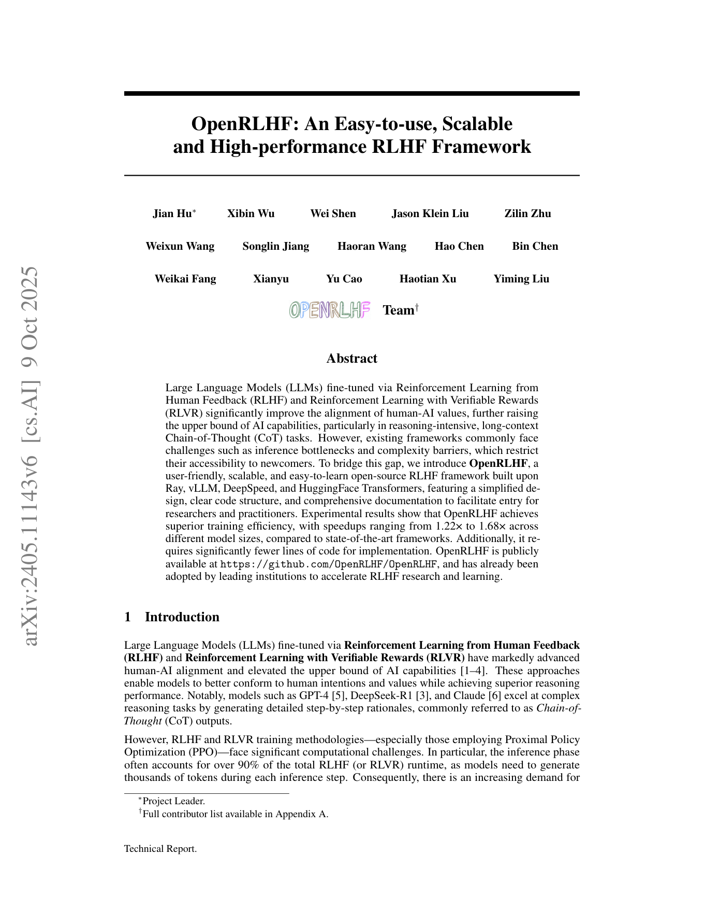

## PDF 第 2 页

efficient and scalable frameworks that reduce inference overhead and simplify the training workflows
for distributed RLHF and RLVR.

Existing RLHF and RLVR systems, such as DeepSpeed-Chat [7], TRL [8], and ColossalChat [9],
have made notable progress in distributed computation and memory efficiency. Conversely, industrialgrade solutions like Nemo-aligner [10] and ChatLearn [11] offer advanced optimizations at the
modeling and framework levels. While verl [12], a framework proposed after our initial development,
also provides sophisticated optimizations (e.g., its 3D-Hybrid engine), these industrial solutions
generally feature tightly coupled and specialized designs that introduce considerable complexity,
steep learning curves, and accessibility barriers for newcomers and academic researchers. Yet, their
tightly coupled and specialized designs introduce significant complexity, steep learning curves, and
accessibility barriers for newcomers and academic researchers. Therefore, there remains a pressing
need for an RLHF and RLVR framework that balances high performance, scalability, and ease of
use—one that is straightforward enough for researchers new to the field, yet adaptable to diverse and
evolving workloads.

In this paper, we present **OpenRLHF**, a simple, high-performance, fully open-source framework
supporting both RLHF and RLVR, built upon Ray [13], vLLM, DeepSpeed [7], and HuggingFace
Transformers [14]. OpenRLHF offers these key contributions:

    - **First Ray-Based Open-Source RLHF and RLVR Architecture** : Leveraging Ray’s flexible distributed computing primitives, OpenRLHF enables streamlined orchestration and
resource management for RLHF and RLVR workflows, significantly simplifying distributed
operations and deployments while enhancing usability and flexibility.

    - **3D** **Parallelism** **with** **DeepSpeed-ZeRO** **and** **Ring** **Attention** : To enable seamless and
efficient scalability for large models, OpenRLHF integrates automatic tensor parallelism
(AutoTP) provided by DeepSpeed-ZeRO and implements sequence parallelism via ring attention. This streamlined integration realizes an efficient "3D" parallel strategy—combining
tensor, data, and sequence parallelism—without requiring complex engineering or extensive
user configuration.

    - **First Accelerated CoT Inference with vLLM** : Addressing the critical inference bottleneck
in long-chain-of-thought RLHF and RLVR workloads, OpenRLHF incorporates the state-ofthe-art vLLM inference engine. This integration accelerates inference through token-level
parallel decoding, advanced caching, and optimized dynamic batching, thereby substantially
improving overall training runtime efficiency.

    - **Asynchronous Dataflow and Remote Engine Interactions** : OpenRLHF supports asynchronous dataflow and remote engine communication to maximize system throughput and
resource utilization during distributed RLHF training. In this architecture, rollout engines,
actor engines, and remote engines operate independently and communicate via message
passing, enabling immediate processing as soon as data becomes available. This design reduces idle time, improves pipeline efficiency, and enhances scalability and flexibility across
large distributed GPU clusters. By leveraging asynchronous remote engine interactions,
OpenRLHF can be easily extended to support scalable **agent RL** training.

Together, these innovations position OpenRLHF as an accessible yet robust framework suitable
for both efficient experimentation in academic environments and practical deployment scenarios.
Already adopted by leading institutions and companies—including CMU, MIT, Microsoft, and
HKUST—OpenRLHF demonstrates broad applicability and impact across the research community
(see Appendix B for details on the framework’s broad impact and adoption). We publicly release
OpenRLHF to foster openness, accelerate research, and promote innovation within the RLHF and
RLVR ecosystem.

### 2 Related Work

**RLHF** **and** **RLVR** Reinforcement Learning from Human Feedback (RLHF) has emerged as a
pivotal paradigm for aligning large language models with human preferences [1, 2]. The foundational
RLHF framework trains a reward model using human preference data and optimizes the language
model with reinforcement learning algorithms, such as PPO [15]. This approach has been successfully
deployed in prominent models, including InstructGPT [16], ChatGPT, and GPT-4 [5]. Building

2

本页完整原图（核对图表与公式）

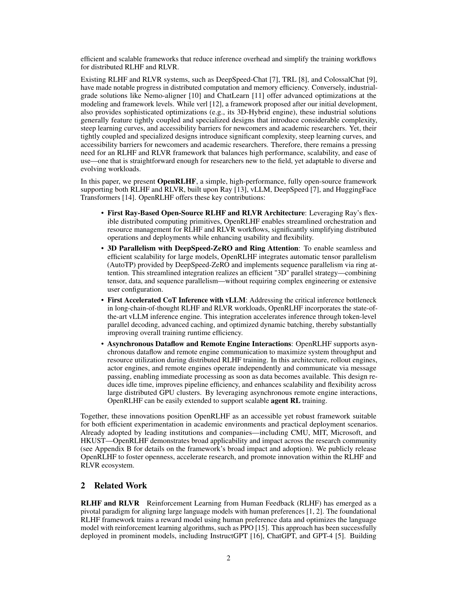

## PDF 第 3 页

upon RLHF, Reinforcement Learning with Verifiable Rewards (RLVR) leverages automatically
verifiable signals from mathematical verification, code execution, or other automated evaluation
mechanisms [3, 4, 17]. While PPO remains dominant due to its stability [15, 18], alternative
approaches, such as Direct Preference Optimization (DPO) [19], have gained attention for their
computational efficiency. However, both RLHF and RLVR methods require substantial computational
resources and sophisticated distributed training strategies. The computational challenges have
motivated various optimization techniques, including efficient inference engines [20], memoryefficient training strategies [21], and distributed orchestration frameworks [7]. Nevertheless, existing
solutions often sacrifice either performance for simplicity or accessibility for optimization, creating a
gap that OpenRLHF aims to address.

**RLHF (RLVR) Frameworks** The computational complexity of RLHF and RLVR training has
driven the development of specialized frameworks for these tasks. General-purpose RL frameworks [13, 22] designed for small-scale networks often fail to address LLM-specific challenges and
typically employ multi-controller architectures with complex inter-process communication, resulting in steep learning curves. RLHF-specific frameworks face significant performance-accessibility
trade-offs. Open-source solutions like TRL [8], DeepSpeed-Chat [7], and ColossalChat [9] provide
accessible implementations but often lack sophisticated orchestration capabilities and struggle with
inference optimization. Industrial frameworks like Nemo-aligner [10], ChatLearn [11], and verl [12]
offer advanced optimizations including 3D parallelism and memory management. However, they
feature tightly coupled architectures requiring substantial engineering expertise and extensive infrastructure setup, creating accessibility barriers for academic researchers. These systems employ
static resource allocation paradigms, resulting in suboptimal utilization and limited adaptability. Most
frameworks inadequately address both inference bottlenecks and usability challenges simultaneously,
forcing users to choose between high performance and ease of use.

### 3 Design of OpenRLHF

#### 3.1 Overview: Ray-based RLHF architecture

Figure 1: Overall architecture of OpenRLHF. The system assigns GPUs to two primary roles:
rollout engines dedicated to response generation and actor engines responsible for computing logprobabilities and model training. OpenRLHF leverages Ray for distributed scheduling, integrates
vLLM to achieve efficient response rollout with low GPU memory usage, and employs DeepSpeed
ZeRO for 3D parallelism (including tensor, data, and sequence parallelism) to enable efficient training.
The underlying models are instantiated with flexible Transformer architectures, making the system
easy to extend and adapt for diverse scenarios.

OpenRLHF is the first open-source, Ray-based RLHF architecture that assigns a batch of GPUs to
distinct roles and manages both data flow and workflow among these roles using Ray’s scheduling
capabilities. As illustrated in Figure 1, it defines two primary roles: the **rollout engine**, responsible
for response generation to given prompts, and the **ZeRO engine**, which computes _logprobs_, _reference_
_policy logprobs_, and handles model training (For a detailed design of the PPO workflow, refer to
Appendix C, and for in-depth implementation tips, consult Blog [23].)

3

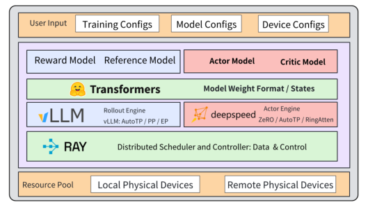

本页完整原图（核对图表与公式）

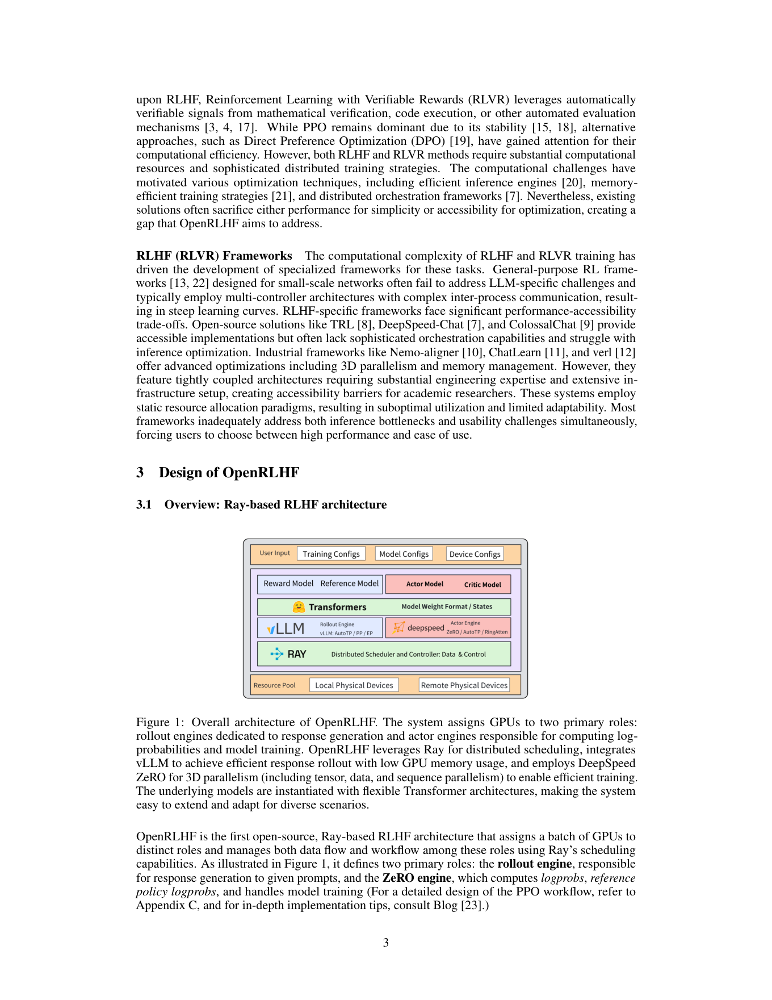

## PDF 第 4 页

Additionally, we leverage **vLLM** as the rollout engine, enabling efficient response generation with
minimal GPU memory usage. For model training, we adopt DeepSpeed, which implements 3D
parallelism, including automatic tensor parallelism, ZeRO/data parallelism, and sequence parallelism,
to train both the actor and value models efficiently.

**Core reason for ease of use** The remarkable usability of our framework stems from three core
design principles: simplified model slicing, seamless integration, and flexible scheduling, which
collectively streamline the workflow and significantly reduce the implementation burden during
training and deployment. The exchange of model weights between the rollout engine and the training
engine is enabled by a flexible slicing and partitioning pipeline. Hugging Face Transformer [24]
models are instantiated and trained using **DeepSpeed ZeRO**, **AutoTP**, and **Ring-Attention** [25]
model parallelism. These model slices are then efficiently transferred to vLLM through AutoTP
and AutoPP, which dynamically partition the models into sub-modules. The **Ray-based scheduling**
**mechanism** enables seamless switching between different model parallelism modes, such as hybrid
engine and asynchronous training. This streamlined workflow significantly reduces complexity,
making the system highly user-friendly and easy to extend. Compared with architectures such as
DeepSpeed-Chat, Transformer Reinforcement Learning (TRL), or other mainstream frameworks,
OpenRLHF supports asynchronous dataflow and remote engine interactions, significantly improving
the overall efficiency of the training process and the agent workflow.

#### 3.2 Distributed and Efficient System Design

**3D Parallelism with DeepSpeed ZeRO and Ring Attention** To enable seamless and efficient
scalability for large models, OpenRLHF integrates the latest automatic tensor parallelism (AutoTP)
feature from DeepSpeed ZeRO. In many industrial-grade RLHF architectures, users previously
needed to manually specify an injection policy for each transformer model, identifying the linear
layers and attention outputs that required communication between data-parallel ranks. In contrast,
OpenRLHF leverages DeepSpeed ZeRO’s new capability to support automatic tensor parallelism for
HuggingFace models by default. When kernel injection is not enabled and an injection policy is not
provided, DeepSpeed automatically determines and applies the necessary policy at runtime. It can
dramatically simplify the user experience and extend robust tensor parallelism support to a broader
range of models, removing the need for complex engineering or manual configuration.

In addition, OpenRLHF implements sequence parallelism through ring attention. Ring attention
employs a ring-based communication topology, efficiently distributing attention computation for long
sequences across multiple GPUs while minimizing both memory usage and communication overhead.
It is especially critical for modern RLHF and RLVR workloads involving long CoT reasoning, where
conventional attention computation can become a major scalability bottleneck. By combining AutoTP,
data parallelism, and ring attention-based sequence parallelism, OpenRLHF empowers large-scale,
efficient, and highly usable RLHF model training on flexible GPU clusters.

**Accelerated** **CoT** **Inference** **with** **vLLM** As LLMs advance in reasoning, RLHF and RLVR
pipelines increasingly face inference bottlenecks, particularly with long CoT outputs. For models
like OpenAI-o1 and DeepSeek-R1, CoT generation can dominate training time, making efficient
long-form inference crucial for scalability. To address this challenge, OpenRLHF integrates the
vLLM inference framework, which is specifically designed for high-throughput and memory-efficient
LLM serving. vLLM provides a streamlined interface for generating RLHF samples and supporting
frequent model weight updates.

The core innovation in vLLM is efficient management of attention key and value memory with
**PagedAttention** [20]. The technique significantly reduces memory waste to less than 4%, enabling
the batching of more sequences and enhancing GPU utilization and throughput. PagedAttention
also supports efficient memory sharing for advanced sampling methods, such as parallel sampling
and beam search, reducing memory usage by up to 55% and further boosting inference efficiency.
Besides PagedAttention, vLLM has several other advantages, including continuous batching of
incoming requests, fast model execution with CUDA Graph, and CUDA kernels optimized with
FlashAttention and FlashInference, which enable rapid and memory-efficient attention computations.
It also features speculative decoding for faster inference and chunked prefill to reduce latency on
long sequences. Collectively, these enhancements make vLLM highly effective for large-scale,

4

本页完整原图（核对图表与公式）

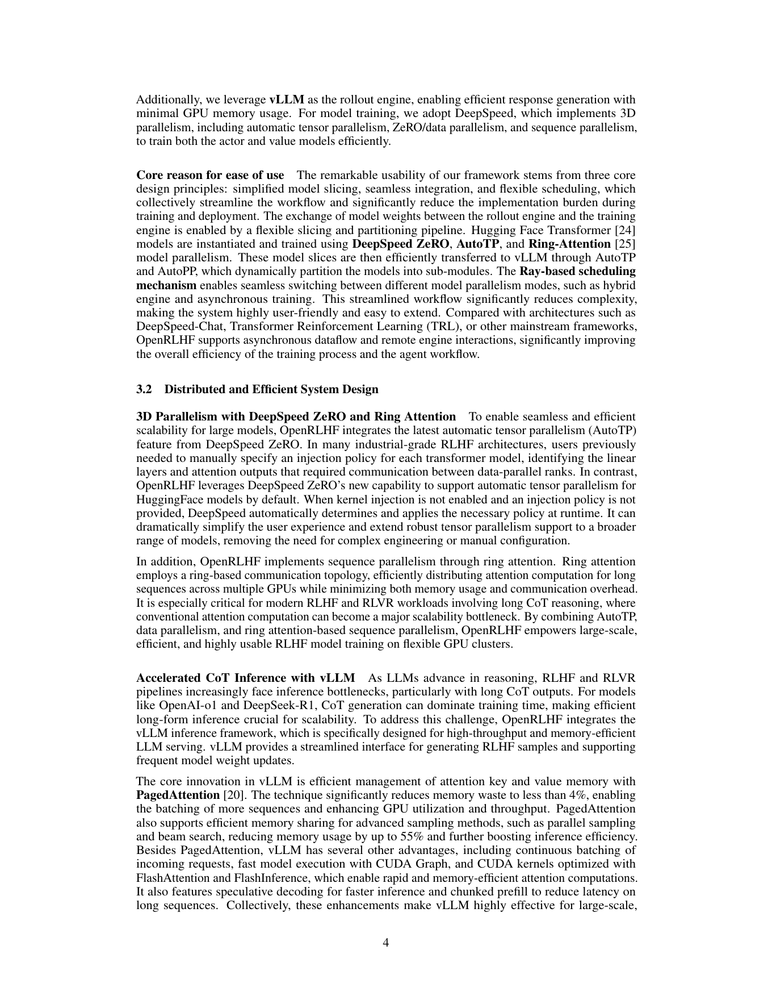

## PDF 第 5 页

long-sequence inference, especially suitable for RLHF and RLVR pipelines, where efficiency and
scalability are crucial.

**Asynchronous Dataflow and Remote Engine Interactions** OpenRLHF supports asynchronous
dataflow and remote engine communication to maximize system throughput and resource utilization
during distributed RLHF training. In this architecture, rollout engines, actor engines, and remote
engines operate independently and communicate via message passing, enabling immediate processing
as soon as data becomes available. Fully asynchronous execution is critical in the CoT era, where
inference involves generating multi-step reasoning that can vary significantly in length and computational cost. In synchronous frameworks, the slowest CoT generation can bottleneck the whole
pipeline and waste resources. In contrast, OpenRLHF’s asynchronous design allows each engine to
operate at its own pace, ensuring hardware is utilized even for long or variable CoT tasks. It not only
accelerates training and evaluation but also enables efficient scaling and supports dynamic agent RL
workflows. Leveraging asynchronous remote engine interactions, OpenRLHF is readily extensible
for scalable **agent RL** training in modern, CoT-centric environments.

**Model Size**

**1K** **2K** **4K** **8K**
**Ours** **verl** **Ours** **verl** **Ours** **verl** **Ours** **verl** **Avg.** **Speedup**
**(sec)** **(sec)** **(sec)** **(sec)** **(sec)** **(sec)** **(sec)** **(sec)**

1.5B 14.9 16.2 26.5 33.1 61.6 65.5 113.0 134.8 1.22 _×_
7B 16.0 17.3 30.3 47.3 90.3 101.3 226.4 232.4 1.42 _×_
14B 25.5 28.5 51.0 74.3 136.3 202.8 328.6 511.1 1.68 _×_

Table 1: The average training time (seconds) per step for different model sizes and context window
lengths compared between OpenRLHF and verl. The speedup is calculated as the geometric mean of
verl time / OpenRLHF time across all sequence lengths.

### 4 Experiments

#### 4.1 Performance Comparison

**Long CoT Experiment Setup** To ensure the applicability of the compared methods in current
RLHF workflows, we conduct our experimental evaluation under a long-chain-of-thought (CoT)
generation scenario. Given computational resource constraints, we focus our comparison on the long
CoT RLVR setting, benchmarking OpenRLHF against verl, currently the state-of-the-art framework
for RLHF training. We evaluate the training efficiency of OpenRLHF (v0.8.5) and verl (v0.4.0)
by measuring the average per-step training time (in seconds) across various model sizes (1.5B, 7B,
and 14B parameters) and maximum generation lengths (1K, 2K, 4K, and 8K tokens). To ensure
the base models can produce sufficiently long contextual outputs for stress testing, we adopt the
DeepSeek open-source distilled Qwen series. All models are fine-tuned using the Decoupled Clip
and Dynamic Sampling Policy Optimization (DAPO) algorithm [26] under identical hyperparameter
settings. Experiments are conducted on 8 NVIDIA H200 140GB GPUs using PyTorch 2.7 [27] and
the ZeRO Stage 3 optimizer or Fully Sharded Data Parallel (FSDP) [28]. For each configuration,
the local batch size is set to 1 to mitigate the risk of out-of-memory errors, with a maximum input
context length of 1024 tokens. Following the discussion in [29], we use _k_ 2 as the loss function. The
reported values represent the average training time per step, excluding the first 10 steps.

**Long** **CoT** **Performance** **Analysis** The experimental results in Table 1 show that OpenRLHF
consistently achieves superior training speed compared to verl across all configurations. OpenRLHF
delivers speedups ranging from 1.22× for the 1.5B model to 1.68× for the 14B model, with performance advantages becoming more pronounced as model size and context length increase. For
instance, in the 14B-8K setting, OpenRLHF achieves a 1.56× speedup (328.6 seconds vs. 511.1
seconds), while the 7B-2K configuration shows a 1.56× speedup (30.3 seconds vs. 47.3 seconds).
These speedup improvements can be attributed to OpenRLHF’s algorithmic design, including the
DAPO optimization strategy, which effectively mitigates memory overhead and computational bottlenecks under long-context scenarios. The consistent speedup across different scales underscores
OpenRLHF’s efficiency advantages in contemporary RLHF pipelines.

5

本页完整原图（核对图表与公式）

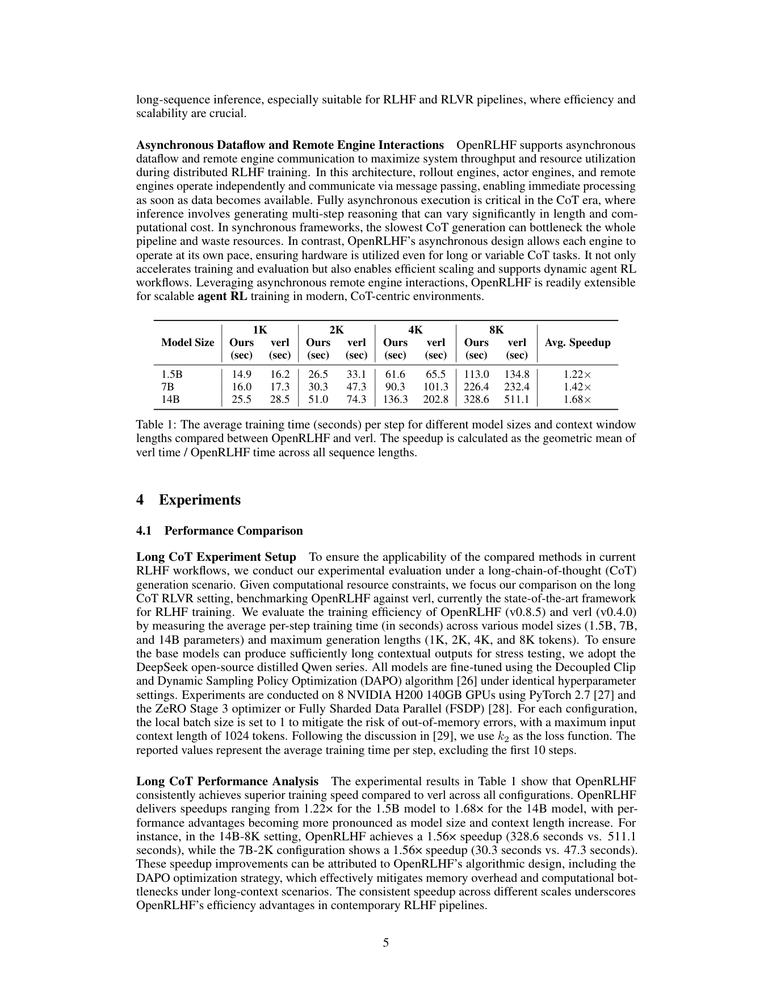

## PDF 第 6 页

30000

25000

20000

15000

10000

5000

0

|32325 Usability Comparison|Col2|Col3|Col4|Col5|Col6|Col7|
|---|---|---|---|---|---|---|
|~~32325~~ |~~32325~~ |~~32325~~ |~~32325~~ |~~32325~~ |~~32325~~ |~~32325~~ |
|~~32325~~ |~~32325~~ |~~32325~~ |||||
||||||||
||||||||
|||||~~19071~~|~~19071~~|~~19071~~|
|||||~~19071~~|||
||||||||
|~~8523~~|~~8523~~|~~8523~~|||||
|~~8523~~|||||||
|||||||2378|

OpenRLHF verl TRL DeepSpeed-Chat

Figure 2: Core code complexity comparison across RLHF frameworks (lines of code). Lower values
indicate simpler implementation and better maintainability.

**General RLVR Experiment** To ensure a fair and controlled evaluation of training efficiency in
reinforcement learning fine-tuning, we compare OpenRLHF with the optimized TRL framework
on the GSM8K dataset [17] using the GRPO algorithm over a single training epoch. Both systems
are configured with identical hyperparameters and run on the same hardware setup to isolate the
effect of framework design on performance. The GRPO algorithm is selected due to its relevance in
reward-based fine-tuning scenarios, and GSM8K serves as a representative benchmark for arithmetic
reasoning tasks. In terms of training efficiency, OpenRLHF demonstrates a substantial advantage,
completing one epoch in 1,657 seconds, compared to the 5,189 seconds required by TRL, representing
approximately a 3.1× speedup. The result highlights the superior efficiency and maintainability of
OpenRLHF’s implementation, which benefits from a streamlined design and targeted system-level
optimizations.

**General RLHF Experiment** To evaluate the training efficiency of modern RLHF frameworks, we
compare OpenRLHF with the optimized DeepSpeed-Chat (DSChat) implementation. The experiment
involves fine-tuning 1,024 prompts using the PPO algorithm for one epoch under identical hardware
and hyperparameter configurations. This setup ensures that observed differences in performance
are attributable solely to differences in system design and optimization strategies between the two
frameworks. In terms of training time, OpenRLHF completes the task in 236.8 seconds, significantly
outperforming DSChat, which requires 855.09 seconds, resulting in a 3.6× speedup. This performance
gain is primarily driven by two system-level innovations in OpenRLHF: the use of vLLM for
accelerated token generation and Ray for efficient distributed execution. Collectively, these design
choices result in a more scalable and excellent RLHF framework.

#### 4.2 Usability Comparison

As illustrated in Figure 2, OpenRLHF achieves a compelling balance between implementation
conciseness and training performance. Despite being the second most concise framework with
only 8,523 lines of code—significantly fewer than TRL (19,071) and verl (32,325)—OpenRLHF
demonstrates a clear performance advantage across standard RLHF benchmarks. This streamlined
codebase not only facilitates easier comprehension and modification for developers but also reduces
the engineering overhead associated with integration into custom pipelines. In addition to its
lightweight design, OpenRLHF offers comprehensive support for various reinforcement learning finetuning paradigms, including Supervised Fine-Tuning (SFT), Direct Preference Optimization (DPO)

[19], Reward Model (RM), and Process Reward Model (PRM) [30]. This broad functionality,
combined with its modular and well-documented architecture, significantly lowers the barrier to entry
for both research and production use. Overall, OpenRLHF’s design exemplifies high usability by
combining minimal code complexity with extensive functionality and competitive performance.

6

本页完整原图（核对图表与公式）

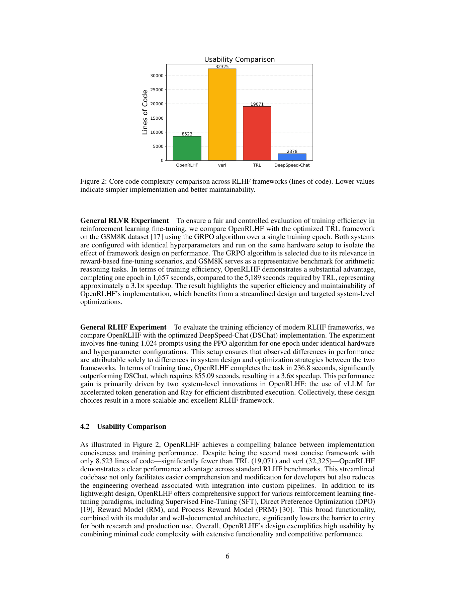

## PDF 第 7 页

### 5 Limitations

While OpenRLHF demonstrates significant advantages in balancing performance and accessibility,
several limitations should be acknowledged. Despite our optimization efforts, OpenRLHF may not
match the peak performance of highly specialized industrial frameworks that benefit from dedicated
engineering teams and extensive resources. As a community-driven, open-source project without
dedicated economic support, OpenRLHF faces resource constraints in rapidly integrating cutting-edge
features, which may result in delays compared to well-funded commercial frameworks. Currently, the
framework primarily focuses on language models and does not support Vision-Language Models or
other multimodal architectures, thereby limiting its applicability to multimodal AI alignment research.
Additionally, OpenRLHF’s modular design introduces dependencies on external systems such as Ray,
vLLM, and DeepSpeed, where updates in these upstream systems may require maintenance work or
introduce compatibility issues. Despite these limitations, we believe OpenRLHF’s contributions to
accessibility and democratization of RLHF research provide significant value to the community.

### 6 Conclusion

We presented OpenRLHF, a simple yet high-performance open-source framework that bridges
the gap between performance and usability in RLHF and RLVR training. By integrating Ray’s
distributed computing, vLLM’s inference optimization, DeepSpeed ZeRO’s memory efficiency,
and ring attention’s sequence parallelism, OpenRLHF delivers four key innovations: a Ray-based
architecture for streamlined orchestration, 3D parallelism for efficient scaling, accelerated CoT
inference that addresses the critical bottleneck, and asynchronous dataflow for maximum throughput.
The framework’s broad adoption across leading institutions and companies—from academic courses
at CMU to production deployments at major tech companies—validates its real-world effectiveness.
OpenRLHF’s influence on subsequent frameworks and its role in democratizing RLHF research
demonstrate its significant contribution to the field. By open-sourcing this framework, we aim to
accelerate research progress and enable broader participation in the development of aligned AI.

7

本页完整原图（核对图表与公式）

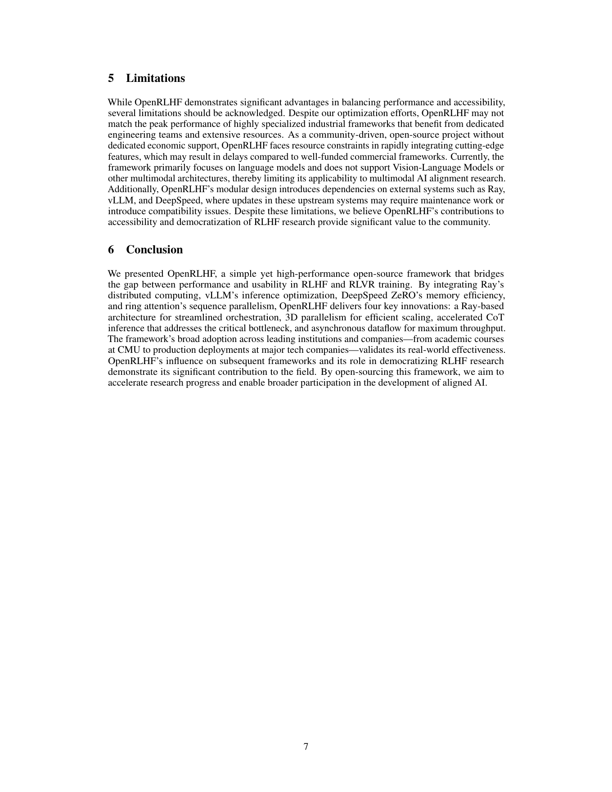

## PDF 第 8 页

### References

[1] Paul F Christiano, Jan Leike, Tom Brown, Miljan Martic, Shane Legg, and Dario Amodei. Deep

reinforcement learning from human preferences. _Advances in neural information processing_
_systems_, 30, 2017.

[2] Nisan Stiennon, Long Ouyang, Jeffrey Wu, Daniel Ziegler, Ryan Lowe, Chelsea Voss, Alec

Radford, Dario Amodei, and Paul F Christiano. Learning to summarize with human feedback.
_Advances in Neural Information Processing Systems_, 33:3008–3021, 2020.

[3] Daya Guo, Dejian Yang, Haowei Zhang, Junxiao Song, Ruoyu Zhang, Runxin Xu, Qihao Zhu,

Shirong Ma, Peiyi Wang, Xiao Bi, et al. Deepseek-r1: Incentivizing reasoning capability in
llms via reinforcement learning. _arXiv preprint arXiv:2501.12948_, 2025.

[4] Wei Shen, Guanlin Liu, Zheng Wu, Ruofei Zhu, Qingping Yang, Chao Xin, Yu Yue, and Lin

Yan. Exploring data scaling trends and effects in reinforcement learning from human feedback.

_arXiv preprint arXiv:2503.22230_, 2025.

[5] Josh Achiam, Steven Adler, Sandhini Agarwal, Lama Ahmad, Ilge Akkaya, Florencia Leoni

Aleman, Diogo Almeida, Janko Altenschmidt, Sam Altman, Shyamal Anadkat, et al. Gpt-4
technical report. _arXiv preprint arXiv:2303.08774_, 2023.

[6] Amanda Askell, Yuntao Bai, Anna Chen, Dawn Drain, Deep Ganguli, Tom Henighan, Andy

Jones, Nicholas Joseph, Ben Mann, Nova DasSarma, et al. A general language assistant as a
laboratory for alignment. _arXiv preprint arXiv:2112.00861_, 2021.

[7] Zhewei Yao, Reza Yazdani Aminabadi, Olatunji Ruwase, Samyam Rajbhandari, Xiaoxia

Wu, Ammar Ahmad Awan, Jeff Rasley, Minjia Zhang, Conglong Li, Connor Holmes, et al.
Deepspeed-chat: Easy, fast and affordable rlhf training of chatgpt-like models at all scales.
_arXiv preprint arXiv:2308.01320_, 2023.

[8] Leandro von Werra, Younes Belkada, Lewis Tunstall, Edward Beeching, Tristan Thrush, Nathan

Lambert, and Shengyi Huang. Trl: Transformer reinforcement learning. `[https://github.](https://github.com/huggingface/trl)`
`[com/huggingface/trl](https://github.com/huggingface/trl)`, 2020.

[9] Shenggui Li, Hongxin Liu, Zhengda Bian, Jiarui Fang, Haichen Huang, Yuliang Liu, Boxiang

Wang, and Yang You. Colossal-ai: A unified deep learning system for large-scale parallel
training. In _Proceedings of the 52nd International Conference on Parallel Processing_, pages
766–775, 2023.

[10] Gerald Shen, Zhilin Wang, Olivier Delalleau, Jiaqi Zeng, Yi Dong, Daniel Egert, Shengyang

Sun, Jimmy Zhang, Sahil Jain, Ali Taghibakhshi, Markel Sanz Ausin, Ashwath Aithal, and
Oleksii Kuchaiev. Nemo-aligner: Scalable toolkit for efficient model alignment, 2024.

[11] alibaba. chatlearn. `[https://github.com/alibaba/ChatLearn](https://github.com/alibaba/ChatLearn)`, 2017.

[12] Guangming Sheng, Chi Zhang, Zilingfeng Ye, Xibin Wu, Wang Zhang, Ru Zhang, Yanghua

Peng, Haibin Lin, and Chuan Wu. Hybridflow: A flexible and efficient rlhf framework. _arXiv_
_preprint arXiv:_ _2409.19256_, 2024.

[13] Eric Liang, Richard Liaw, Robert Nishihara, Philipp Moritz, Roy Fox, Ken Goldberg, Joseph

Gonzalez, Michael Jordan, and Ion Stoica. Rllib: Abstractions for distributed reinforcement
learning. In _International conference on machine learning_, pages 3053–3062. PMLR, 2018.

[14] Thomas Wolf, Lysandre Debut, Victor Sanh, Julien Chaumond, Clement Delangue, Anthony

Moi, Pierric Cistac, Tim Rault, Rémi Louf, Morgan Funtowicz, Joe Davison, Sam Shleifer,
Patrick von Platen, Clara Ma, Yacine Jernite, Julien Plu, Canwen Xu, Teven Le Scao, Sylvain
Gugger, Mariama Drame, Quentin Lhoest, and Alexander M. Rush. Transformers: State-of-theart natural language processing. In _Proceedings of the 2020 Conference on Empirical Methods_
_in Natural Language Processing:_ _System Demonstrations_, pages 38–45, Online, October 2020.
Association for Computational Linguistics. URL `[https://www.aclweb.org/anthology/](https://www.aclweb.org/anthology/2020.emnlp-demos.6)`
`[2020.emnlp-demos.6](https://www.aclweb.org/anthology/2020.emnlp-demos.6)` .

[15] John Schulman, Filip Wolski, Prafulla Dhariwal, Alec Radford, and Oleg Klimov. Proximal

policy optimization algorithms. _arXiv preprint arXiv:1707.06347_, 2017.

[16] Long Ouyang, Jeffrey Wu, Xu Jiang, Diogo Almeida, Carroll Wainwright, Pamela Mishkin,

Chong Zhang, Sandhini Agarwal, Katarina Slama, Alex Ray, et al. Training language models to
follow instructions with human feedback. _Advances in neural information processing systems_,
35:27730–27744, 2022.

8

本页完整原图（核对图表与公式）

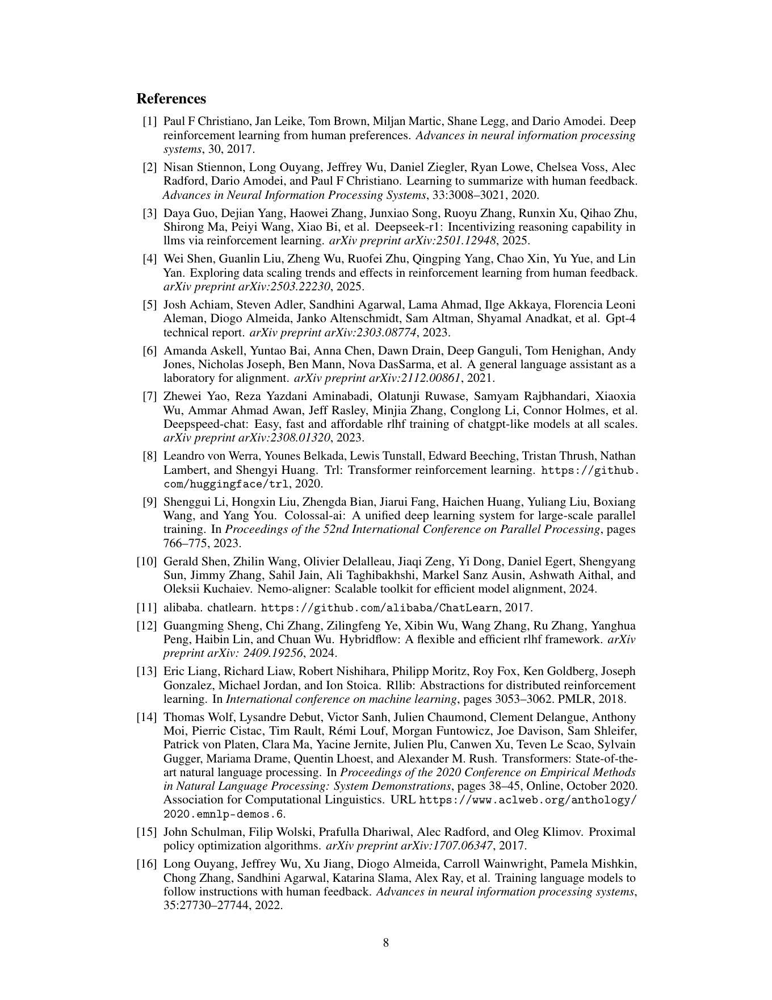

## PDF 第 9 页

[17] Karl Cobbe, Vineet Kosaraju, Mohammad Bavarian, Mark Chen, Heewoo Jun, Lukasz Kaiser,

Matthias Plappert, Jerry Tworek, Jacob Hilton, Reiichiro Nakano, et al. Training verifiers to
solve math word problems. _arXiv preprint arXiv:2110.14168_, 2021.

[18] Daniel M Ziegler, Nisan Stiennon, Jeffrey Wu, Tom B Brown, Alec Radford, Dario Amodei,

Paul Christiano, and Geoffrey Irving. Fine-tuning language models from human preferences.
_arXiv preprint arXiv:1909.08593_, 2019.

[19] Rafael Rafailov, Archit Sharma, Eric Mitchell, Christopher D Manning, Stefano Ermon, and

Chelsea Finn. Direct preference optimization: Your language model is secretly a reward model.
_Advances in Neural Information Processing Systems_, 36:53728–53741, 2023.

[20] Woosuk Kwon, Zhuohan Li, Siyuan Zhuang, Ying Sheng, Lianmin Zheng, Cody Hao Yu,

Joseph E. Gonzalez, Hao Zhang, and Ion Stoica. Efficient memory management for large language model serving with pagedattention. In _Proceedings of the ACM SIGOPS 29th Symposium_
_on Operating Systems Principles_, 2023.

[21] Samyam Rajbhandari, Jeff Rasley, Olatunji Ruwase, and Yuxiong He. Zero: Memory optimiza
tions toward training trillion parameter models. In _SC20:_ _International Conference for High_
_Performance Computing, Networking, Storage and Analysis_, pages 1–16. IEEE, 2020.

[22] Prafulla Dhariwal, Christopher Hesse, Oleg Klimov, Alex Nichol, Matthias Plappert, Alec

Radford, John Schulman, Szymon Sidor, Yuhuai Wu, and Peter Zhokhov. Openai baselines.
`[https://github.com/openai/baselines](https://github.com/openai/baselines)`, 2017.

[23] Wei Shen, Jian Hu, Pengyu Zhao, Xiaonan He, and Lichang Chen. Advanced tricks for training large language models with proximal policy optimization. `[https://swtheking.notion.site/eb7b2d1891f44b3a84e7396d19d39e6f?v=](https://swtheking.notion.site/eb7b2d1891f44b3a84e7396d19d39e6f?v=01bcb084210149488d730064cbabc99f&pvs=74)`
`[01bcb084210149488d730064cbabc99f&pvs=74](https://swtheking.notion.site/eb7b2d1891f44b3a84e7396d19d39e6f?v=01bcb084210149488d730064cbabc99f&pvs=74)`, 2024. Notion Blog.

[24] Shashank Mohan Jain. Hugging face. In _Introduction to transformers for NLP: With the hugging_

_face library and models to solve problems_, pages 51–67. Springer, 2022.

[25] Hao Liu, Matei Zaharia, and Pieter Abbeel. Ring attention with blockwise transformers for

near-infinite context. _arXiv preprint arXiv:2310.01889_, 2023.

[26] Qiying Yu, Zheng Zhang, Ruofei Zhu, Yufeng Yuan, Xiaochen Zuo, Yu Yue, Weinan Dai,

Tiantian Fan, Gaohong Liu, Lingjun Liu, et al. Dapo: An open-source llm reinforcement
learning system at scale. _arXiv preprint arXiv:2503.14476_, 2025.

[27] Sagar Imambi, Kolla Bhanu Prakash, and GR Kanagachidambaresan. Pytorch. _Programming_

_with TensorFlow:_ _solution for edge computing applications_, pages 87–104, 2021.

[28] Yanli Zhao, Andrew Gu, Rohan Varma, Liang Luo, Chien-Chin Huang, Min Xu, Less Wright,

Hamid Shojanazeri, Myle Ott, Sam Shleifer, et al. Pytorch fsdp: experiences on scaling fully
sharded data parallel. _arXiv preprint arXiv:2304.11277_, 2023.

[29] Kezhao Liu, Jason Klein Liu, Mingtao Chen, and Yiming Liu. Rethinking kl regularization in

rlhf: From value estimation to gradient optimization. _arXiv preprint arXiv:2510.01555_, 2025.

[30] Hunter Lightman, Vineet Kosaraju, Yuri Burda, Harrison Edwards, Bowen Baker, Teddy Lee,

Jan Leike, John Schulman, Ilya Sutskever, and Karl Cobbe. Let’s verify step by step. In _The_
_Twelfth International Conference on Learning Representations_, 2023.

9

本页完整原图（核对图表与公式）

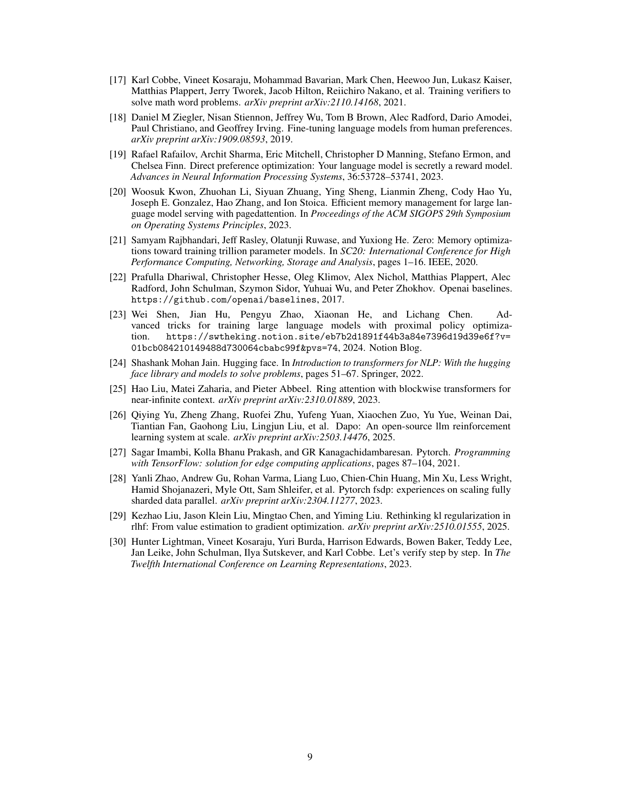

## PDF 第 10 页

### A Full Contributors

A more complete list can be found in the OpenRLHF commit and release history.

**Ray Integration** Jian Hu, Xibin Wu, Songlin Jiang

**vLLM Integration** Jian Hu, Xibin Wu, Songlin Jiang, Kaichao You (vLLM Team)

**Ring Attention** Zilin Zhu (Zhipu), Zhibo Zhou (Vivo), gzpan(GitHub User), Jian Hu

**Supervised Learning:** Haoran Wang and Xianyu

**DeepSpeed Integration** Jian Hu, Xibin Wu, Songlin Jiang, Bin Chen, Yiming Liu

**Asynchronous Agentic RL** Haotian Xu and Jian Hu

**Single Controller Architecture** Jian Hu

**PPO Implementation** Jian Hu

**GRPO Implementation** Jason Klein Liu

**KL Control Mechanism** Yiming Liu and Jason Klein Liu

**RLVR Experiment Design** Jason Klein Liu

**RLHF Experiment Design** Jian Hu

**Dynamic Sampling** Jian Hu

**Dynamic Batching** Hao Chen

**Documentation** Jian Hu

**Testing and Bug Reports** Weikai Fang, Wei Shen, Weixun Wang

**Paper Writing and Presentations** Wei Shen, Jason Klein Liu, Weixun Wang, Yu Cao, Jian Hu

### B Broad Impact and Adoption

OpenRLHF has achieved significant adoption and impact across both academic and industrial
communities since its release. The framework’s balance of high performance and accessibility
has made it a preferred choice for diverse applications ranging from research experimentation to
production deployment.

OpenRLHF has been formally integrated into academic curricula, notably being adopted by the
CMU Advanced Natural Language Processing course in Spring 2025 as a core teaching framework.
This integration demonstrates the framework’s educational value and accessibility for students
new to RLHF. The framework has also garnered recognition from major technology communities,
including an invitation to present at the PyTorch Expert Exchange 2025, which highlights its technical
contributions to the broader deep learning ecosystem.

The framework has been widely adopted by leading technology companies and research institutions,
including Google, ByteDance, Baidu, NVIDIA, Tencent, China Telecom, Vivo, NexusFlow, JSC,
UC Berkeley’s Starling Team, Meituan, and HKUST. This diverse adoption across major tech
companies, telecommunications providers, and academic institutions demonstrates OpenRLHF’s
versatility and robustness in handling various scales of RLHF workloads, from research prototyping
to production-scale deployments.

10

本页完整原图（核对图表与公式）

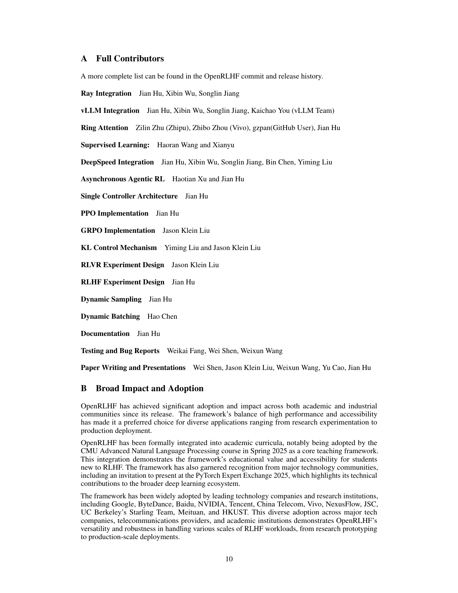

## PDF 第 11 页

OpenRLHF’s modular design and extensible architecture have enabled it to serve as a foundation
for specialized frameworks. Notable examples include LMM-R1 for multimodal reinforcement
learning, MARTI for advanced reasoning tasks, and MM-EUREKA for multimodal applications.
These derivative frameworks demonstrate OpenRLHF’s flexibility in supporting diverse research
directions and its role as a platform for innovation in the RLHF ecosystem.

The design principles and technical innovations introduced in OpenRLHF have influenced subsequent framework development in the field. Several prominent frameworks, including verl, Alibaba
ROLL, SLIME, and Open-Reasoner-Zero, have acknowledged OpenRLHF’s contributions in their
documentation and publications, citing its distributed architecture design, Ray-based orchestration
approach, and integration strategies as influential to their own development. This acknowledgment
reflects OpenRLHF’s role in advancing the state-of-the-art in RLHF system design and establishing
best practices for distributed RLHF training.

Beyond direct usage and citations, OpenRLHF has contributed to democratizing RLHF research by
lowering the barrier to entry for academic researchers and smaller organizations. The framework’s
emphasis on ease of use without sacrificing performance has enabled broader participation in RLHF
research, fostering innovation across diverse research communities that might otherwise lack the
resources for complex distributed training setups.

Figure 3: Overall PPO workflow of OpenRLHF.

### C PPO Workflow Design

This section presents OpenRLHF’s comprehensive PPO-based RLHF training workflow, which
orchestrates multiple specialized engines to efficiently handle the complex multi-stage training
process (as shown in Figure 3). The OpenRLHF PPO workflow consists of four main stages
executed iteratively: (1) **Rollout** **Generation**, where the current policy generates responses to
prompts; (2) **Reward Computation**, where responses are evaluated using a trained reward model;
(3) **Advantage Estimation**, where advantages and returns are calculated using GAE (Generalized
Advantage Estimation); and (4) **Policy Optimization**, where the policy is updated using PPO loss.
This pipeline repeats for multiple iterations until convergence is achieved.

The training begins with the **Rollout Engine** generating responses for a batch of prompts using the
current policy _πθ_ . A batch of prompts _{x_ 1 _, x_ 2 _, ..., xB}_ is sampled from the training dataset, and the
Rollout Engine, equipped with vLLM for efficient inference, generates responses _{y_ 1 _, y_ 2 _, ..., yB}_
using the current policy. During generation, the engine records action log-probabilities log _πθ_ ( _yi|xi_ )
and attention masks. The generated sequences ( _xi, yi_ ) along with their metadata are collected for

11

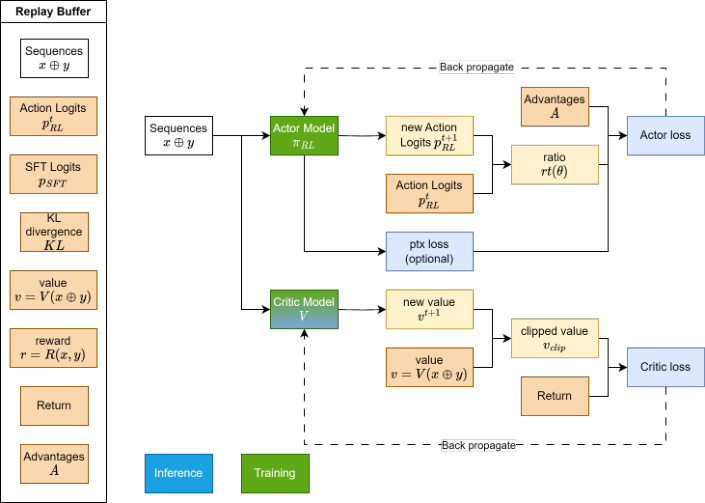

本页完整原图（核对图表与公式）

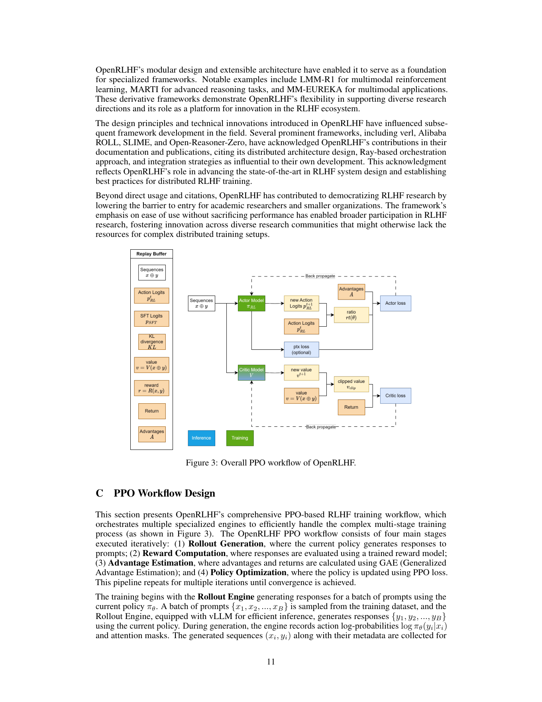

## PDF 第 12 页

subsequent processing. The Rollout Engine leverages vLLM’s optimizations, including continuous
batching, KV-cache management, and PagedAttention, to maximize throughput during this inferenceheavy stage.

Once rollouts are generated, the system computes rewards and reference policy log-probabilities.
The trained reward model _Rϕ_ evaluates each prompt-response pair to produce scalar rewards _ri_ =
_Rϕ_ ( _xi, yi_ ). Simultaneously, the frozen reference policy _π_ ref computes log-probabilities log _π_ ref( _yi|xi_ )
for KL regularization, and the critic network _Vψ_ estimates state values _Vψ_ ( _xi, yi,_ : _t_ ) for advantage
computation. These computations can be parallelized across multiple GPUs and are often batched
together for efficiency.

The system then computes advantages using Generalized Advantage Estimation (GAE). First, temporal difference residuals are calculated: _δt_ = _rt_ + _γVψ_ ( _st_ +1) _−Vψ_ ( _st_ ). Then, advantages are computed
using GAE: _At_ = � _l_ _∞_ =0 ( _γλ_ ) _lδt_ + _l_ , and discounted returns are calculated as _Rt_ = _At_ + _Vψ_ ( _st_ ). The

using GAE: _At_ = � _l_ _∞_ =0 ( _γλ_ ) _lδt_ + _l_ , and discounted returns are calculated as _Rt_ = _At_ + _Vψ_ ( _st_ ). The

advantage computation incorporates KL penalty terms to prevent the policy from deviating too far
from the reference policy: _rt_ _′_ = _rt_ _−_ _β_ KL[ _πθ||π_ ref].

The final stage updates the policy using PPO’s clipped objective function. The **ZeRO**
**Engine** computes the policy loss using the clipped surrogate objective: _L_ CLIP ( _θ_ ) =
E[min( _rt_ ( _θ_ ) _At,_ clip( _rt_ ( _θ_ ) _,_ 1 _−_ _ϵ,_ 1 + _ϵ_ ) _At_ )], where _rt_ ( _θ_ ) = _ππθθ_ old( _<u>a</u>_ ( _at|ts|st_ <u>)</u> _t_ ) is the probability ra-

tio. The critic loss is computed as _L_ _V_ ( _ψ_ ) = E[( _Vψ_ ( _st_ ) _−_ _Rt_ ) 2 ]. The critic loss is computed
as _L_ _V_ ( _ψ_ ) = E[( _Vψ_ ( _st_ ) _−_ _Rt_ ) 2 ]. The total loss combines policy and value losses: _L_ total =
_L_ CLIP + _c_ 1 _L_ _V_ + _c_ 2 _S_ [ _πθ_ ]( _st_ ), where _c_ 1 and _c_ 2 are coefficients for value loss and entropy bonus
respectively, and _S_ [ _πθ_ ]( _st_ ) is the entropy of the policy distribution to encourage exploration. The
ZeRO Engine performs gradient computation and model parameter updates using DeepSpeed ZeRO
optimizations for memory efficiency and scalability.

_t_ _′_ = _rt_ _−_ _β_ KL[ _πθ||π_ ref].

The final stage updates the policy using PPO’s clipped objective function. The **ZeRO**
**Engine** computes the policy loss using the clipped surrogate objective: _L_ CLIP ( _θ_ ) =
E[min( _rt_ ( _θ_ ) _At,_ clip( _rt_ ( _θ_ ) _,_ 1 _−_ _ϵ,_ 1 + _ϵ_ ) _At_ )], where _rt_ ( _θ_ ) = _ππθθ_ old( _<u>a</u>_ ( _at|ts|st_ <u>)</u> _t_ ) is the probability ra-

Throughout this workflow, OpenRLHF’s Ray-based architecture enables seamless coordination
between different engines while maintaining computational efficiency. The Rollout Engine and
ZeRO Engine can operate on different GPU clusters, each optimized for their respective workloads:
inference-optimized hardware for rollout generation and training-optimized hardware for policy
updates. Ray’s distributed scheduling automatically handles data transfer, synchronization, and fault
tolerance across the distributed system. This asynchronous execution model enables the system
to overlap computation stages whenever possible, thereby significantly improving overall training
throughput compared to traditional synchronous RLHF implementations.

The entire PPO training loop continues for multiple epochs, with each epoch processing multiple
batches of rollout data. Early stopping criteria based on KL divergence thresholds and performance
metrics prevent policy collapse and ensure stable training. The modular design enables the easy
integration of advanced techniques, such as advantage normalization, gradient clipping, and adaptive
KL penalty coefficients, making OpenRLHF highly customizable for various research and production
scenarios.

12

本页完整原图（核对图表与公式）

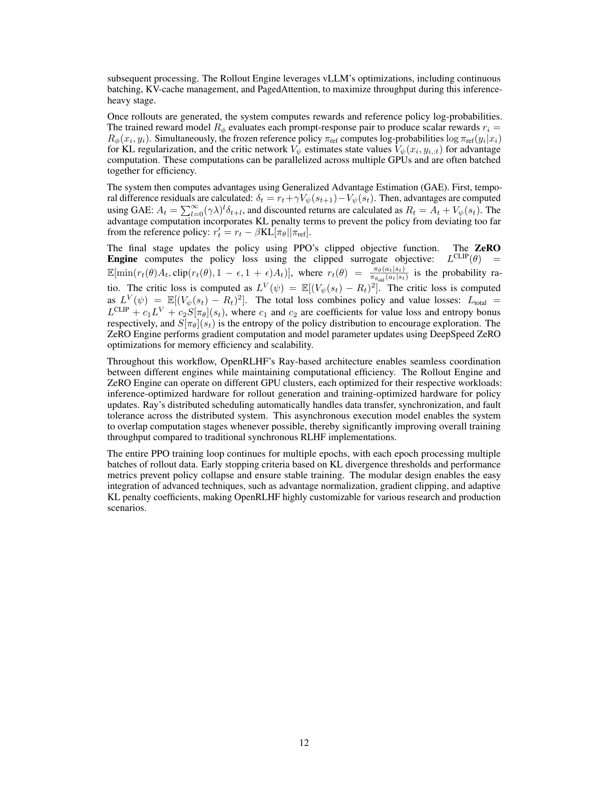

