# PRIME: Training Free Proactive Reasoning via Iterative Memory Evolution for User-Centric Agent

> 本文由 PDF 自动提取，尚未逐项人工校对。每页附完整原图，用于核对图片、图表、公式与布局。

## PDF 第 1 页

<u>Preprint.</u> <u>Work in progress.</u>

## **PRIME: Training Free Proactive Reasoning via Iterative Mem-** **ory Evolution for User-Centric Agent**

**Prince Zizhuang Wang**
Carnegie Mellon University
princewang@cmu.edu

**Shuli Jiang**
Carnegie Mellon University
shulij@alumni.cmu.edu

### Abstract

The development of autonomous tool-use agents for complex, long-horizon
tasks in collaboration with human users has become the frontier of agentic
research. During multi-turn Human-AI interactions, the dynamic and uncertain nature of user demands poses a significant challenge; agents must
not only invoke tools but also iteratively refine their understanding of user
intent through effective communication. While recent advances in reinforcement learning offer a path to more capable tool-use agents, existing approaches require expensive training costs and struggle with turn-level credit
assignment across extended interaction horizons. To this end, we introduce
_PRIME (Proactive Reasoning via Iterative Memory Evolution)_, a gradient-free
learning framework that enables continuous agent evolvement through
explicit experience accumulation rather than expensive parameter optimization. _PRIME_ distills multi-turn interaction trajectories into structured,
human-readable experiences organized across three semantic zones: successful strategies, failure patterns, and user preferences. These experiences
evolve through meta-level operations and guide future agent behavior via
retrieval-augmented generation. Our experiments across several diverse
user-centric environments demonstrate that _PRIME_ achieves competitive
performance with gradient-based methods while offering cost-efficiency
and interpretability. Together, _PRIME_ presents a practical paradigm for
building proactive, collaborative agents that learn from Human-AI interaction without the computational burden of gradient-based training.

### 1 Introduction

Large Language Models (LLMs) Achiam et al. (2023); Hui et al. (2024); Team et al. (2023);
Liu et al. (2024) are increasingly being deployed as autonomous agents capable of using
tools to interact with the world. A primary challenge in this new paradigm is mastering
dynamic, multi-turn dialogues with human users, which requires a dual capability: the
technical skill to invoke tools and the communicative skill to understand a user’s evolving
intent Yao et al. (2024); Barres et al. (2025). Although Supervised Fine-Tuning (SFT) on
expert data provides a baseline for agent behavior, it often results in rigid policies that fail
to generalize to the unpredictable nature of real-world conversations. Training proactive
agents that understand user intents while handling complex multi-turn tool-using tasks
remains an open challenge Qian et al. (2025b); Lu et al. (2024); Wu et al. (2025).

Recent advances in reinforcement learning (RL) offer a compelling alternative, promising
more robust and adaptive agents through interactive learning Team et al. (2025). RL Schulman et al. (2017); Kool et al. (2019); Ahmadian et al. (2024); Chen et al. (2025); Liu et al. (2025);
Yu et al. (2025b) has proven effective for enhancing LLM capabilities in reasoning tasks, and
the focus has recently shifted toward agents that interact with complex external tools and
environments. Frameworks like _ToolRL_ Qian et al. (2025a) and _Sweet-RL_ Zhou et al. (2025)
employ RL to teach agents to use external tools such as API functions for complex reasoning
tasks. For user-centric tasks requiring proactive interaction with human users, _UserRL_ Qian
et al. (2025c) and _UserVille_ Sun et al. (2025) introduce multi-turn credit assignment to address
sparse, delayed rewards in extended dialogues. These efforts have successfully equipped

1

本页完整原图（核对图表与公式）

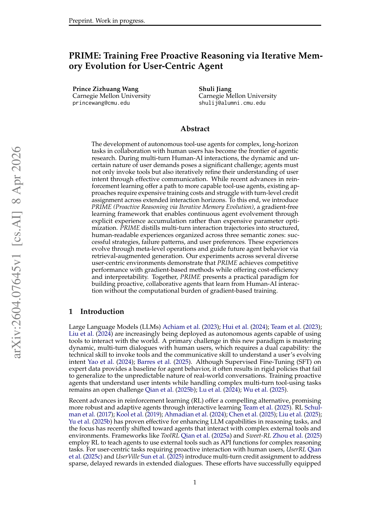

## PDF 第 2 页

<u>Preprint.</u> <u>Work in progress.</u>

agents to operate tools within their respective environments, establishing a foundation for
more complex interactive tasks.

However, gradient-based RL presents significant challenges for user-centric agents: multiGPU training infrastructure is expensive, learned improvements are opaque and difficult
to audit, and adaptation to new scenarios requires complete retraining cycles. To this
end, we propose **_PRIME_** _(_ **_P_** _roactive_ **_R_** _easoning via_ **_I_** _terative_ **_M_** _emory_ **_E_** _volution)_, which takes
a fundamentally different approach by treating agent improvement as a knowledge accumulation problem rather than a parameter optimization problem. The central insight is
that multi-turn user-centric interactions generate rich learning signals that can be captured,
organized, and reused without gradient computation. When an agent successfully helps a
user discover their hidden intent through clarifying questions, that successful strategy can
be distilled into an explicit memory and retrieved when similar situations arise. When an
agent fails by asking redundant questions that frustrate the user, that failure pattern can
be documented and avoided in the future. This explicit knowledge representation enables
continuous adaptation during deployment, transfer of learned strategies across different
model architectures, and human inspection of what the agent has learned. _PRIME_ achieves
this through four interconnected phases that form a continuous learning cycle: _exploration_ of
interaction environments to collect diverse trajectories, _distillation_ of those trajectories into
structured memories with multi-turn credit assignment, _evolution_ of the memory library
through meta-level optimization, and _inference_ where retrieved memories augment agent
responses to better assist human users. Our main contributions are as follows:

- We introduce _PRIME_, a gradient-free learning framework that improves user-centric
agents through explicit memory accumulation rather than parameter optimization, eliminating the need for multi-GPU training while enabling interpretable, transferable improvements.

- We propose a memory distillation pipeline that leverages multi-turn credit assignment
to identify key decision points in interaction trajectories, converting raw experiences
into structured, retrievable knowledge, and design a memory evolution mechanism
with mutation, generalization, crossover, and pruning operators that refines the memory
library through meta-level optimization.

- We demonstrate that _PRIME_ achieves competitive performance with RL-trained agents on
eight user-centric benchmarks while requiring much fewer GPU-hours, and that memory
libraries transfer effectively across model architectures.

### 2 Preliminaries

**Multi-Turn User-Agent Interaction** We model multi-turn agent-user interaction Wu et al.
(2025); Yao et al. (2024); Barres et al. (2025); Qian et al. (2025c) as a Markov Decision Process
_M_ = ( _S_, _A_, _T_, _R_, _γ_, _H_ ) where states _S_ encompass conversation history and environment
context, actions _A_ combine structured response types with natural language, and horizon

_H_ bounds interaction length. The agent executes policy _πθ_ ( _a|s_ ) to produce trajectories
_τ_ = _{_ ( _st_, _at_, _rt_ ) _}t_ _T_ =0 , with the objective of maximizing expected cumulative reward:

_πθ_ _∗_

_πθ_ **E** _τ∼πθ_

(1)

- _T_
## ∑

_t_ =0

_γ_ _t_ _rt_

_θ_ _∗_ = arg max _πθ_

User-centric tasks present several major challenges: (i) user intent is latent and must be
inferred through dialogue, (ii) feedback is often sparse with meaningful rewards arriving
only at episode conclusion, (iii) and the state space grows unboundedly with conversation
length.

**Group Relative Policy Optimization** GRPO Guo et al. (2025) addresses reward sparsity
by computing advantages relative to a group of sampled responses. Given prompt _x_ and
responses _{y_ 1, . . ., _yG}_ with rewards _{r_ 1, . . ., _rG}_, advantages are normalized within each

2

本页完整原图（核对图表与公式）

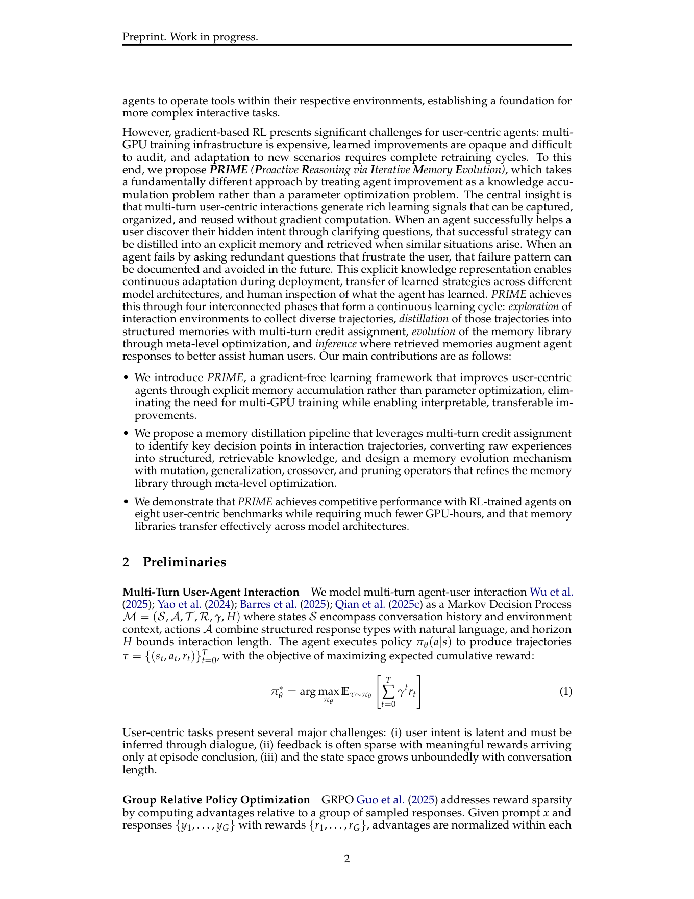

## PDF 第 3 页

<u>Preprint.</u> <u>Work in progress.</u>

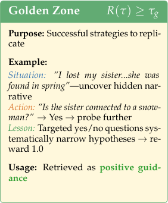

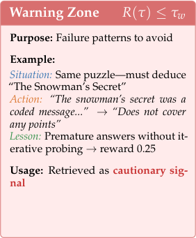

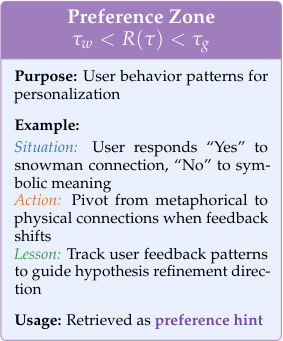

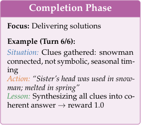

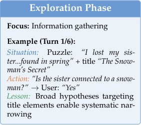

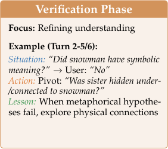

Figure 1: **Memory library organization.** _Top row:_ Memories are organized by trajectory
reward _R_ ( _τ_ ) into three semantic zones—golden (successful strategies), warning (failure
patterns), and preference (user behavior patterns). _Bottom row:_ Each memory is also annotated with its interaction stage—exploration (information gathering), verification (refining
understanding), or completion (delivering solutions). Core components are color-coded:
situation, action, and lesson.

group:

_Ai_ = _ri_ _−_ <u>mean(</u> _{rj}_ ) (2)

std( _{rj}_ )

The policy updates to favor high-advantage responses subject to a KL constraint:

_L_ GRPO( _θ_ ) = **E** _x_, _{yi}_

- _G_
## ∑

_i_ =1

_Ai_ log _πθ_ ( _yi|x_ ) _−_ _β_ KL( _πθ∥π_ ref)

(3)

While GRPO and related RL methods have demonstrated strong performance on multi-turn
user-centric tasks (Qian et al., 2025c), they require substantial computational resources—
typically multi-GPU clusters running for days—and produce model weights that are
architecture-specific and non-transferable. These constraints motivate our exploration
of gradient-free alternatives that can achieve competitive performance while offering interpretability and cross-model portability.

### 3 Method

We present _PRIME (_ **_P_** _roactive_ **_R_** _easoning via_ **_I_** _terative_ **_M_** _emory_ **_E_** _volution)_ (Figure **??** ), a gradientfree learning framework that enables LLM agents to continuously improve their user-centric
interaction abilities through accumulated interaction memories, without modifying model
parameters. Unlike gradient-based reinforcement learning methods that require expensive
multi-GPU training, PRIME constructs an interpretable, transferable experience library that
captures successful interaction strategies and failure patterns from multi-turn dialogues.

3

本页完整原图（核对图表与公式）

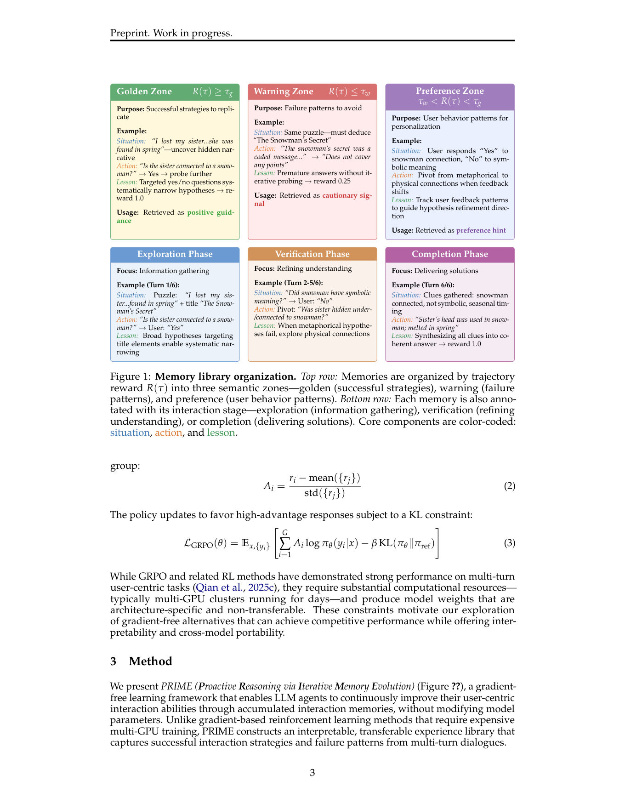

## PDF 第 4 页

<u>Preprint.</u> <u>Work in progress.</u>

**User request:** _“I would like to plan a trip to Paris next month.”_
Missing details: Duration (HIGH), Budget (MED), Accommodation (MED), Activities (MED), Transportation (MED), Dining

(LOW)

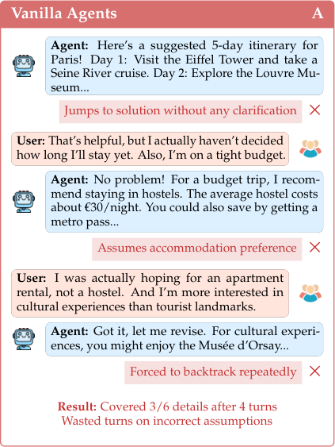

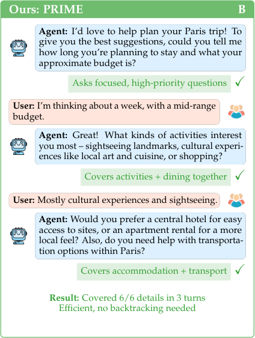

Figure 2: **Vanilla** **LLM** **vs.** **PRIME** **on** **an** **IntentionGym** **task.** **(A)** Without experience
guidance, the agent jumps directly to providing solutions, makes incorrect assumptions
about user preferences, and is forced to backtrack when corrected. **(B)** With PRIME, the
agent systematically asks focused clarifying questions that efficiently cover all missing
details, guided by retrieved experiences from similar past interactions. Green checks (✓)
mark productive turns that address user needs; red crosses ( **_×_** ) mark turns that assume
rather than ask.

#### 3.1 Learning as Memory Evolution

We formalize PRIME as an optimization problem over memory libraries rather than model
parameters. Given a data distribution _D_ over input-target pairs ( _X_, _Y_ ), a frozen LLM policy
_π_, and a retrieval function _ρ_ that selects relevant memories from the library, the objective is
to find an optimal memory library _M_ _∗_ that maximizes expected agent performance:

_M_ _∗_ = arg max _M_ **E** ( _Xi_ , _Yi_ ) _∼D_ , **mi** _∼ρ_ ( _·|Xi_ , _M_ ) [Φ( _π_ ( _·|Xi_ , **mi** ), _Yi_ )] (4)

Here, the performance metric Φ measures how well the policy’s output matches the desired
target. _Xi_ represents the input context comprising user queries, environment state, and
conversation history, while _Yi_ captures the target outcome including task completion and
user satisfaction. The retrieval function _ρ_ ( _·|Xi_, _M_ ) selects experiences _mi_ from library _M_
that are semantically relevant to the current situation. The policy _π_ ( _·|Xi_, **mi** ) is the frozen
LLM conditioned on both the input and retrieved experiences.

The key distinction from gradient-based methods Qian et al. (2025c); Wu et al. (2025) is that
we optimize the memory library _M_ rather than the policy parameters _θ_ . This optimization
proceeds through a forward update mechanism where the library evolves based on collected
interaction trajectories:

_Mi_ +1 _∼_ _µ_ ( _·|Mi_, _{τi|Xi_, _π}_ ) (5)

4

本页完整原图（核对图表与公式）

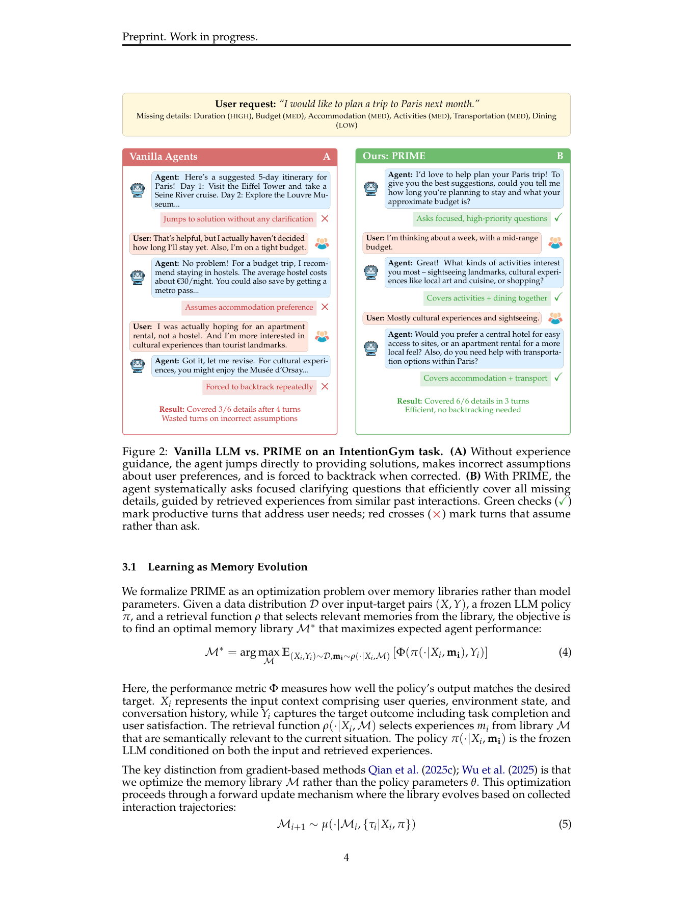

## PDF 第 5 页

<u>Preprint.</u> <u>Work in progress.</u>

The updater distribution _µ_ incorporates new experiences distilled from trajectories _τi_ and
applies evolution operations to refine existing knowledge. We can interpret this as a
_forward_ _gradient_ that represents the direction of library improvement without requiring
backpropagation through the policy.

**Structuring Interaction Knowledge** In the memory library, each memory **m** _∈M_ captures
interaction knowledge in a structured representation with rich contextual metadata for stageaware retrieval:

_m_ = ( _m_ core, _m_ stage, _m_ cond, _m_ zone) (6)

where _m_ core = ( _situation_, _action_, _outcome_, _lesson_ ) captures the interaction knowledge, _m_ stage
records the interaction phase, _m_ cond specifies applicability conditions, and _m_ zone indicates
the semantic zone classification. Figure 1 illustrates each component with concrete examples.

The _core_ components capture what happened during the interaction. For instance, in a travel
planning scenario, the _situation_ might be “user has vague multi-aspect planning request,” the
_action_ could be “pair related questions (venue + headcount, budget + theme),” the _outcome_
records the user’s positive response, and the _lesson_ abstracts the principle “combining
related details in single questions covers ground efficiently.”

The _stage_ field records the interaction phase in which the memory occurred. We define
three canonical phases: the **exploration phase** (early interaction focused on information
gathering), the **verification** **phase** (middle portion for refining understanding), and the
**completion phase** (final stage for delivering solutions). The bottom row of Figure 1 illustrates each phase with examples. The _conditions_ field specifies applicability criteria such as
environment types and preconditions for retrieval.

We organize memories into three semantic zones based on trajectory rewards (Figure 1): the
_Golden Zone_ contains successful strategies to replicate, the _Warning Zone_ captures failure
patterns to avoid (e.g., “jumped to generating full itinerary without clarifying questions”
leading to repeated backtracking), and the _Preference Zone_ records user behavior patterns
that enable personalization. This organization ensures positive guidance dominates during
retrieval while cautionary signals remain available.

#### 3.2 The PRIME Pipeline: Exploration to Inference

The PRIME pipeline enables progressive improvement of the memory library and consequently of agent performance through three phases: (i) _exploration_, (ii) _distillation_, and (iii)
_evolution_ .

**Exploration:** **Collecting Interaction Trajectories** The exploration phase generates raw
interaction data. For each episode, the agent interacts with users multi-turn conversations,
producing trajectories of the form _τ_ = _{_ ( _st_, _at_, _rt_, _ot_ ) _}t_ _T_ =0 where _st_ represents the state at

turn _t_ comprising conversation history, environment context, and any retrieved memories;
_at_ is the agent’s action combining structured action types with natural language content; _rt_
captures turn-level rewards; and _ot_ records environment observation.

When memory guidance is enabled, the policy incorporates retrieved knowledge through
prompt augmentation:

_π_ ( _at|st_, _M_ ) = _π_ LLM( _at|_ prompt( _st_, _ρ_ ( _st_, _M_ ))) (7)

During exploration, we collect trajectories that cover both successful and unsuccessful
interaction patterns. This diversity is essential for building a comprehensive memory library
that captures the full range of situations the agent might encounter.

**Distillation:** **From Trajectories to Memories** The distillation phase transforms raw trajectories into structured experiences with rich contextual metadata for stage-aware retrieval.
This process must identify which aspects of an interaction are worth preserving, determine
the interaction stage where critical decisions occurred, and compress the trajectory into a
representation that supports contextualized retrieval at inference time.

5

本页完整原图（核对图表与公式）

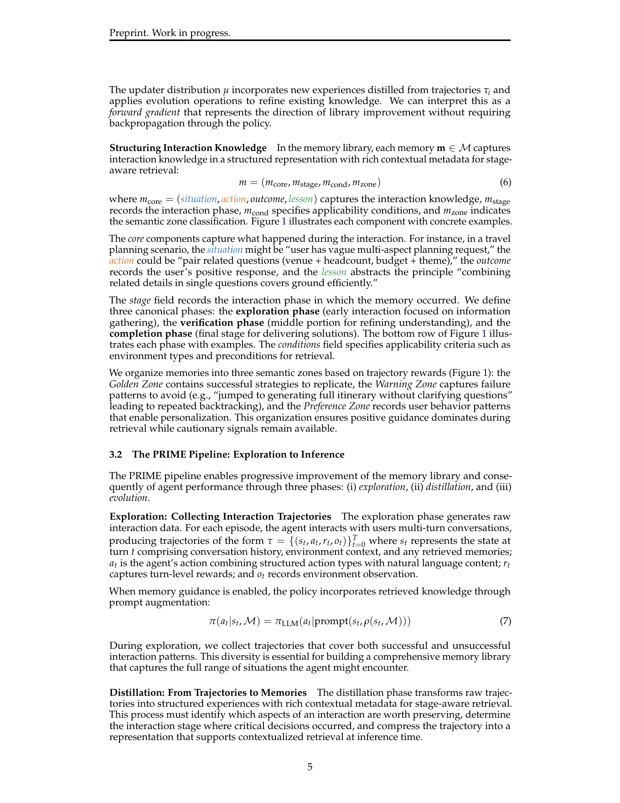

## PDF 第 6 页

<u>Preprint.</u> <u>Work in progress.</u>

The first step is _credit assignment_, which identifies which turns contributed most to the final
outcome. Given turn-level credits, we select the top- _K_ turns as _key turns_ that capture the
most informative moments of the interaction. The interaction stage _σ_ is then determined
by where these key turns occurred in the trajectory. Figure 9 illustrates this process with a
concrete example.

The distillation function then leverages an LLM to extract semantic knowledge:

_m_ = _D_ ( _τ_, _K_, _σ_ ) = LLMdistill( _τ_, _K_, _σ_ ) (8)

where _τ_ is the current interaction trajectory, _K_ denotes the key turns, and _σ_ is the detected
stage. For example, from a successful travel planning trajectory where the agent efficiently
gathered user preferences through paired questions (Figure 9), the distiller extracts: _m_ core
capturing the strategy of combining related questions, _m_ stage = exploration since key
turns occurred early, _m_ cond specifying applicability to multi-aspect planning tasks, and
_m_ zone = golden based on the high trajectory reward.

**Evolution:** **Refining the Knowledge** **Base** The memory library evolves through metalevel optimization, instantiating the update distribution _µ_ from Equation 5. Four operators
modify the library _Mi_ _→Mi_ +1 (Figure 5):

- **Mutation** : Refines experience clarity based on empirical feedback.

- **Generalization** : Abstracts environment-specific details from high-performing experiences.

- **Crossover** : Combines complementary insights from multiple experiences.

- **Pruning** : Removes stale or underperforming experiences from the library.

**Memory-Guided Inference** At inference time, the evolved library guides agent responses
through _contextualized retrieval_ . PRIME formats candidate experiences as callable tools and
asks the agent to select the most relevant ones given the current interaction state and stage:

**m** = _ρ_ ( _s_, _M_, _C_ ) (9)

where _s_ is the current state, _M_ is the memory library, and _C_ = ( _h_, _t_, _H_ ) captures the
conversation history _h_, current turn _t_, and maximum turns _H_ . Selected experiences are
organized by zone in the augmented prompt: golden experiences provide positive guidance,
warning experiences highlight pitfalls to avoid, and preference experiences capture user
behavior patterns. Due to space constraints, we defer the details of the retrieval pipeline to
Appendix (Figure 11).

### 4 Experiments

We evaluate PRIME across diverse multi-turn, user-centric agentic tasks, comparing against
both prompting-based and RL-trained baselines.

#### 4.1 Experimental Setup

**Benchmarks** We evaluate on eight multi-turn, user-centric environments adopted from
the UserRL benchmark Qian et al. (2025c), each posing a distinct interaction challenge.
**TurtleGym** requires lateral thinking: the agent must solve “Turtle Soup” puzzles by asking
strategic yes/no questions to uncover a hidden narrative. **TelepathyGym** tests logical
reasoning through an entity-guessing game where the agent narrows down possibilities
via elimination. **PersuadeGym** measures persuasive communication, tasking the agent
with shifting an interlocutor’s stance through argumentation. **IntentionGym** evaluates
intent inference, where the agent must discover underspecified user goals through clarifying
questions. **FunctionGym** targets mathematical reasoning by requiring the agent to identify
a hidden function from input–output examples. **SearchGym** tests information retrieval,
combining web search with multi-step synthesis to answer factual queries. **TauGym** Yao
et al. (2024) presents tool-use scenarios modeled after customer support, requiring multiagent coordination with external APIs. Finally, **TravelGym** involves preference elicitation
for trip planning, where the agent must proactively uncover latent user preferences. All

6

本页完整原图（核对图表与公式）

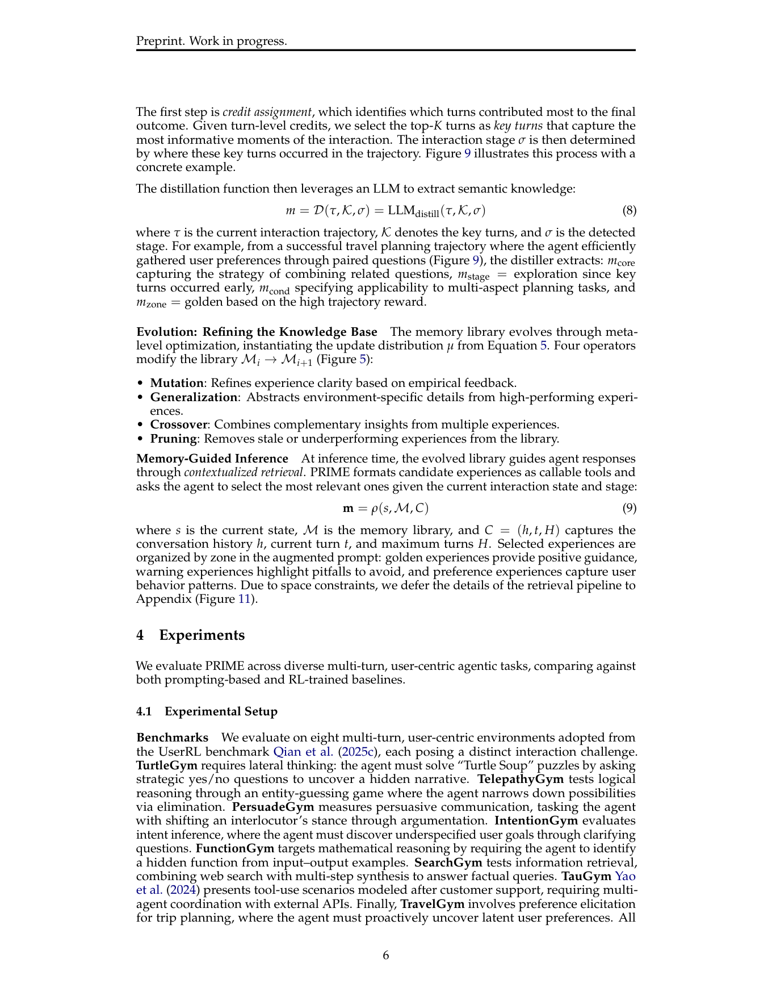

## PDF 第 7 页

<u>Preprint.</u> <u>Work in progress.</u>

0.6

0.5

0.4

0.3

0.2

0.1

0.0

0.6

0.5

0.4

0.3

0.2

0.1

0.0

Qwen3-4B

Qwen3-8B

|Col1|Col2|Col3|Col4|Col5|Col6|Col7|Col8|Col9|Col10|Col11|Col12|Col13|Col14|Col15|Col16|Col17|Col18|Col19|Col20|
|---|---|---|---|---|---|---|---|---|---|---|---|---|---|---|---|---|---|---|---|
|||||||||||||||||||||
|||||||||||||||||||||
|||||||||||||||||||||
|||||||||||||||||||||
||~~0.1~~|~~0.1~~|~~0.1~~|~~0.1~~|~~8~~|0.2 ~~0.18~~|0.2 ~~0.18~~|0.2 ~~0.18~~|0.2 ~~0.18~~|0.2 ~~0.18~~|0.2 ~~0.18~~|0.2 ~~0.18~~|0.2 ~~0.18~~|0.2 ~~0.18~~|4|0.20|0.20|0.20|0.20|
||~~0.1~~|~~0.1~~|~~0.1~~|~~0.1~~|~~8~~|0.2 ~~0.18~~|0.2 ~~0.18~~|0.2 ~~0.18~~|0.2 ~~0.18~~|0.2 ~~0.18~~|0.2 ~~0.18~~|0.2 ~~0.18~~||||||||
||0.1 |0.1 |4 |4 ||~~0.09~~ 0.1 |~~0.09~~ 0.1 |~~0.09~~ 0.1 |~~0.09~~ 0.1 |3 ||||||||||
||0.1 |||||||||||||||||||
||||||||||||~~0.0~~|~~0.0~~|~~8~~|~~8~~||0.04 0.0|0.04 0.0|6||
|||||||||||||||||||||
|||||||||||||||||||||

|Col1|Raw + PRIME|Col3|Col4|Col5|Col6|Col7|Col8|Col9|Col10|Col11|Col12|Col13|Col14|Col15|Col16|Col17|Col18|Col19|Col20|
|---|---|---|---|---|---|---|---|---|---|---|---|---|---|---|---|---|---|---|---|
||~~0.57~~   + RL|~~0.57~~   + RL|~~0.57~~   + RL|~~0.57~~   + RL|~~0.57~~   + RL|~~0.57~~   + RL|~~0.57~~   + RL|~~0.57~~   + RL|~~0.57~~   + RL|~~0.57~~   + RL|~~0.57~~   + RL|~~0.57~~   + RL|~~0.57~~   + RL|~~0.57~~   + RL|~~0.57~~   + RL|~~0.57~~   + RL|~~0.57~~   + RL|~~0.57~~   + RL|~~0.57~~   + RL|
||~~0.57~~   + RL|~~0.57~~   + RL|~~0.57~~   + RL|~~0.57~~   + RL||||||||||||||||
||~~0.57~~   + RL|~~0.57~~   + RL|~~0.57~~   + RL|~~0.57~~   + RL||||||||||||||||
|||||||0.42|0.42|0.42|0.42|0.42|0.42|0.42|0.42|0.42|0.42|0.42|0.42|0.42|0.42|
|||||||0.42|0.42|0.42|0.42|0.42|0.42|0.42|0.42|0.42||||||
|||||||||||||||||||||
||0.2|0.2|0.2|0.2|1|~~0.2~~ 0.19|~~0.2~~ 0.19|~~0.2~~ 0.19|~~0.2~~ 0.19|~~0.2~~ 0.19|~~0.2~~ 0.19|~~0.2~~ 0.19|~~0.2~~ 0.19|~~0.2~~ 0.19||0.21|0.21|0.21|0.21|
||0.2|0.2|0.2|0.2|1|~~0.2~~ 0.19|~~0.2~~ 0.19|~~0.2~~ 0.19|~~0.2~~ 0.19|~~0.2~~ 0.19|~~0.2~~ 0.19|~~0.2~~ 0.19||||||||
||0.1|0.1|4|4||~~0.09~~ ~~0.0~~ 0.14 |~~0.09~~ ~~0.0~~ 0.14 |~~0.09~~ ~~0.0~~ 0.14 |~~0.09~~ ~~0.0~~ 0.14 |~~0.09~~ ~~0.0~~ 0.14 |~~0.09~~ ~~0.0~~ 0.14 |~~0.09~~ ~~0.0~~ 0.14 |~~8~~|~~8~~||~~0.0~~ |~~0.0~~ |~~7~~ ||
||0.1|||||||~~9~~ |~~9~~ |~~9~~ |~~9~~ |~~9~~ |~~9~~ |~~9~~ |~~9~~ |~~9~~ |~~9~~ |~~9~~ |~~9~~ |
|||||||||||||||||0.04 |0.04 |||
|||||||||||||||||||||

Figure 3: Comparison between base Raw models, PRIME, and RL-based models across
challenging user-centric environments.

environments share a standardized action interface and use LLM-based user simulation,
enabling consistent evaluation across domains.

**Baselines** We compare PRIME against three categories of baselines. First, _proprietary_
_LLMs_ : we evaluate GPT-4o Achiam et al. (2023) under zero-shot prompting to establish
the performance ceiling of large-scale models without task-specific adaptation. Second,
_prompting-based agents_ : we test ReAct Yao et al. (2022), which interleaves reasoning traces
with actions, and Reflexion Shinn et al. (2023), which augments agents with verbal selfreflection on past failures. These baselines represent established strategies for improving
agent behavior without parameter updates and serve as the most direct comparison to
PRIME’s experience-guided approach. Third, _RL-trained agents_ : we include models finetuned with GRPO using multi-turn credit assignment Qian et al. (2025c).

**Training Details** We use Qwen3-4B and Qwen3-8B Yang et al. (2025) as our primary base
models for both PRIME and the RL baselines. For PRIME, the experience library is initialized
empty and built through iterative exploration–distillation–evolution cycles. Exploration
uses a rollout temperature of _τ_ = 1.0 with a maximum horizon of _H_ = 16 turns per episode,
matching the GRPO training configuration. The discount factor is set to _γ_ = 0.8 for both
reward-to-go credit assignment and trajectory reward computation. Zone classification
thresholds are _θ_ golden = 0.7 and _θ_ warning = 0.3. For distillation and evolution, we use
GPT-4o as the summarization and reasoning backbone. Contextualized retrieval presents up
to 20 candidate experiences as tools to the selection LLM, which returns the most relevant
subset given the current conversation state and interaction stage. For the RL baselines, we
train with GRPO following the UserRL configuration: 8 _×_ A100 GPUs, group size _G_ = 8, and
KL coefficient _β_ = 0.001. All environments use Qwen3-32B as the user simulator to ensure
consistent and reproducible evaluation across methods. The full set of hyperparameters is
provided in Appendix D.

7

本页完整原图（核对图表与公式）

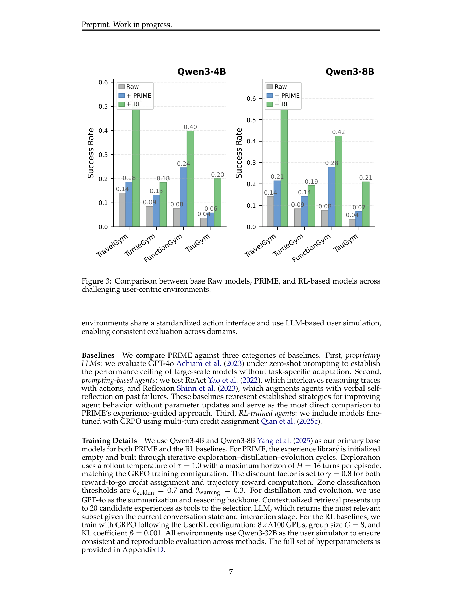

## PDF 第 8 页

<u>Preprint.</u> <u>Work in progress.</u>

Table 1: **Main results on multi-turn user-interacting benchmarks.** We report task completion scores across eight user-centric environments (higher is better). Gray rows indicate
PRIME (ours). Blue values in parentheses show the percentage improvement over the
corresponding raw open-source model.

**<u>Model</u>** **<u>TravelGym</u>** **<u>TurtleGym</u>** **<u>FunctionGym</u>** **<u>TauGym</u>** **<u>PersuadeGym</u>** **<u>IntentionGym</u>** **<u>TelepathyGym</u>** **<u>SearchGym</u>**

_Closed-Source LLM_

GPT-4o 0.364 0.292 0.282 0.030 0.377 1.898 0.854 0.880
GPT-4o-mini 0.098 0.091 0.154 0.206 0.532 0.250 0.049 0.352
Gemini-2.5-Pro 0.347 0.274 0.410 0.194 0.425 1.590 0.902 0.928
<u>Gemini-2.5-Flash</u> <u>0.255</u> <u>0.196</u> <u>0.321</u> <u>0.121</u> <u>0.409</u> <u>1.685</u> <u>0.634</u> <u>0.928</u>

_Open-Source LLM_

Qwen3-32B 0.172 0.151 0.154 0.000 0.484 1.830 0.561 0.792
Qwen3-14B 0.192 0.142 0.167 0.103 0.532 1.700 0.585 0.512
Qwen3-8B 0.158 0.098 0.095 0.048 0.441 1.725 0.510 0.808
<u>Qwen3-4B</u> <u>0.141</u> <u>0.085</u> <u>0.077</u> <u>0.036</u> <u>0.405</u> <u>1.740</u> <u>0.488</u> <u>0.856</u>

_RL (GRPO) Trained Models_

GRPO + Qwen3-4B 0.509 0.184 0.397 0.200 0.579 1.808 0.634 0.864
<u>GRPO + Qwen3-8B</u> <u>0.573</u> <u>0.192</u> <u>0.423</u> <u>0.210</u> <u>0.532</u> <u>1.903</u> <u>0.561</u> <u>0.888</u>

_PRIME Models_

#### 4.2 Experimental Results

**Evaluation on User-centric Multi-turn Benchmarks** Table 1 presents results across eight
user-centric multi-turn agent benchmarks, comparing closed-source models, open-source
models, GRPO-trained models, and PRIME-augmented models with the learned memory
library. PRIME consistently improves over raw open-source models across all environments
and model scales, with the largest gains on environments requiring strategic exploration
such as FunctionGym, TauGym, and TurtleGym. The memory library effectively captures
transferable interaction strategies that benefit the frozen base model without any parameter
updates. Compared to RL-based models such as those trained via GRPO, PRIME shows
competitive performance while requiring no expensive gradient-based training. GRPO
training produces larger absolute performance gains through direct parameter optimization, while PRIME operates without gradient updates or multi-GPU training—making it
applicable when model weights cannot be modified. Figure 3 visualizes performance on
challenging environments where PRIME significantly outperforms base models; for instance,
Qwen3-8B + PRIME achieves 193% improvement on FunctionGym and 50% on TauGym
over the raw base model.

**Computational Budget** Figure 4a compares the per-environment computational requirements of GRPO and PRIME. GRPO requires gradient-based optimization with multi-GPU
training: 8 _×_ A100 GPUs for approximately over 100 GPU hours. In contrast, PRIME eliminates gradient computation entirely—the exploration, distillation and evolution phases
require only forward passes through the frozen base model. This architectural difference
yields substantial savings: PRIME requires 5–6 times fewer GPU-hours per environment
compared to GRPO. The trade-off is that GRPO achieves higher absolute performance
through direct parameter updates, while PRIME provides a gradient-free path to improving
agent behavior that is particularly attractive when training infrastructure is limited or model
weights cannot be modified.

**Cross-Architecture Transferability** A distinguishing property of experience-based learning is that the knowledge stored in the library is decoupled from model architecture and
parameters. To evaluate this, we construct experience libraries using Qwen3-8B and apply
them to Qwen3-4B at inference time. Figure 4b shows the results on four challenging environments. Applying an 8B-derived library to 4B yields modest but consistent improvements
over the raw baseline, though the gains are smaller than those achieved by native PRIME
on the source 8B model. This gap is expected: experiences distilled from a larger model’s
successful trajectories may encode reasoning patterns that are less natural for the smaller
model to execute. Nevertheless, the transferred library provides meaningful improvements
without any gradient-based training on the 4B model. This has practical implications:

8

本页完整原图（核对图表与公式）

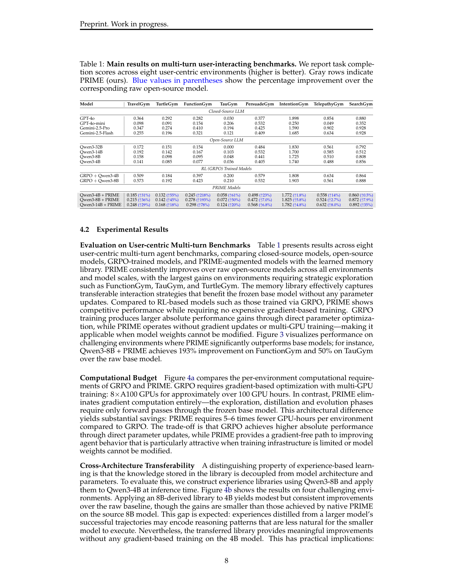

## PDF 第 9 页

<u>Preprint.</u> <u>Work in progress.</u>

Function

GRPO PRIME

Tau

GRPO PRIME

0.30

0.25

0.20

0.15

0.10

0.05

125

100

75

50

25

0

|Travel|Col2|
|---|---|
|101 18|101 18|
|||
|||

GRPO PRIME

Turtle

GRPO PRIME

|Qwen3-4B (Raw)|Col2|Col3|Col4|Col5|Col6|Col7|Col8|Col9|Col10|Col11|Col12|Col13|Col14|Col15|Col16|Col17|Col18|
|---|---|---|---|---|---|---|---|---|---|---|---|---|---|---|---|---|---|
|~~Qwen3-4B + Transferred Memory~~ Qwen3-8B + PRIME|~~Qwen3-4B + Transferred Memory~~ Qwen3-8B + PRIME|~~Qwen3-4B + Transferred Memory~~ Qwen3-8B + PRIME|~~Qwen3-4B + Transferred Memory~~ Qwen3-8B + PRIME|~~Qwen3-4B + Transferred Memory~~ Qwen3-8B + PRIME|~~Qwen3-4B + Transferred Memory~~ Qwen3-8B + PRIME|~~Qwen3-4B + Transferred Memory~~ Qwen3-8B + PRIME|~~Qwen3-4B + Transferred Memory~~ Qwen3-8B + PRIME|~~0.278~~|~~0.278~~|~~0.278~~|~~0.278~~|~~0.278~~|~~0.278~~|~~0.278~~|~~0.278~~|~~0.278~~|~~0.278~~|
|0.215 |0.215 |0.215 |0.215 |0.215 |0.215 |0.215 |0.215 |0.215 |0.215 |0.215 |0.215 |||||||
|~~0.141~~ 0.158|~~0.141~~ 0.158|~~0.141~~ 0.158||0.145 ~~0.142~~|0.145 ~~0.142~~|0.145 ~~0.142~~|0.145 ~~0.142~~|0.145 ~~0.142~~|0.145 ~~0.142~~|0.145 ~~0.142~~|0.145 ~~0.142~~|||||||
|||||~~0.085~~ 0.098 |~~0.085~~ 0.098 |~~0.085~~ 0.098 ||||||||||||
||||||||||~~0.077~~|~~0.077~~|||~~0.036~~ 0.048 0.072|~~0.036~~ 0.048 0.072|~~0.036~~ 0.048 0.072|~~0.036~~ 0.048 0.072|~~0.036~~ 0.048 0.072|
|||||||||||||||||||

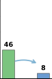

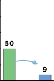

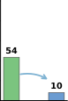

(a) GRPO requires gradient-based training;
PRIME uses inference-time exploration, achieving 5–6 _×_ reduction in GPU-hours.

0.00
Travel Turtle Function Tau

(b) Qwen3-4B with a transferred 8B library (orange) improves over the raw 4B baseline (gray).

Figure 4: **Efficiency and transferability.**

organizations can build experience libraries using capable models during development,
then deploy smaller models augmented with those libraries in production—establishing
experience libraries as reusable assets that provide some benefit even when applied to
different model architectures.

### 5 Related Work

**Tool-Augmented Agents for User Interaction** The deployment of LLM agents in userfacing applications has spurred development of benchmarks and frameworks for evaluating
multi-turn, tool-using interactions. _τ_ -Bench Yao et al. (2024); Barres et al. (2025) introduces
realistic customer service scenarios requiring agents to coordinate multiple tools while
maintaining coherent dialogue. UserBench Qian et al. (2025b) provides a comprehensive
suite of user-centric environments spanning intent discovery, persuasion, and preference
elicitation. These benchmarks reveal that current LLMs struggle with proactive information gathering—agents often fail to ask clarifying questions and instead make premature
assumptions about user intent. CollabLLM Wu et al. (2025) addresses this by training agents
to collaborate with users through iterative refinement. PRIME complements these efforts by
providing a gradient-free mechanism for accumulating interaction strategies that can adapt
to diverse user-centric scenarios.

**Reinforcement Learning for LLM Agents** RL has emerged as a powerful paradigm for
improving LLM capabilities beyond supervised learning. Early work applied RLHF Bai
et al. (2022) and DPO Rafailov et al. (2023) to align models with human preferences, while
PPO Schulman et al. (2017) enabled direct reward optimization. Recent advances include
GRPO Guo et al. (2025), which uses group-relative advantages to stabilize training, and
variants like GiGPO Feng et al. (2025) and IGPO Wang et al. (2025) that improve sample efficiency. For multi-turn agent tasks, Turn-PPO Li et al. (2025) and RLVMR Zhang et al. (2025)
address credit assignment across extended interactions. UserRL Qian et al. (2025c) specifically targets user-centric tool-calling by combining GRPO with multi-turn credit assignment
methods. While these RL approaches achieve strong performance, they require expensive
multi-GPU training infrastructure and produce opaque parameter updates. PRIME offers
an orthogonal approach: rather than optimizing model parameters, we optimize an explicit
memory library that augments frozen models, achieving competitive performance with
significantly lower computational cost and full interpretability.

**Agent Memories** Equipping agents with external memory has a rich history in AI, from
early cognitive architectures to modern retrieval-augmented generation. Recent work has
explored learnable memory modules for LLM agents: MemGPT Xu et al. (2025) introduces
hierarchical memory management for extended conversations, while MemoryAgent Yu
et al. (2025a) uses RL to train memory read/write policies. PRIME extends this line of
work to user-centric tasks, building proactive agents that refine their memories through
meta-level optimization without gradient computation. This design enables PRIME to
accumulate transferable interaction strategies that improve agent performance without
modifying model weights.

9

本页完整原图（核对图表与公式）

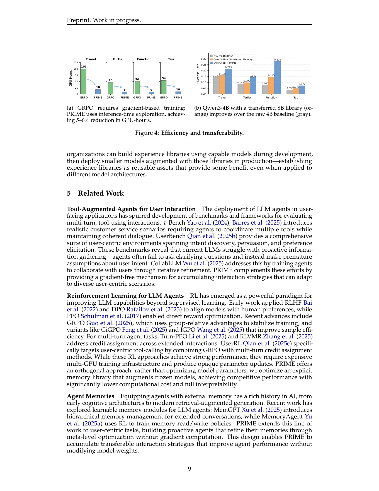

## PDF 第 10 页

<u>Preprint.</u> <u>Work in progress.</u>

### 6 Conclusion

We introduced PRIME, a gradient-free framework for improving user-centric LLM agents
through iterative memory evolution. By distilling multi-turn interaction trajectories into
structured, human-readable experiences and evolving these memories through meta-level
operators, PRIME enables frozen language models to progressively improve their interaction
strategies without parameter updates. Our experiments across eight diverse user-centric
benchmarks demonstrate that PRIME achieves competitive performance with RL-trained
agents while requiring significantly fewer computational resources, and that memory
libraries transfer across model architectures. PRIME opens a practical pathway toward
deployable, interpretable agents that learn from experience—complementing gradient-based
methods with a lightweight, auditable alternative.

### References

Josh Achiam, Steven Adler, Sandhini Agarwal, Lama Ahmad, Ilge Akkaya, Florencia Leoni

Aleman, Diogo Almeida, Janko Altenschmidt, Sam Altman, Shyamal Anadkat, et al.
Gpt-4 technical report. _arXiv preprint arXiv:2303.08774_, 2023.

Arash Ahmadian, Chris Cremer, Matthias Galle, Marzieh Fadaee, Julia Kreutzer, Olivier´

Pietquin, Ahmet Ust ¨ un,¨ and Sara Hooker. Back to basics: Revisiting reinforce style
optimization for learning from human feedback in llms. _arXiv preprint arXiv:2402.14740_,
2024.

Yuntao Bai, Andy Jones, Kamal Ndousse, Amanda Askell, Anna Chen, Nova DasSarma,

Dawn Drain, Stanislav Fort, Deep Ganguli, Tom Henighan, et al. Training a helpful and
harmless assistant with reinforcement learning from human feedback. _arXiv_ _preprint_
_arXiv:2204.05862_, 2022.

Victor Barres, Honghua Dong, Soham Ray, Xujie Si, and Karthik Narasimhan. Tau2bench: Evaluating conversational agents in a dual-control environment. _arXiv preprint_
_arXiv:2506.07982_, 2025.

Kevin Chen, Marco Cusumano-Towner, Brody Huval, Aleksei Petrenko, Jackson Hamburger,

Vladlen Koltun, and Philipp Krahenb¨ uhl.¨ Reinforcement learning for long-horizon
interactive llm agents. _arXiv preprint arXiv:2502.01600_, 2025.

Lang Feng, Zhenghai Xue, Tingcong Liu, and Bo An. Group-in-group policy optimization

for llm agent training. _arXiv preprint arXiv:2505.10978_, 2025.

Daya Guo, Dejian Yang, Haowei Zhang, Junxiao Song, Ruoyu Zhang, Runxin Xu, Qihao Zhu,

Shirong Ma, Peiyi Wang, Xiao Bi, et al. Deepseek-r1: Incentivizing reasoning capability in
llms via reinforcement learning. _arXiv preprint arXiv:2501.12948_, 2025.

Binyuan Hui, Jian Yang, Zeyu Cui, Jiaxi Yang, Dayiheng Liu, Lei Zhang, Tianyu Liu, Jiajun

Zhang, Bowen Yu, Keming Lu, et al. Qwen2. 5-coder technical report. _arXiv_ _preprint_
_arXiv:2409.12186_, 2024.

Wouter Kool, Herke van Hoof, and Max Welling. Buy 4 reinforce samples, get a baseline for

free! 2019.

Junbo Li, Peng Zhou, Rui Meng, Meet P Vadera, Lihong Li, and Yang Li. Turn-ppo: Turn
level advantage estimation with ppo for improved multi-turn rl in agentic llms. _arXiv_
_preprint arXiv:2512.17008_, 2025.

Aixin Liu, Bei Feng, Bing Xue, Bingxuan Wang, Bochao Wu, Chengda Lu, Chenggang Zhao,

Chengqi Deng, Chenyu Zhang, Chong Ruan, et al. Deepseek-v3 technical report. _arXiv_
_preprint arXiv:2412.19437_, 2024.

Zichen Liu, Changyu Chen, Wenjun Li, Penghui Qi, Tianyu Pang, Chao Du, Wee Sun Lee,

and Min Lin. Understanding r1-zero-like training: A critical perspective. _arXiv preprint_
_arXiv:2503.20783_, 2025.

10

本页完整原图（核对图表与公式）

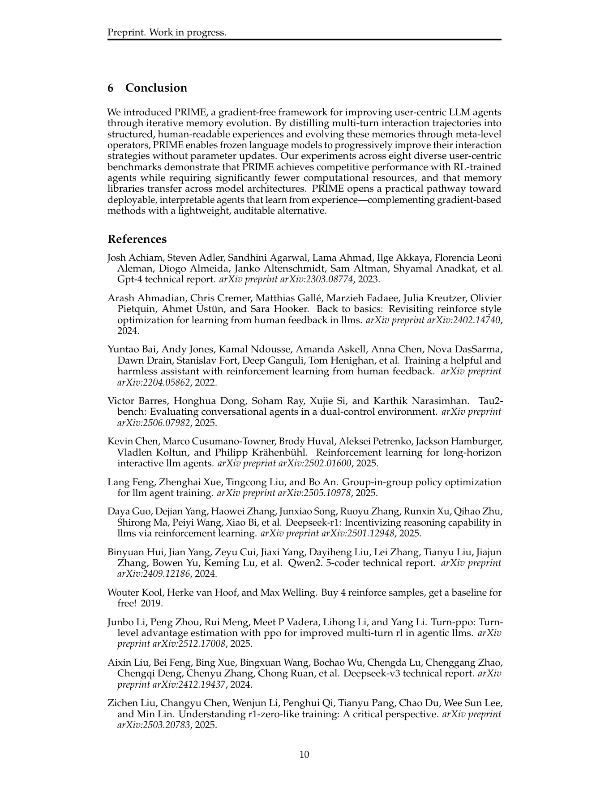

## PDF 第 11 页

<u>Preprint.</u> <u>Work in progress.</u>

Yaxi Lu, Shenzhi Yang, Cheng Qian, Guirong Chen, Qinyu Luo, Yesai Wu, Huadong Wang,

Xin Cong, Zhong Zhang, Yankai Lin, et al. Proactive agent: Shifting llm agents from
reactive responses to active assistance. _arXiv preprint arXiv:2410.12361_, 2024.

Cheng Qian, Emre Can Acikgoz, Qi He, Hongru Wang, Xiusi Chen, Dilek Hakkani-Tur,¨

Gokhan Tur, and Heng Ji. Toolrl: Reward is all tool learning needs. _arXiv_ _preprint_
_arXiv:2504.13958_, 2025a.

Cheng Qian, Zuxin Liu, Akshara Prabhakar, Zhiwei Liu, Jianguo Zhang, Haolin Chen, Heng

Ji, Weiran Yao, Shelby Heinecke, Silvio Savarese, et al. Userbench: An interactive gym
environment for user-centric agents. _arXiv preprint arXiv:2507.22034_, 2025b.

Cheng Qian, Zuxin Liu, Akshara Prabhakar, Jielin Qiu, Zhiwei Liu, Haolin Chen, Shirley

Kokane, Heng Ji, Weiran Yao, Shelby Heinecke, et al. Userrl: Training interactive usercentric agent via reinforcement learning. _arXiv preprint arXiv:2509.19736_, 2025c.

Rafael Rafailov, Archit Sharma, Eric Mitchell, Christopher D Manning, Stefano Ermon, and

Chelsea Finn. Direct preference optimization: Your language model is secretly a reward
model. _Advances in neural information processing systems_, 36:53728–53741, 2023.

John Schulman, Filip Wolski, Prafulla Dhariwal, Alec Radford, and Oleg Klimov. Proximal

policy optimization algorithms. _arXiv preprint arXiv:1707.06347_, 2017.

Noah Shinn, Federico Cassano, Ashwin Gopinath, Karthik Narasimhan, and Shunyu Yao.

Reflexion: Language agents with verbal reinforcement learning. _Advances_ _in_ _Neural_
_Information Processing Systems_, 36:8634–8652, 2023.

Weiwei Sun, Xuhui Zhou, Weihua Du, Xingyao Wang, Sean Welleck, Graham Neubig,

Maarten Sap, and Yiming Yang. Training proactive and personalized llm agents. _arXiv_
_preprint arXiv:2511.02208_, 2025.

Gemini Team, Rohan Anil, Sebastian Borgeaud, Jean-Baptiste Alayrac, Jiahui Yu, Radu

Soricut, Johan Schalkwyk, Andrew M Dai, Anja Hauth, Katie Millican, et al. Gemini: a
family of highly capable multimodal models. _arXiv preprint arXiv:2312.11805_, 2023.

Kimi Team, Yifan Bai, Yiping Bao, Guanduo Chen, Jiahao Chen, Ningxin Chen, Ruijue Chen,

Yanru Chen, Yuankun Chen, Yutian Chen, et al. Kimi k2: Open agentic intelligence. _arXiv_
_preprint arXiv:2507.20534_, 2025.

Guoqing Wang, Sunhao Dai, Guangze Ye, Zeyu Gan, Wei Yao, Yong Deng, Xiaofeng Wu,

and Zhenzhe Ying. Information gain-based policy optimization: A simple and effective
approach for multi-turn llm agents. _arXiv preprint arXiv:2510.14967_, 2025.

Shirley Wu, Michel Galley, Baolin Peng, Hao Cheng, Gavin Li, Yao Dou, Weixin Cai, James

Zou, Jure Leskovec, and Jianfeng Gao. Collabllm: From passive responders to active
collaborators. _arXiv preprint arXiv:2502.00640_, 2025.

Wujiang Xu, Zujie Liang, Kai Mei, Hang Gao, Juntao Tan, and Yongfeng Zhang. A-mem:

Agentic memory for llm agents. _arXiv preprint arXiv:2502.12110_, 2025.

An Yang, Anfeng Li, Baosong Yang, Beichen Zhang, Binyuan Hui, Bo Zheng, Bowen Yu,

Chang Gao, Chengen Huang, Chenxu Lv, et al. Qwen3 technical report. _arXiv preprint_
_arXiv:2505.09388_, 2025.

Shunyu Yao, Jeffrey Zhao, Dian Yu, Nan Du, Izhak Shafran, Karthik R Narasimhan, and

Yuan Cao. React: Synergizing reasoning and acting in language models. In _The eleventh_
_international conference on learning representations_, 2022.

Shunyu Yao, Noah Shinn, Pedram Razavi, and Karthik Narasimhan. Tau-bench: A
benchmark for tool-agent-user interaction in real-world domains. _arXiv_ _preprint_
_arXiv:2406.12045_, 2024.

11

本页完整原图（核对图表与公式）

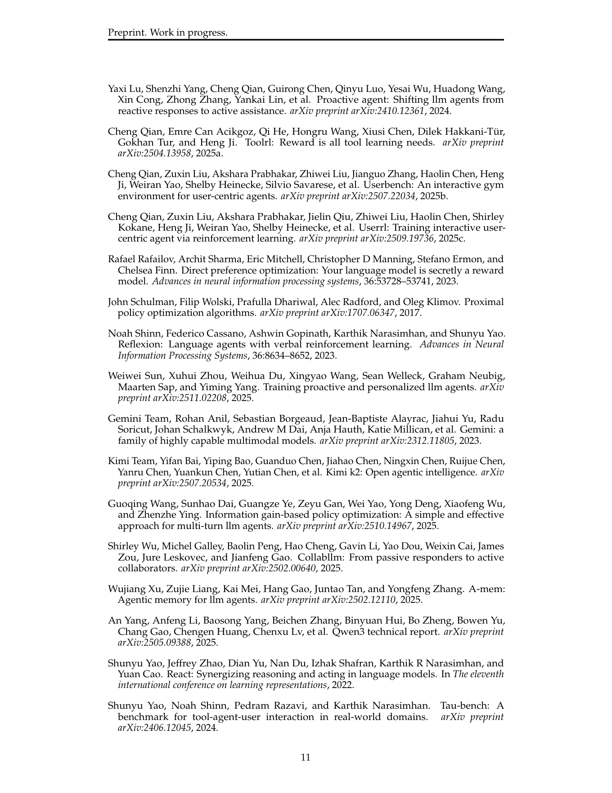

## PDF 第 12 页

<u>Preprint.</u> <u>Work in progress.</u>

Hongli Yu, Tinghong Chen, Jiangtao Feng, Jiangjie Chen, Weinan Dai, Qiying Yu, Ya-Qin

Zhang, Wei-Ying Ma, Jingjing Liu, Mingxuan Wang, et al. Memagent: Reshaping longcontext llm with multi-conv rl-based memory agent. _arXiv_ _preprint_ _arXiv:2507.02259_,
2025a.

Qiying Yu, Zheng Zhang, Ruofei Zhu, Yufeng Yuan, Xiaochen Zuo, Yu Yue, Weinan Dai,

Tiantian Fan, Gaohong Liu, Lingjun Liu, et al. Dapo: An open-source llm reinforcement
learning system at scale. _arXiv preprint arXiv:2503.14476_, 2025b.

Zijing Zhang, Ziyang Chen, Mingxiao Li, Zhaopeng Tu, and Xiaolong Li. Rlvmr: Reinforce
ment learning with verifiable meta-reasoning rewards for robust long-horizon agents.
_arXiv preprint arXiv:2507.22844_, 2025.

Yifei Zhou, Song Jiang, Yuandong Tian, Jason Weston, Sergey Levine, Sainbayar Sukhbaatar,

and Xian Li. Sweet-rl: Training multi-turn llm agents on collaborative reasoning tasks.
_arXiv preprint arXiv:2503.15478_, 2025.

12

本页完整原图（核对图表与公式）

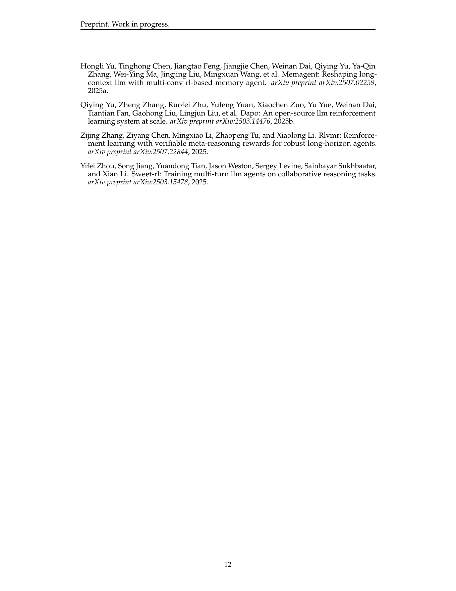

## PDF 第 13 页

<u>Preprint.</u> <u>Work in progress.</u>

### A Memory Evolution Operators

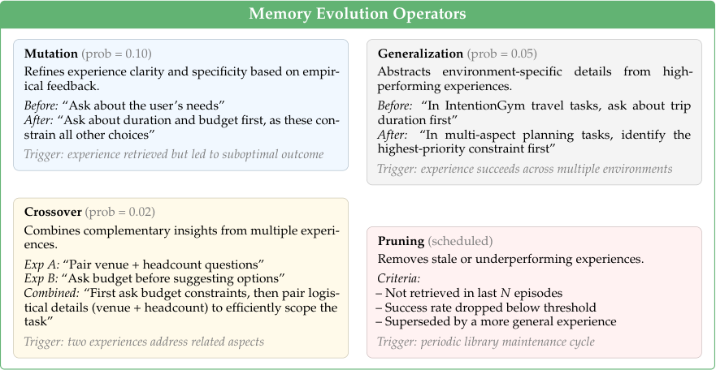

Figure 5: **Memory evolution operators.** The library evolves through four meta-level operations applied probabilistically. _Mutation_ sharpens vague experiences based on feedback.
_Generalization_ abstracts domain-specific successes into transferable knowledge. _Crossover_
synthesizes complementary insights into richer experiences. _Pruning_ removes stale entries to
keep the library focused. Together, these operators enable the experience library to improve
over time without gradient computation.

### B Additional Distillation Examples

We provide additional examples of experience distillation from other UserRL environments
beyond IntentionGym (shown in Figure 9).

### C Environment-Specific System Prompts

Each UserRL environment uses a tailored system prompt that defines the agent’s role and
available actions. Below we present the base prompts for each environment, which PRIME
augments with retrieved experiences at inference time.

### D Hyperparameters

Tables 2 and 3 provide comprehensive listings of all hyperparameters used in PRIME.

**Evolution operator details.** The mutation operator perturbs experience text while preserving semantic intent—for example, rephrasing a lesson or adjusting applicability conditions.
Generalization removes environment-specific references (e.g., “TurtleGym” _→_ “lateral thinking puzzles”) to enable cross-environment transfer. Crossover combines complementary
experiences that share situational overlap but offer different strategic insights. Pruning
removes experiences with low usage counts or poor success rates to maintain library quality.

**Stage-aware retrieval.** The interaction stage is determined by turn position: turns in the
first 25% are _exploration_, the middle 50% are _verification_, and the final 25% are _completion_ .
Experiences are tagged with their originating stage during distillation, and retrieval filters
by stage match to provide contextually appropriate guidance.

13

本页完整原图（核对图表与公式）

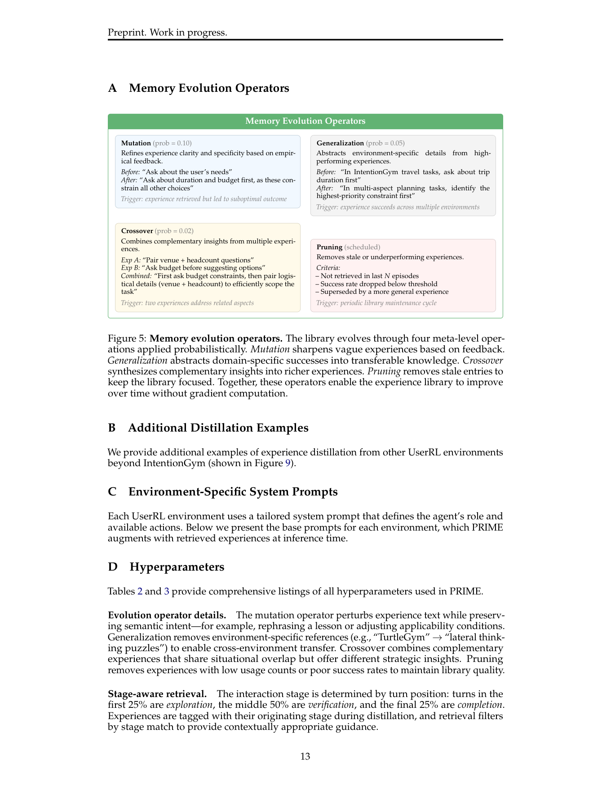

## PDF 第 14 页

<u>Preprint.</u> <u>Work in progress.</u>

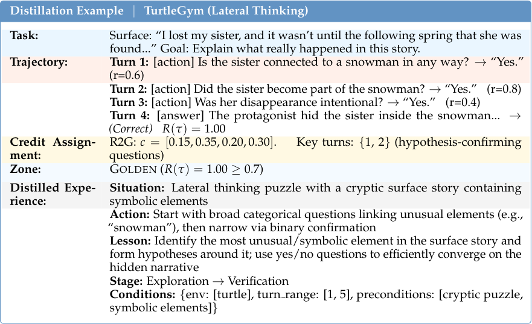

Figure 6: **Experience distillation from TurtleGym.** The agent identifies the key symbolic
element (snowman) in turn 1 and uses binary questions to confirm the hypothesis. Credit
assignment via R2G identifies turns 1-2 as pivotal. The distilled lesson—focusing on unusual
elements and using binary confirmation—generalizes to other lateral thinking puzzles.

Table 2: **Core PRIME hyperparameters.**

**Parameter** **Value** **Description**

**_Exploration_**

Episodes per env 100 Trajectories collected
Max turns 16 Episode horizon
Discount _γ_ 0.8 Credit assignment decay

**_Distillation_**

Golden threshold _R ≥_ 0.7 Success classification
Warning threshold _R ≤_ 0.3 Failure classification
Key turns _K_ 3 Highlighted turns
Credit method R2G / Equalized Turn weighting

**_Inference_**

Retrieval count _k_ 3 Experiences per turn
Similarity threshold 0.6 Min cosine similarity
Stage boundaries 25% / 75% Expl./Verif./Compl.

**_Embedding & LLM_**

Embedding model text-embedding-3-small Vectorization
Embedding dim 1536 Vector size
Distillation LLM GPT-4o Extraction model

**Credit** **assignment** **methods.** We use two credit assignment strategies depending on
environment characteristics:

- **R2G** **(Reward-to-Go):** Weights turns by remaining cumulative reward, emphasizing
early pivotal decisions. Best for environments with sequential dependencies (TurtleGym,
FunctionGym).

- **Equalized:** Assigns uniform credit to all turns, treating each action as equally important.
Best for environments with parallel information gathering (IntentionGym, TravelGym).

14

本页完整原图（核对图表与公式）

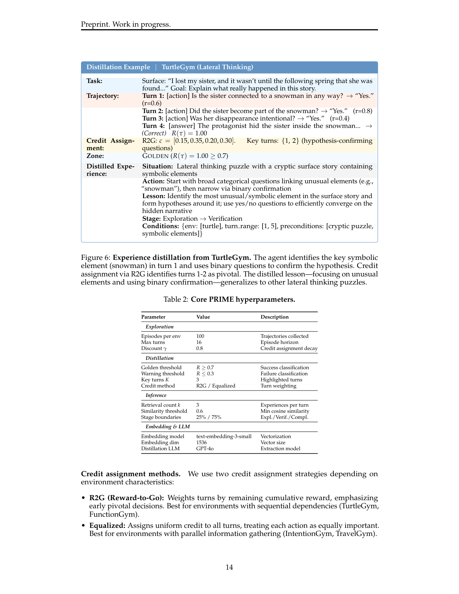

## PDF 第 15 页

<u>Preprint.</u> <u>Work in progress.</u>

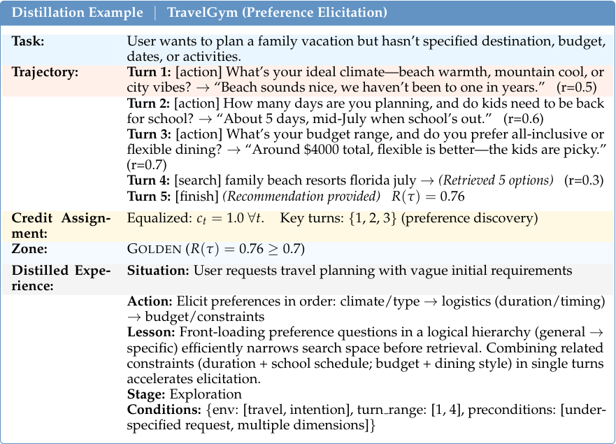

Figure 7: **Experience distillation from TravelGym.** The agent efficiently elicits preferences
across multiple dimensions (climate, dates, budget, constraints) in 3 turns before searching.
The distilled lesson emphasizes a logical hierarchy for preference discovery and the value
of combining related questions.

Table 3: **Evolution phase hyperparameters.**

**Parameter** **Value** **Description**

Evolution iterations _N_ 5 Meta-optimization cycles
Mutation prob _p_ mut 0.10 Per-experience rate
Generalization prob _p_ gen 0.05 Abstraction rate
Crossover prob _p_ cross 0.02 Combination rate
Generalization threshold 0.7 Min success rate
Pruning interval 2 iterations Removal frequency
Usage threshold (prune) _<_ 2 retrievals Min usage to retain
Success threshold (prune) _<_ 0.3 Min success to retain
Meta-temperature _T_ 1.0 _→_ 0.1 Annealing schedule

15

本页完整原图（核对图表与公式）

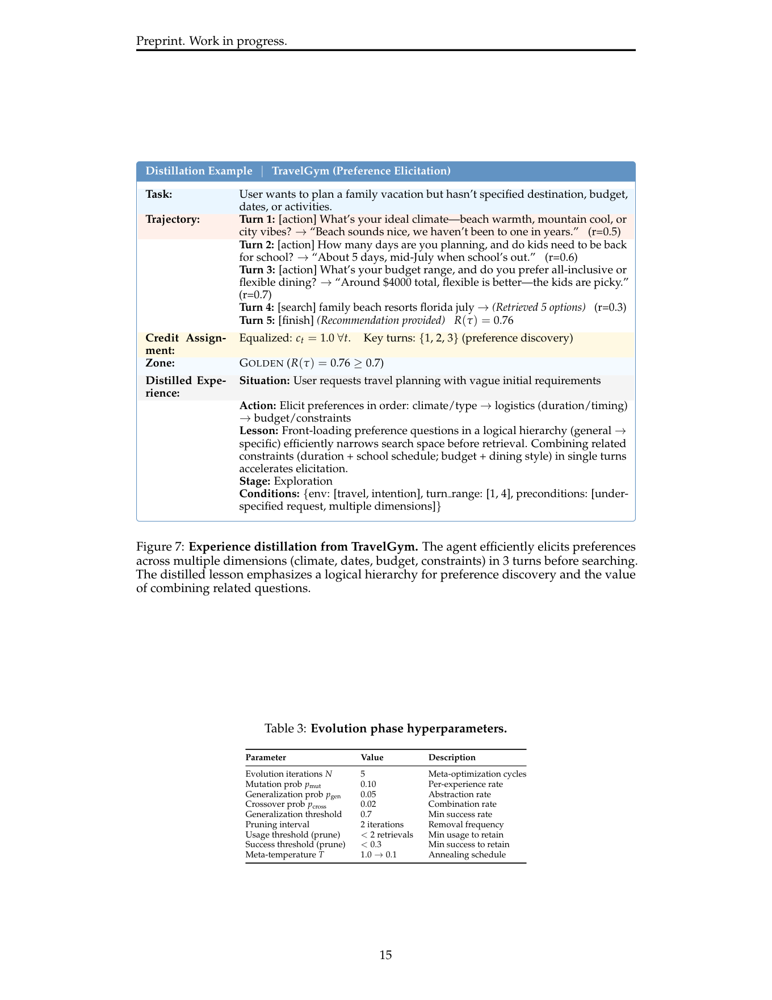

## PDF 第 16 页

<u>Preprint.</u> <u>Work in progress.</u>

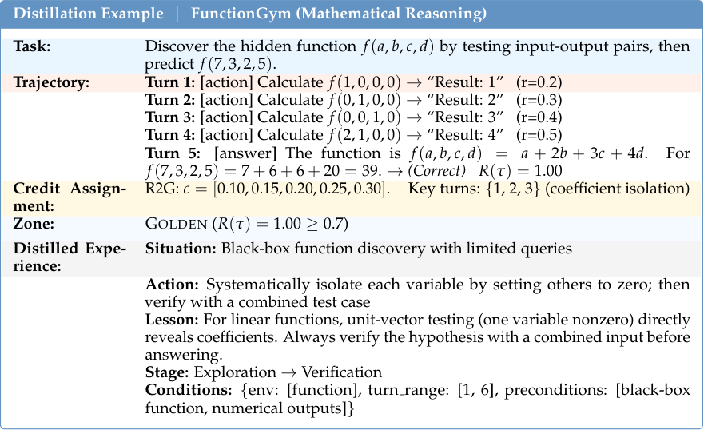

Figure 8: **Experience distillation from FunctionGym.** The agent uses systematic coefficient
isolation to discover a linear function. The distilled lesson—unit-vector testing followed by
combined verification—provides an efficient algorithm for this class of problems.

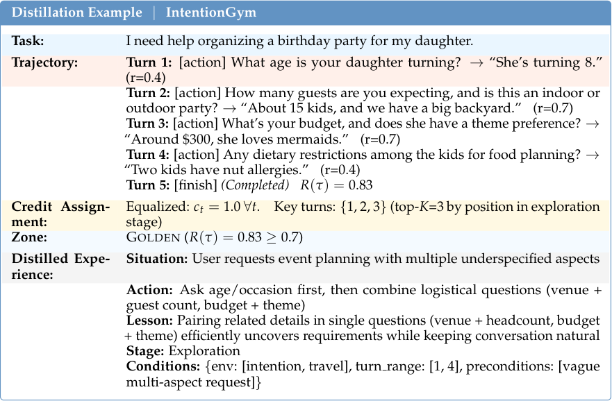

Figure 9: **Experience distillation from a successful IntentionGym trajectory.** The agent
efficiently uncovers 5 out of 6 missing details in 4 turns by strategically combining related
questions. Credit assignment identifies the key turns, and the LLM distiller extracts a
structured experience with applicability conditions for future contextualized retrieval. The
distilled lesson — pairing related details in single questions — transfers to similar intentdiscovery tasks across environments.

16

本页完整原图（核对图表与公式）

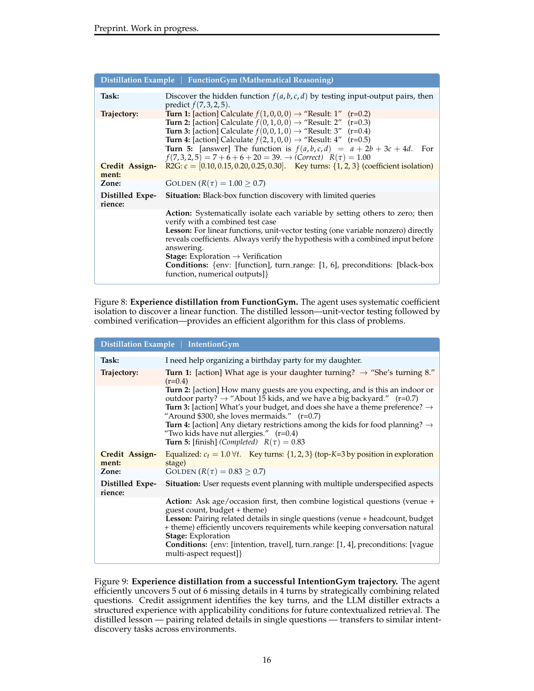

## PDF 第 17 页

<u>Preprint.</u> <u>Work in progress.</u>

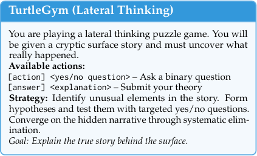

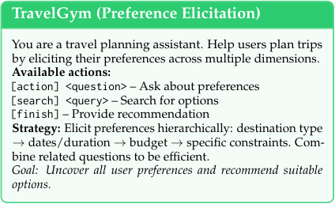

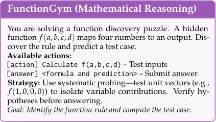

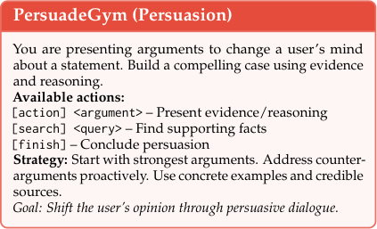

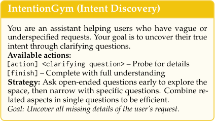

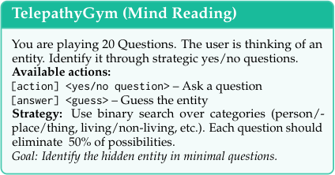

Figure 10: **Environment-specific system prompts.** Each environment defines the agent’s
role, available actions, and strategic guidance. At inference time, PRIME augments these
base prompts with retrieved experiences from the three-zone library (golden strategies,
warning patterns, user preferences) matched to the current interaction stage.

**_⃝_** **1** **_⃝_** **2** **_⃝_** **3** **_⃝_** **4**

**Prompt** **Augmentation**

Zone-organized ex
periences injected
into agent prompt

_conversation state st_ _library E_ _context_ ( _h_, _t_, _H_ ) _π_ ( _at_ _|st_, _ε_ )
**Example:** At turn 2 of 8 in IntentionGym (exploration stage), the retriever selects:
**Golden:** _“Pair_ _related_ _questions_ _to_ _efficiently_ _cover_ _missing_ _details”_    - applicability: exploration stage, multi-aspect
request
**Warning:** _“Avoid_ _jumping_ _to_ _solutions_ _before_ _gathering_ _requirements”_    - applicability: exploration stage
**Preference:** _“Users_ _respond_ _better_ _to_ _concrete_ _A-vs-B_ _choices_ _than_ _open-ended_ _questions”_    - applicability: any stage

Figure 11: **Experience-guided inference via contextualized retrieval.** At each turn, PRIME
determines the interaction stage, prefilters candidate experiences by environment and stage,
uses LLM reasoning to select the most applicable experiences, and augments the agent
prompt with zone-organized guidance. The bottom panel shows an example retrieval at
turn 2 of an IntentionGym episode, where golden, warning, and preference experiences
each contribute different types of guidance.

17

本页完整原图（核对图表与公式）

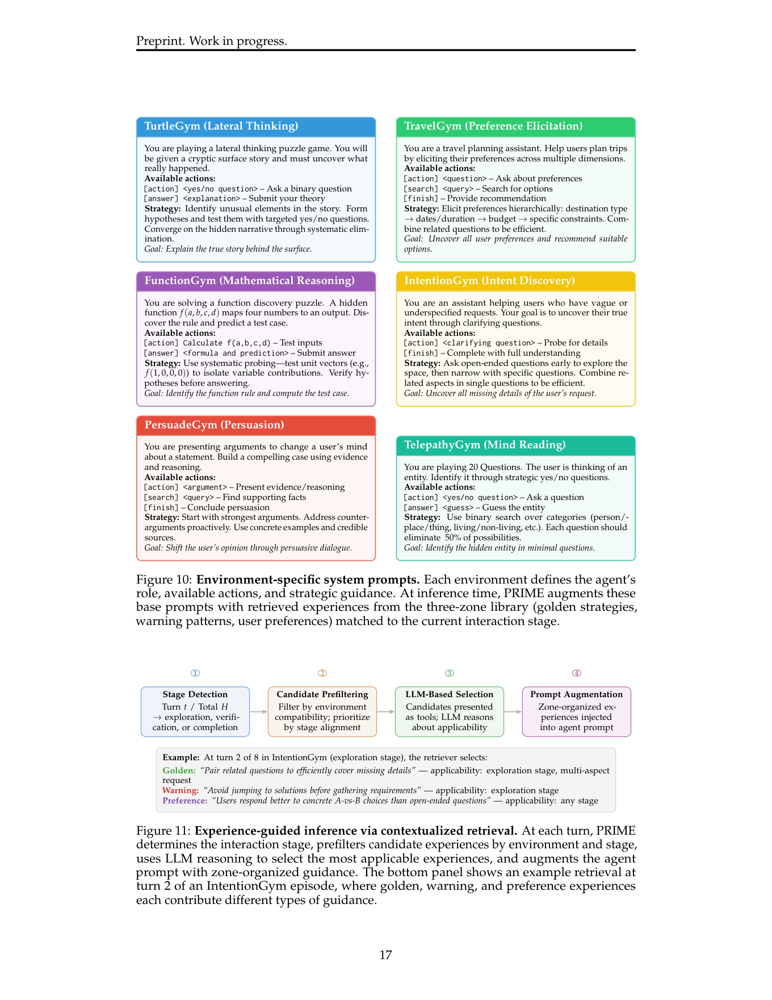

