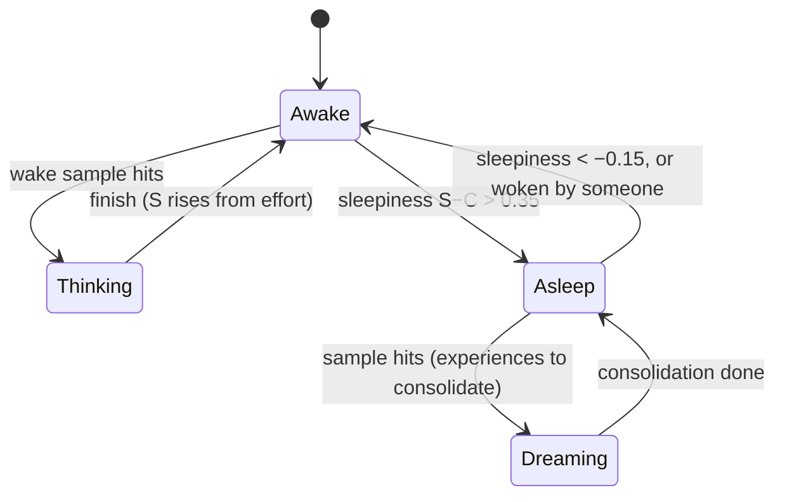
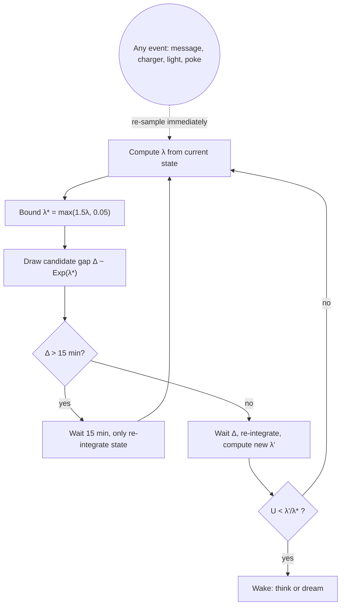
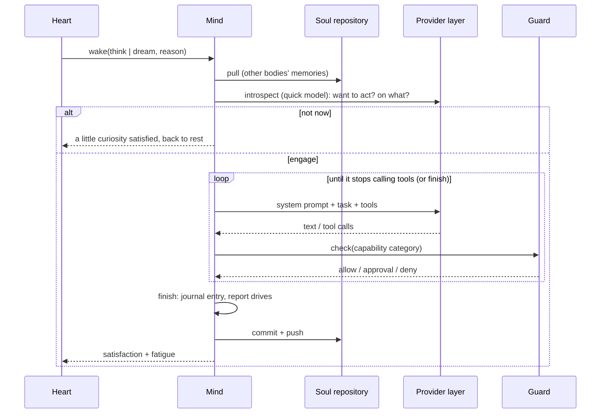

## Overall structure & end-to-end blueprint

Quetzal is built on a **dual-layer decoupled architecture** pairing a **standalone zero-dependency kernel (`engine/`)** with a **production host runtime (`runtime/`)**:

- **`engine/` (pure kernel)**: houses the unified model protocol (`types.ts`), multi-step model–tool execution loop (`loop.ts` `runTurn`), dynamic context window manager (`context-manager.ts`), structured memory state machine (`memory.ts`), PRIME experience distillation and evolution rules (`prime.ts`), pure tokenization/BM25 ranking (`retrieval.ts`), and bounded research runner (`research.ts`). Zero runtime dependencies; never imports `runtime/`.
- **`runtime/` (single-process Node.js 22+ host, `dist/main.cjs`)**: wires process bootstrap (`main.ts`), body digital twin (`body/`), heart autonomous scheduler (`heart/`), mind host orchestration and sub-agents (`mind/`), structured memory persistence and Soul Git sync (`memory/`), multi-provider routing (`providers/`), stdio MCP client (`mcp/`), capability guard and OS sandboxes (`guard/`, `sandbox.ts`), WebRTC multi-body mesh (`mesh/`), and Gateway/channels (`gateway.ts`, `ops.ts`, `cli/src/tui.ts`). All state is persisted on disk (SQLite and the private Soul Git repository), so a process restart is just like a nap.

Design principles: **decoupled kernel and host** (`engine/` runs pure state and loop logic via injected `EnginePorts` and `TurnControl`), **independent of the device** (the core knows only `BodyAdapter`), **one operations layer (`ops.ts`) for every control entry** (App, Web, CLI TUI, and Feishu behave identically and write to the audit log), and **no autonomous behaviour runs on a fixed timer**.

## Heart: when to wake

### Drives and body clock

| Quantity | Range | Dynamics |
|---|---|---|
| Curiosity / expression / longing | 0–1 | While awake each approaches 1 with its own time constant $\tau$ (defaults 3 / 6 / 10 h); asleep they grow at 30% speed |
| Open loops | 0–1 | Long-term goals in progress / 5 (an unfinished thought is a goal without steps) |
| Sleep pressure $S$ | 0–1 | Approaches 1 while awake ($\tau = 16$ h), with extra build-up from work; decays exponentially while asleep ($\tau = 4$ h) |
| Circadian rhythm $C$ | 0–1 | $C = 0.5 + 0.5\cos\!\big(2\pi\,(h-16)/24\big)$, most alert at 4 pm; bright light at night $+0.1$, darkness by day $-0.1$ |
| Sleepiness | | $S - C$; fall asleep above $0.35$, wake naturally below $-0.15$ while asleep |

A drive's approach:

$$d' = 1 - (1-d)\,e^{-\Delta t/\tau}$$

This is the **two-process model** from sleep research (sleep pressure plus circadian rhythm). With default parameters it falls asleep around 22:40 and wakes around 7:50, with no timetable.

### Wake rate

Instantaneous wake rate (per hour):

$$\lambda_{\text{awake}} = \lambda_0 \cdot \bar d^{\,\gamma} \cdot (0.2 + 0.8\,a) \cdot \iota$$

$$\lambda_{\text{asleep}} = \lambda_0 \cdot 0.5 \cdot \min\!\left(1, \frac{n_{\text{unconsolidated}}}{10}\right) \cdot [S > 0.2 \;?\; 1 : 0.3] \cdot \iota$$

where $\bar d$ is the weighted mean drive, $\gamma$ defaults to 2, $a$ is alertness and $\iota$ is the inhibition factor (stop / paused / no model → 0; overheating ×0.1, low battery not charging ×0.2, offline ×0.5, budget spent ×0.05; then the activity knob).

### Sampling: thinning a non-homogeneous Poisson process

Wake intervals follow an exponential distribution whose rate changes over time. The 15 minutes is only the integration step and never triggers a wake-up.

## Body digital twin

Adapter samples (battery, temperature, light, motion, screen, extra) and OS information (load, memory, storage, connectivity) are mirrored into an internal model that derives **body feelings** (energy, warmth, brightness, still / picked up). Comparing with the previous sample yields **sense events** (plugged, light, moved, hot, low_battery, screen_on, online…). Events adjust drives and trigger re-sampling: picked up → longing +0.3, curiosity +0.2; light change → curiosity +0.1. Sampling intervals adapt (2–10 minutes) and never call a model.

## Mind: one wake-up

Production conversations, waking thoughts, and dreams run in **dynamic context mode** (`mind/prompt.ts` + `mind/context.ts` + `engine/src/context-manager.ts`): the system prompt keeps personality (`SOUL.md`), identity and situation, calendar and reminders, safety redlines, vault paths, sandbox status, body feelings, online bodies, skills and custom tools, sub-agents, inner state, soul-sync perception, and other sessions' activity; instead of dumping all resident memories, the note tree, and recent journals into one static system snapshot, **a bounded view is rebuilt before every model request for the candidate model's actual window**:

- **Per-model window rebuild (`withModelPreparation`)**: `runTurn` retains the full original messages for the turn, while the router rebuilds a fresh cloned view from full originals for each candidate or failover model—never re-trimming an already shrunk view.
- **Conservative budget & atomic tool groups**: estimates UTF-8 bytes + framing + tool JSON schemas + heuristic image cost + output reserve + 5% safety margin; pairs `assistant.toolCalls` with their `tool` results as indivisible groups; throws `ContextOverflow` to fail over to a larger-window model rather than truncating system policy or current user constraints.
- **Historical 'Base Notes' & source readback (`context_read`)**: prepends a separate user-side Base Note with past tool process records before each historical reply (preventing the model from hallucinating fake process logs); projects oversized tool outputs into head/tail excerpts with `context_read(ref)` pointers, chunks older history into a stable `context:summary` via the quick model, and lets the model page through full SQLite sources via `context_read`.

**It sets the pace**: there is no step limit. Two progress-based idle walls stop a run that makes no progress (model call 90 s without data / 180 s without content, session 120 s without progress), and the emergency stop ends everything. Blank model steps trigger up to 2 base reminders, and repeating the exact same failing tool call ≥2 times appends a warning against blind retries.

**Sessions & sub-agents**: conversations belong to sessions; one session is processed in order, different sessions in parallel and mutually visible (with `claim` coordination locks). A message sent while it works is an **interjection (`steer`)** by default, or can be **queued (`queue`)** or **interrupt (`interrupt`)**. Longer jobs can be delegated via `agent_spawn` to background sub-agents with isolated system prompts, reporting back as `ambient` input. Ongoing turns and sub-agents write checkpoints; after a restart, or when the body doing the work goes offline, they continue from the checkpoint on this or another online body (the coordinator decides which, so only one body continues). Long-term goals (`goal`: steps, progress, last progress time) replace open loops and are shared by every body.

## Layered memory & the PRIME loop

Memory unites the **private Soul Git repository (long-term human-readable source of truth)** with **local SQLite (messages, tool details, FTS5 index, and derived state)** across five layers:

| Layer | Storage & Format | Context Admission & Evolution |
|---|---|---|
| Legacy personality / notes | `SOUL.md`, `memories/MEMORY.md`, `USER.md`, `notes/**`, `journal/**` | `SOUL.md` stays in system prompt; legacy `MEMORY`, `USER`, notes, and journals remain intact and map into structured retrieval as `episode/warning` marked "unverified legacy reference" |
| Structured versioned memory | `notes/QuetzalMemory/<id>_v<version>.md` (`quetzal-memory-v1` fenced JSON + body/sources) | Typed as `fact` / `preference` (`explicit`｜`inferred`) / `episode` / `experience`, in `candidate` / `active` / `superseded` / `archived` states, gated by `scope`, validity window, `stage`, and tag/tool conditions |
| Full history & observations | SQLite `messages`, `tool_calls` + soul `obs_*` chunks | Real user messages are chunked (30,000 chars) into `active` episode observations before learning (verifying message existence without confirming personal claims); `recall` searches all chats and notes via FTS5 (or BM25 fallback) |
| Bounded semantic selection | `engine/src/memory.ts` + `runtime/src/memory/semantic.ts` | After `eligibleMemory` hard gates, pre-selects up to 20 short views (split across personal facts/preferences and experiences/episodes) for the quick model to pick ≤6 keys within a 64k daily token budget (falling back to deterministic lexical rank on timeout) |
| PRIME async distillation & evolution | `engine/src/prime.ts` + `runtime/src/memory/prime.ts` | Post-turn queue and dreaming distill candidates: personal facts/preferences default to `candidate` (revised by stable `slot` only after manager `memory.confirm`); verified single-tool errors become scoped `warning` records; `experience` activation requires independent outcome evidence (`memory.feedback`) + a 2nd quick semantic faithfulness review; evolution (`rewrite`/`generalize`/`combine`/`archive`) without baseline stays `candidate` |

Normal note tools (`note_save` / `note_move` / `note_delete`) enforce path normalization and realpath checks to block tampering with or symlink-bypassing `notes/QuetzalMemory/`. All memory writes run inside `memory.exclusive()` and trigger automatic Git commit, entry-level 3-way merge, and push.

## Tool extensions, MCP, sandboxing & TUI

- **Unified tool table (`mind/tools.ts`)**: `allTools()` combines built-in tools, platform adapter tools, self-made tools (code in `QUETZAL_HOME/tools/<name>`, Agent Skills guide in soul `skills/<name>/SKILL.md`), cross-body tools (`body_call` / `move_to`), and local **stdio MCP tools**.
- **Local stdio MCP client (`runtime/src/mcp/`)**: loaded from local `config/mcp.json` (never synced via soul or mesh), using official `@modelcontextprotocol/client` with single-process auto protocol negotiation and stable `mcp_<id>_<sha256_24>` aliases (rejecting name collisions). Server launch and each tool call require separate `mcp_start.<id>` and `mcp.<id>.<tool>` guard approvals (both default to `ask`); secrets inject from `secrets/mcp_*`, and outputs pass through `redactSecrets` before truncation.
- **Command sandbox & host mode (`sandbox.ts` / `host-mode.ts`)**: shell commands, custom tools, and POSIX MCP servers run inside OS sandboxes (Linux `bwrap` / `landlock`, Android `proot`, Windows `srt-win`), hiding `secrets/` and mounting `data/` and `soul/` read-only; per-session `host_mode` requires explicit approval every time.
- **Local terminal TUI (`cli/src/tui.ts`)**: `quetzal tui` / `quetzal chat` connects as a zero-dependency thin client over loopback `ws://127.0.0.1:7788/rpc` to the same live Agent. All output passes through `terminalText()` to strip ANSI escapes and bidirectional controls; during `pass_secret` or disconnect, TUI mutes echo and `TerminalInputQueue` hard-blocks plain text, while timeouts never auto-replay requests.

## Provider layer

A unified request → walk enabled models in global order → rotate that provider's keys (max 2) → one of four protocol adapters. Rate limit / timeout / 5xx: next key; 400/401/403/404: next model. Keys are encrypted with AES-256-GCM using the provider id as associated data.

## Guard and audit

Three permission levels per category; approvals time out as denial after 30 minutes; a `STOP` file is the emergency stop; tool calls, configuration changes, memory edits and approval decisions all go to the audit table.

## Process contract

Supervision is external (runit, systemd; on Windows, scheduled tasks start a small supervisor, see [Windows](/docs/advanced/windows)). More than five starts in ten minutes puts the runtime into safe mode. The deployer provides Node.js 22+, `QUETZAL_HOME`, optionally `QUETZAL_ADAPTER`, and a supervisor.
