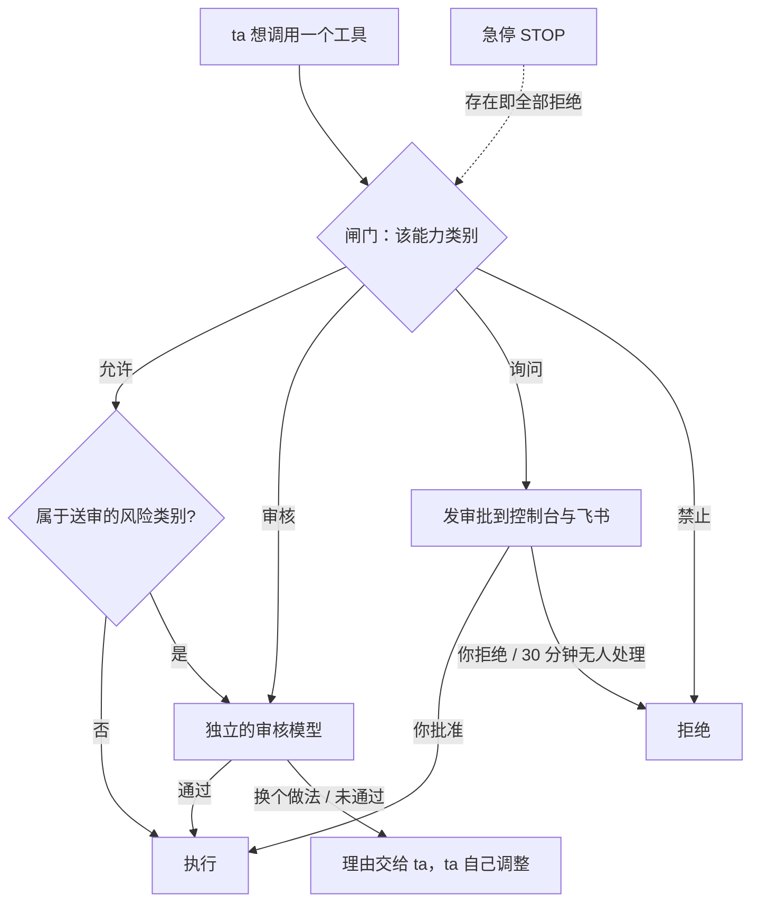

## 闸门在哪里

ta 每次调用一项能力前，都要先经过**闸门**的检查。你在 **控制** 页里管理闸门；飞书卡片上也能做同样的操作，效果一样，都会记进操作记录。

## 能力类别

| 类别 | 默认 | 例子 |
|---|---|---|
| 联网 | 允许 | 搜索、抓取网页 |
| 执行命令 | 允许 | shell、后台任务 |
| 设备功能 | 允许 | 震动、手电、剪贴板、读传感器 |
| 相机 | **审核** | 拍照 |
| 麦克风 | **审核** | 录音 |
| 定位 | **审核** | 获取位置 |
| 主动发消息 | 允许 | ta 醒来时主动给你发消息 |
| 修改自身参数 | 允许 | 在限定范围内调自己的性格参数、声音与听觉设置 |
| 改写记忆 | 允许 | 改人格、常驻记忆 |
| 操作屏幕与应用 | **审核** | 预留（hands） |
| 索取保密信息 | 允许 | `pass_secret`，见 [保密传递](/docs/guide/secrets) |
| 会话与子 agent | 允许 | 开新会话、派子 agent 去做事 |
| 跨身体操作 | 允许 | 用另一台设备的相机或命令行（`body_call`）、换到另一台设备继续（`move_to`）、带上另一台设备的 uuid 看那边的图片、读那边的文档、取那边的文件来跑命令（`view_image` / `read_document` / `shell` 带 `body`；把文件交出去的那台设备另按它的「执行命令」判断） |
| 造工具 | **审核** | 把做熟了的事写成自己的工具（`tool_write`） |

每类有四档，在 **控制 → 权限** 里逐项设置：

- **审核**：交给独立的审核模型判断，不打扰你（见下面「安全审核」）。
- **允许**：直接做；属于送审风险类别的操作仍先由审核模型过一遍。
- **询问**：每次等你批准（人工审批）。想亲自把关的类别可以选它，它不是默认。
- **禁止**：不做。

一个工具同时属于几类时，按最严的那一类检查（禁止 > 询问 > 审核 > 允许）。

> [!WARNING]
> 「执行命令」设为允许时，ta 用命令就能做到设备工具、联网、改文件能做的一切，其他类别的设置拦不住。边界是下面的隔离环境；想更紧，把「执行命令」改成审核或询问。

## 安全审核

我们不想给 ta 太多限制，也不想让你一条条点批准：那样太慢。所以有风险的操作，在执行前交给一个**独立的审核模型**判断。

- **它只看这一次操作**：工具、参数（密码等保密值已遮住）、ta 这一步说了要做什么、你在这个对话里最近说的一两句话、是哪台设备、是不是真实环境。它看不到 ta 的提示词和整段对话，所以网页或别人的话里藏着的指令，带偏了 ta 也带不偏它。
- **结论**：通过就照常执行；「建议换个做法」或「未通过」时不执行，理由会交给 ta，ta 自己换个做法，或者先跟你说清楚。
- **送审的操作**：设为「审核」的类别每次都送审；设为「允许」的类别里，这几类操作也先审核：真实环境里的命令、到别的设备上执行命令、ta 醒来时主动发消息、MCP 工具里没声明只读的、删除找不回的数据（比如删掉自造工具）、账号与凭据、造工具、操作屏幕。隔离环境里的普通命令默认不审。按工具的作用分类，不按命令文字猜。
- **审核没有结论时**（超时、模型出错）：默认按风险处理，低风险的放行，高风险的拦下并说明原因；也可以改成一律放行、一律拦下或转给你审批。
- **在哪里改**：**控制 → 权限** 的「安全审核」一节：开关、用哪个模型（默认用快速模型）、哪些操作要审核、没有结论时怎么办、真实环境的请求交给谁。几台设备共用同一份设置。
- **在哪里看**：每次审核的结论、理由、用的模型和耗时都记在操作记录里，可以只看审核结论；对话里点开工具卡片也能看到。

> [!NOTE]
> 审核模型也会看错，它挡得住明显的失误和被诱导，挡不住所有事。真正的边界仍是下面的隔离环境。

从旧版本升级时，原来默认「每次询问」的相机、麦克风、定位、操作屏幕、造工具会改为「审核」；你自己明确选过「询问」的保持不变。

## 命令的隔离环境

ta 的命令、后台任务和自造工具都在隔离环境里运行：电脑上依次尝试 bubblewrap、Landlock、proot，安卓上用 proot。隔离环境里看不到密钥目录和控制台的登录信息；第一次使用前会实测一次，确认密钥确实看不见。哪种隔离都用不了时，ta 的命令一律不执行；你可以在 **控制 → 高级 → 运行** 里明确允许不隔离运行。

ta 和运行基座是同一个系统用户，这层隔离挡不住所有情况。剩下的风险和我们的建议见 [信任与边界](/docs/guide/trust#ta-能碰到什么)。在 Windows 上，ta 的命令以安装时建的低权限用户运行，见 [Windows](/docs/advanced/windows) 第 3 节。

## 真实环境

隔离环境里用不了你在电脑上登录过的东西。比如你在终端里登录了 `gh`，ta 在隔离环境里运行 `gh` 仍然会说令牌无效：令牌在系统钥匙串里，隔离环境刻意碰不到它。

确实需要时，ta 可以请求进入**真实环境**，并写明理由。默认由审核模型判断：理由充分、和你的要求对得上就放行，否则 ta 会收到理由，仍在隔离环境里；手机上会有一条通知。放行后，这个对话里 ta 的命令不再经过隔离环境，直接在这台设备上运行，每条命令仍先经审核模型过一遍。想每次自己决定，在「安全审核」里把真实环境的请求改为「每次问我」：请求就出现在对话顶部和 **控制 → 权限**，飞书里是一张审批卡片。你也可以点对话右上角的盾牌图标自己打开。

- **能做什么**：你能读写的一切，ta 都能读写，包括密钥目录、保密库和基座的配置。
- **范围**：只在这一个对话、这一台设备上。ta 自己醒来时、子 agent、从别的设备调来的命令，仍在隔离环境里。
- **看得见**：开着的时候，这个对话的标题下面有一条浅红色的提示；别的对话开着真实环境时，界面最上方也有一条。每条命令都记在操作记录里，并标出是在真实环境里运行的。
- **退出**：点提示上的「退出」，或在飞书发 `/sandbox`；ta 做完也会自己退出。30 分钟没有命令、按急停、运行基座重启，都会回到隔离环境。

只需要一个令牌时，更稳妥的做法是让 ta 用 [保密传递](/docs/guide/secrets) 向你要一个权限尽量小的令牌，命令仍在隔离环境里运行。

## 审批

设为「询问」的能力（以及你选了「每次问我」的真实环境请求），ta 想用时会生成一条审批，推送到控制台（**控制 → 权限** 最上面，带角标）与飞书（带按钮的卡片）。你可以批准或拒绝，并附一句话；**30 分钟没人处理就算拒绝**。

## 节律

**控制 → 节律**：

- **ta 来找你**（少找我 ↔ 多找我）：ta 醒来的频率整体乘上这个倍率。往「多找我」调，ta 醒得更勤，想到什么来找你的机会也更多；往「少找我」调，ta 更安静。ta 只在醒着时主动发消息，夜里睡着时不发。
- **暂停**：ta 保持在线、会回应你，但不会自己醒来，只在你找 ta 时醒来。

好奇心、表达欲、想念的时间常数，以及困意、睡眠恢复、最清醒的时刻，这些性格参数由 ta 自己在限定范围内调整（`adjust_self`，属于「修改自身参数」），界面上没有。想让 ta 变一变，直接跟 ta 说，比如「你最近太吵了」。

## 预算与身体限制

**控制 → 高级 → 预算**：每日 token 上限、每日费用上限、最低电量、最高温度。默认 2,000,000 tokens / 5 美元 / 15% / 45°C。

超出限制后，ta 自己醒来的频率会被**压低**：预算用尽 ×0.05、过热 ×0.1、电量低且未充电 ×0.2、离线 ×0.5。ta 会变得非常安静；你叫 ta，ta 照样会应，对话不受预算限制。

## 停止这一轮

ta 正在对话里做事、输入框是空的时，发送键会变成停止键：按下就停止这一轮，正在跑的命令随之结束。电脑上也可以连按两次 Esc（第一次按下时会提示）。只停这个对话里的这一轮，不影响别的对话。

## 急停

顶栏的急停**一直显示**。按下后，所有工具调用立即被拒绝（不再送审），醒来率归零；解除时要再确认一次。急停在家目录下放一个 `STOP` 文件，这个文件在，ta 就停着。

## 操作记录

**控制 → 高级 → 操作记录**：所有工具调用（参数摘要与结果开头）、配置修改、记忆修改、审批决定、安全审核的结论都记在这里；上方的「只看安全审核」只列审核结论。ta 自己也能查（`recent_actions`），用来核实自己做没做过某件事。

## 时间墙

Quetzal 用**无进展计时**防止失控：模型调用 90 秒没有收到数据块，就算失败并换模型；一轮会话 120 秒没有任何进展，就中止。只要一直在推进，ta 可以做很长的事。
