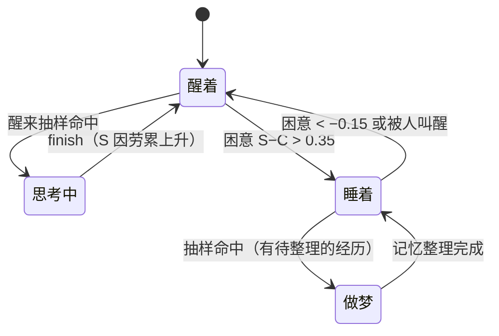
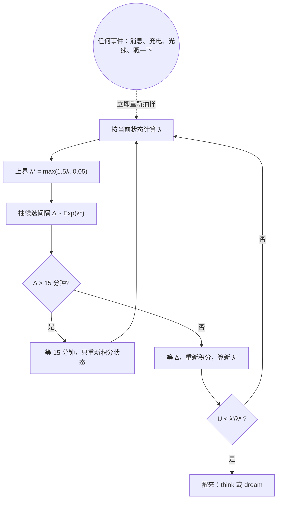
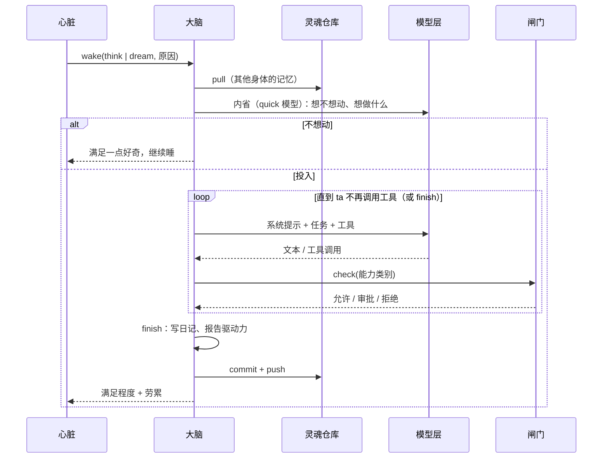

## 总体结构与全链路业务蓝图

Quetzal 采用**「独立零依赖内核（`engine/`）+ 生产运行时宿主（`runtime/`）」**的双层解耦设计：

- **`engine/`（纯内核）**：包含通用模型协议（`types.ts`）、多步模型—工具执行循环（`loop.ts` 的 `runTurn`）、动态上下文窗口管理器（`context-manager.ts`）、结构化记忆状态机（`memory.ts`）、PRIME 经验蒸馏与演化规则（`prime.ts`）、纯分词与 BM25 评分策略（`retrieval.ts`）以及受限研究运行器（`research.ts`）。零第三方运行时依赖，不导入 `runtime/`。
- **`runtime/`（单进程 Node.js 22+ 宿主，`dist/main.cjs`）**：负责进程装配（`main.ts`）、身体数字孪生（`body/`）、心脏自主调度（`heart/`）、心智宿主与子 Agent（`mind/`）、结构化记忆持久化与灵魂 Git 同步（`memory/`）、多模型路由（`providers/`）、stdio MCP 客户端（`mcp/`）、权限闸门与平台沙箱（`guard/`、`sandbox.ts`）、WebRTC 多身体网状层（`mesh/`）以及网关与通道（`gateway.ts`、`ops.ts`、`cli/src/tui.ts`）。状态全部写在磁盘上（SQLite 与私有灵魂 Git 仓库），进程重启对 ta 来说只是"睡了一觉"。

设计原则有四条：

- **内核与宿主解耦**：核心循环、窗口预算和记忆验证规则在 `engine/` 独立测试与演进，宿主能力经 `EnginePorts` 与 `TurnControl` 注入。
- **设备无关**：核心只认识 `BodyAdapter` 接口。仓库自带安卓、Termux、Linux、[Windows](/docs/advanced/windows) 四个平台级适配器，见 [适配器接口](/docs/reference/adapter-interface)。
- **所有控制入口共用一个操作层（`ops.ts`）**：App、网页版、CLI TUI 与飞书的行为一致，都经过审计。
- **没有定时器驱动的自主行为**：提醒按承诺准点触发，而 ta 自己的醒来与做梦完全由内驱力与生物钟按概率抽样决定。

## 心脏：什么时候醒来

### 内驱力与生物钟

| 量 | 范围 | 动力学 |
|---|---|---|
| 好奇心 / 表达欲 / 想念 | 0–1 | 醒着时按各自的时间常数 $\tau$ 趋向 1（默认 3 / 6 / 10 小时）；睡着时只以 30% 的速度增长 |
| 牵挂 | 0–1 | 未完成念头数 / 5 |
| 睡眠压力 $S$ | 0–1 | 醒着时趋向 1（$\tau = 16$ h），做事额外累积；睡着时指数回落（$\tau = 4$ h） |
| 昼夜节律 $C$ | 0–1 | $C = 0.5 + 0.5\cos\!\big(2\pi\,(h-16)/24\big)$，下午 4 点最清醒；夜里强光 $+0.1$，白天黑暗 $-0.1$ |
| 困意 | | $S - C$；超过 $0.35$ 入睡，睡眠中低于 $-0.15$ 自然醒 |

驱动力的趋近：

$$d' = 1 - (1-d)\,e^{-\Delta t/\tau}$$

这是睡眠研究里的**双过程模型**（睡眠压力 + 昼夜节律）。默认参数下，ta 在 22:40 左右入睡、7:50 左右自然醒，作息由这两个量算出，没有预设的时刻表。

### 醒来率

瞬时醒来率（次 / 小时）：

$$\lambda_{\text{awake}} = \lambda_0 \cdot \bar d^{\,\gamma} \cdot (0.2 + 0.8\,a) \cdot \iota$$

$$\lambda_{\text{asleep}} = \lambda_0 \cdot 0.5 \cdot \min\!\left(1, \frac{n_{\text{unconsolidated}}}{10}\right) \cdot [S > 0.2 \;?\; 1 : 0.3] \cdot \iota$$

其中 $\bar d$ 是加权平均驱动力，$\gamma$ 默认 2，$a$ 是清醒度，$\iota$ 是抑制系数（急停 / 暂停 / 无模型 → 0；过热 ×0.1、低电未充 ×0.2、离线 ×0.5、预算用尽 ×0.05；再乘活跃度旋钮）。

### 抽样：非齐次泊松过程的稀疏化

醒来间隔服从随时间变化的指数分布。15 分钟只是数值积分的步长，不会触发醒来。

## 身体数字孪生

适配器的采样（电量、体温、光照、运动、屏幕、extra）与操作系统信息（负载、内存、存储、联网）一起镜像为内部模型。模型从中派生出**身体感受**（精力、冷热、明暗、安静 / 被拿起），再与上次比较得到 **sense 事件**（plugged、light、moved、hot、low_battery、screen_on、online…）。事件调整驱动力并触发重新抽样：被拿起 → 想念 +0.3、好奇 +0.2；光线变化 → 好奇 +0.1。采样间隔随变化在 2–10 分钟之间调整，不调用模型。

## 大脑：一次醒来

生产对话、思考和做梦默认启用 **dynamic 动态上下文模式**（`mind/prompt.ts` + `mind/context.ts` + `engine/src/context-manager.ts`）：系统提示保留人格（`SOUL.md`）、身份与处境、日历与提醒、安全红线、保密库路径、沙箱状态、身体感受、其他在线身体、技能与自造工具、子 Agent、内在状态、灵魂同步知觉与其他会话近况；不再把常驻记忆全文、笔记目录树和最近日记固定塞进一轮的 system 快照，而是**在每次模型请求前按实际候选模型窗口动态重建视图**：

- **按候选模型窗口重算（`withModelPreparation`）**：`runTurn` 保留本轮完整原消息，路由层对每个候选模型（含故障转移切换的模型）从完整原消息重新生成克隆视图，绝不在已缩小的视图上二次裁剪。
- **保守预算与原子工具组**：采用 UTF-8 字节数 + 消息/工具 Schema 开销 + 图片启发式成本 + 输出预留 + 5% 安全余量；同一次响应的 `assistant.toolCalls` 与紧随的 `tool` 结果组成不可拆分的原子组；固定内容放不下时明确抛出 `ContextOverflow` 换更大窗口模型，不截断系统政策或本轮用户输入。
- **历史「基座附注」与原文回查（`context_read`）**：历史里 ta 自己的每条回复前插入一条单独的 `user` 侧「基座附注」记录过往工具过程（防模型模仿格式编造假记录）；超长工具结果自动投影为头尾节选并附 `context_read(ref)` 引用，较早历史按完整组分块由 quick 模型生成稳定摘要（`context:summary`），模型随时可用 `context_read` 分页回查 SQLite 原文与完整工具记录。

**节奏由 ta 决定**：步数不设上限。防止失控靠两道按「无进展」计时的时间墙（模型调用 90 秒无数据 / 180 秒无内容、会话 120 秒无进展）和急停。模型某一步空输出（如推理思考用尽长度）不会直接结束，基座会自动提醒重试最多 2 次；同一工具相同参数连续失败 2 次起自动追加警告阻止原样盲试。

**多会话与子 Agent**：对话分属不同会话，同一会话内顺序处理，不同会话并行且彼此可见（系统提示里有其他会话近况与 `claim` 认领锁）。ta 工作时你发来的消息默认**插话（steer）**，也可以选**排队（queue）**或**打断（interrupt）**。耗时调研或独立任务可由 `agent_spawn` 派出后台子 Agent 独立跑工具循环，完成后以 `ambient` 环境输入送回原会话。

## 记忆分层与 PRIME 经验闭环

记忆系统将**私有 Git 灵魂仓库（长期人类可读真相源）**与**本机 SQLite（对话、工具详情、FTS5 索引与派生状态）**结合，分为五层运作：

| 层 | 存储位置与格式 | 上下文准入与演进机制 |
|---|---|---|
| 原有人格 / 常驻 / 笔记 | `SOUL.md`、`memories/MEMORY.md`、`USER.md`、`notes/**`、`journal/**` | `SOUL.md` 常驻系统提示；原有 `MEMORY`、`USER`、普通笔记与日记保持原样，在结构化检索中兼容映射为标注「旧记忆未核实，仅参考」的 `episode/warning` |
| 结构化版本记忆 | `notes/QuetzalMemory/<id>_v<version>.md`（含 `quetzal-memory-v1` JSON 与正文/来源） | 分 `fact` / `preference`（`explicit`｜`inferred`）/ `episode` / `experience` 四类，状态为 `candidate` / `active` / `superseded` / `archived`，按 `scope`、有效期、阶段 `stage` 与标签/工具条件严格门禁 |
| 完整经历与语境观察 | SQLite `messages`、`tool_calls` + 灵魂 `obs_*` 分片 | 真实用户消息在学习前按 30,000 字符分片保存为 `active` 语境观察（只验证发言存在，不直接确认个人断言）；`recall` 工具通过 FTS5（或 BM25 降级）全文检索全部对话与笔记 |
| 每步有界语义选择 | `engine/src/memory.ts` + `runtime/src/memory/semantic.ts` | 先通过 `eligibleMemory` 硬门禁，再按个人事实/偏好与经验/经历各半配额预筛最多 20 条短视图，由 quick 模型在每日 64k 预算内选出 ≤6 条注入当前步（超时自动退回同门禁词面排序） |
| PRIME 异步蒸馏与演化 | `engine/src/prime.ts` + `runtime/src/memory/prime.ts` | 轮次结束后在后台队列与做梦中提炼候选：个人事实/偏好默认存 `candidate`（需管理者 `memory.confirm` 确认后按稳定 `slot` 升版）；真实单工具报错准入为限定 `warning`；成功 `experience` 须具备独立结果证据（如 `memory.feedback`）并通过第二次 quick 语义忠实性评审才激活；演化（`rewrite`/`generalize`/`combine`/`archive`）缺基线对照时保留候选 |

普通笔记工具（`note_save` / `note_move` / `note_delete`）经路径规范化与真实路径校验，禁止篡改或通过符号链接绕过 `notes/QuetzalMemory/` 受管目录。所有记忆改动在 `memory.exclusive()` 写锁内落盘，并触发基座自动 Git 提交、条目级三方合并与推送。

## 工具扩展、MCP、沙箱与 TUI 交互

- **工具汇聚（`mind/tools.ts`）**：`allTools()` 统一挂载内置工具、平台适配器工具、Agent 自造工具（实现在 `QUETZAL_HOME/tools/<name>`，Agent Skills 说明书在灵魂仓库 `skills/<name>/SKILL.md`）、跨身体工具（`body_call` / `move_to`）以及本机 **stdio MCP 工具**。
- **本机 stdio MCP 客户端（`runtime/src/mcp/`）**：从本机 `config/mcp.json` 加载（不随灵魂或网状层同步），使用官方 `@modelcontextprotocol/client` 在单进程连接上自动协商协议版本，暴露为稳定别名 `mcp_<id>_<sha256前24位>`（名称冲突直接拒绝）。启动与每次工具调用分别经过 `mcp_start.<id>` 与 `mcp.<id>.<tool>` 双重闸门审批（默认均为询问），凭据只从 `secrets/mcp_*` 注入子进程，输出先经 `redactSecrets` 脱敏再截断。
- **命令沙箱与真实环境（`sandbox.ts` / `host-mode.ts`）**：Agent 的命令、自造工具与 POSIX MCP 默认在操作系统沙箱（Linux `bwrap` / `landlock`、Android `proot`、Windows `srt-win`）中运行，遮蔽 `secrets/` 并锁定 `data/` 与 `soul/` 只读；会话级 `host_mode` 每次请求均需用户单独审批。
- **本机终端 TUI（`cli/src/tui.ts`）**：`quetzal tui` / `quetzal chat` 作为零外部依赖的瘦客户端连接本机回环网关 `ws://127.0.0.1:7788/rpc`，与控制台共用同一个 Agent。所有输出经 `terminalText()` 剥离 ANSI 控制序列与双向控制符；会话进入 `pass_secret` 保密输入或断线时，TUI 立即静音回显并由 `TerminalInputQueue` 硬拦截一切普通文本，且断线超时绝不自动重发请求。

## 模型层

一次请求的路径：统一的请求结构 → 按全局顺序遍历已启用模型 → 在该供应商的 Key 之间轮换（最多 2 把）→ 交给四种协议适配器之一。遇到限流、超时或 5xx 换 Key；遇到 400/401/403/404 换模型。Key 用 AES-256-GCM 加密，供应商 id 作为附加认证数据。

## 闸门与审计

每个能力类别有三档授权。审批 30 分钟没处理视为拒绝。`STOP` 文件存在即急停。工具调用、配置修改、记忆修改、审批决定全部写入审计表。

## 进程契约

进程守护由外部负责（runit、systemd、Windows 的计划任务）。10 分钟内启动超过 5 次，运行基座进入安全模式。部署者提供 Node.js 22+、`QUETZAL_HOME`、可选的 `QUETZAL_ADAPTER` 与守护者。
